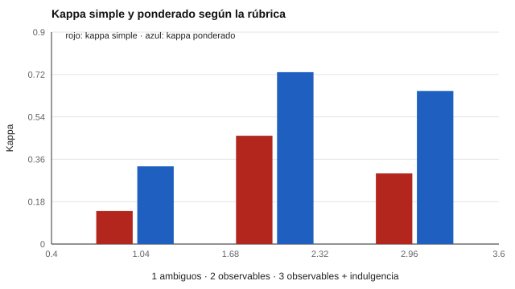

# 138 — Evaluación en educación parvularia


<!-- NAV -->
[← 137 — Atención temprana y apoyos](../137-atencion-temprana-y-apoyos/README.md) · [📚 Parte 13](../README.md) · [🗺️ Índice 001–200](../../../PROGRAMA.md) · [139 — Cribado del neurodesarrollo: alcances y deriv… →](../139-cribado-del-neurodesarrollo-alcances-y-derivacion/README.md)
<!-- /NAV -->

**Parte 13 — Desarrollo infantil y evaluación psicoeducativa** · Nivel avanzado · 4 h · Estado `escrita`
**Pensada para:** educadoras y equipos de nivel inicial, y familias que reciben informes.
**Prerrequisitos:** clases 029 y 134.

> Los niveles describen lo observado en un periodo; no son edades de desarrollo ni diagnósticos. Las bases curriculares vigentes se consultan en la fuente oficial.

## ¿Para qué te sirve esto?

En educación parvularia se evalúa sobre todo **observando** y de manera **formativa**: ¿qué hace el niño hoy y qué apoyo necesita? Una rúbrica de 4 niveles ayuda a describirlo. Pero dos educadoras pueden usar la misma rúbrica y calificar distinto: con descriptores vagos («adecuado», «bueno») el acuerdo es muy bajo. Esta clase te muestra cuánto sube el acuerdo al escribir **descriptores observables**, y por qué la **calibración** entre educadoras es parte del instrumento.

## Al terminar esta clase podrás

- Evaluar con rúbricas de niveles observables.
- Calcular kappa simple y ponderado.
- Entender la calibración entre educadoras como parte del instrumento.

## La idea en palabras simples

La evaluación en parvularia se refiere a los objetivos de las bases curriculares (consultar la versión vigente del Ministerio de Educación). Una rúbrica de 4 niveles es **ordinal**. El acuerdo entre educadoras se mide con **kappa**; el **kappa ponderado** (Cohen, 1968) penaliza más los desacuerdos grandes (1 frente a 3) que los pequeños (1 frente a 2).

## Cómo funciona, paso a paso

**1. Redactar** descriptores observables para cada nivel.

**2. Aplicar** con dos educadoras a 120 niños (en el laboratorio, simulados).

**3. Calcular** kappa simple y ponderado; luego calibrar revisando casos juntas.

**Ejemplo resuelto.** Dos niveles de diferencia (1 frente a 3) pesan (2/3)² = 0,44 y uno de diferencia (1 frente a 2), (1/3)² = 0,11 en el kappa cuadrático de 4 niveles.



*Figura 1.* Los descriptores observables elevan el acuerdo; el sesgo de una educadora lo baja.

## Si construyes el instrumento

- Escribe descriptores con conductas observables, no adjetivos.
- Calibra al equipo: revisen casos juntas y discutan discrepancias.
- Describe lo observado en un periodo, no clasifiques al niño.
- Informa a las familias en lenguaje comprensible.

## Si eres evaluado (o eres la familia)

- Un nivel describe lo que se observó en un periodo, no lo que el niño «es».
- Pide ejemplos de lo que se observó.
- Pregunta qué evidencias (fotos, producciones) se guardan y con qué consentimiento.

## Qué muestra el laboratorio

| Rúbrica / condición | κ simple | κ ponderado |
|---|---:|---:|
| Descriptores ambiguos | 0,14 | 0,33 |
| Descriptores observables | 0,46 | 0,73 |
| Observables + una educadora indulgente (+0,6) | 0,30 | 0,65 |

**Análisis.** (1) Descriptores observables suben el acuerdo. (2) Un sesgo sistemático de una evaluadora lo reduce aunque ambas «coincidan en orden». (3) Con 4 niveles el kappa ponderado es más indulgente con desacuerdos de un nivel. (4) La calibración es parte del instrumento.

## Errores frecuentes

- Clasificar al niño en vez de describir lo observado en un periodo.
- Descriptores ambiguos sin conductas.
- Comparar educadoras sin calibrar.
- Confundir los niveles con edades de desarrollo.

## Lo mínimo que debes llevarte

1. La evaluación en parvularia es formativa y observacional.
2. Descriptores observables mejoran el acuerdo.
3. Kappa ponderado para escalas ordinales.
4. La calibración entre educadoras importa.

## Ejercicios

- **Inicial.** ¿Qué hace observable un descriptor? *Solución: que se refiere a conductas que cualquiera podría ver y registrar.*
- **Intermedio.** Redacta un descriptor observable para «sigue instrucciones de dos pasos».
- **Avanzado.** Simula tres educadoras y calcula el kappa por pares.
- **Aplicación.** Mejora una rúbrica de «participa en el grupo» con cuatro niveles observables.

## Glosario

- **Evaluación formativa:** orientada a apoyar el aprendizaje.
- **Rúbrica:** descripción por niveles de un desempeño.
- **Kappa ponderado:** acuerdo corregido por azar que pesa los desacuerdos.
- **Calibración:** acuerdo previo entre evaluadoras sobre cómo aplicar los criterios.

## Laboratorio

```bash
python classes/part-13-desarrollo-infantil-y-evaluacion-psicoeducativa/138-evaluacion-en-educacion-parvularia/lab.py
python classes/part-13-desarrollo-infantil-y-evaluacion-psicoeducativa/figuras.py
```

## Autoevaluación y criterios

1. ¿Cómo calibrarías al equipo? 2. ¿Qué evidencias (fotos, producciones) recoges y con qué consentimiento? 3. ¿Cómo informas a las familias?
Se logra la clase si mejoras una rúbrica y mides el acuerdo.

## Bibliografía

- Cohen, J. (1968). Weighted kappa: Nominal scale agreement with provision for scaled disagreement or partial credit. *Psychological Bulletin*, 70(4), 213-220. [DOI](https://doi.org/10.1037/h0026256)
- Ministerio de Educación de Chile. *Bases Curriculares de la Educación Parvularia* (versión vigente: verificar en mineduc.cl).

---

<!-- NAV -->
[← 137 — Atención temprana y apoyos](../137-atencion-temprana-y-apoyos/README.md)  
[📚 Parte 13](../README.md) · [🗺️ Índice 001–200](../../../PROGRAMA.md)  
[139 — Cribado del neurodesarrollo: alcances y deriv… →](../139-cribado-del-neurodesarrollo-alcances-y-derivacion/README.md)
<!-- /NAV -->
