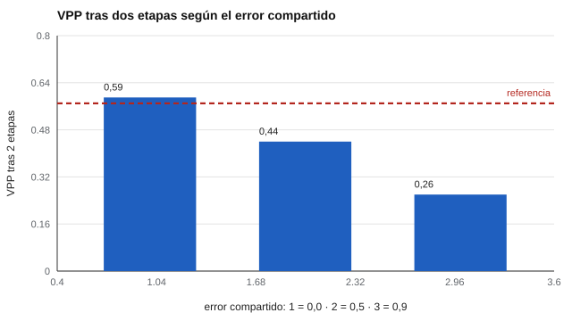

# 139 — Cribado del neurodesarrollo: alcances y derivación


<!-- NAV -->
[← 138 — Evaluación en educación parvularia](../138-evaluacion-en-educacion-parvularia/README.md) · [📚 Parte 13](../README.md) · [🗺️ Índice 001–200](../../../PROGRAMA.md) · [140 — Contexto chileno: referentes curriculares y n… →](../140-contexto-chileno-referentes-curriculares-y-normativos/README.md)
<!-- /NAV -->

**Parte 13 — Desarrollo infantil y evaluación psicoeducativa** · Nivel avanzado · 4 h · Estado `escrita`
**Pensada para:** quien organiza un programa de cribado, y familias que pasan por sus etapas.
**Prerrequisitos:** clases 100 y 135.

> Datos sintéticos. La derivación a evaluación diagnóstica la hace un equipo habilitado, con consentimiento de la familia.

## ¿Para qué te sirve esto?

Un solo cribado deriva a muchos niños sanos. Para reducirlo se usa un cribado **en dos etapas**: primero un cuestionario breve y, solo a quienes resultan en riesgo, una prueba directa. El cálculo que se enseña suele multiplicar las razones de verosimilitud suponiendo que ambas pruebas son **independientes**. Pero si comparten error (el niño estaba cansado, tímido, en un contexto raro), la segunda prueba aporta **menos** de lo que se calcula. Esta clase te enseña a cuantificarlo.

## Al terminar esta clase podrás

- Calcular el valor predictivo de un cribado en dos etapas.
- Reconocer el efecto del error compartido entre pruebas.
- Diseñar una ruta de derivación con apoyos mientras se espera.

## La idea en palabras simples

Un cribado en dos etapas reduce derivaciones innecesarias. El cálculo habitual convierte la prevalencia en *odds* y los multiplica por la razón de verosimilitud de cada etapa (≈ sensibilidad / (1 − especificidad)). Eso supone independencia. Si las pruebas **comparten error** (sueño, timidez, contexto), el VPP real es menor (Glascoe, 2005). Streiner y Norman (2008) discuten el cálculo de estas medidas.

## Cómo funciona, paso a paso

**1. Fijar** prevalencia 4 % y corte 1,2 en ambas etapas.

**2. Simular** distintos pesos del error compartido (0; 0,5; 0,9).

**3. Calcular** el VPP de la etapa 1, tras 2 etapas y el que se obtendría con independencia.

**Ejemplo resuelto.** *Odds* previos = 0,04 / 0,96 = 0,042; con dos etapas independientes, odds = 0,042 · RV² → VPP ≈ 0,57 en este diseño.



*Figura 1.* Con error compartido alto, la segunda etapa casi no mejora el VPP.

## Si construyes el instrumento

- No multipliques razones de verosimilitud sin comprobar independencia.
- Haz seguimiento de los niños entre etapas para no perderlos.
- Define la ruta de derivación con tiempos y apoyos intermedios.
- Llama «riesgo» al resultado positivo.

## Si eres evaluado (o eres la familia)

- Pasar a una segunda etapa no confirma un diagnóstico.
- Pregunta cuánto tiempo falta y qué apoyos hay mientras tanto.
- La derivación diagnóstica requiere tu consentimiento.

## Qué muestra el laboratorio

| Peso del error compartido | VPP etapa 1 | VPP tras 2 etapas | VPP si independientes |
|---:|---:|---:|---:|
| 0,0 | 0,19 | 0,59 | 0,57 |
| 0,5 | 0,19 | 0,44 | 0,57 |
| 0,9 | 0,19 | 0,26 | 0,57 |

**Análisis.** (1) Un segundo cribado mejora el valor predictivo, pero menos de lo que sugiere el cálculo independiente cuando las pruebas comparten error. (2) El cribado de dos etapas reduce derivaciones innecesarias. (3) El resultado sigue siendo «riesgo». (4) La derivación diagnóstica la hace un equipo habilitado, con consentimiento y apoyos.

## Errores frecuentes

- Multiplicar razones de verosimilitud sin comprobar independencia.
- Perder niños entre etapas.
- Ruta de derivación sin tiempos ni apoyos intermedios.
- Comunicar el resultado como diagnóstico.

## Lo mínimo que debes llevarte

1. Dos etapas reducen derivaciones innecesarias.
2. La independencia es un supuesto que hay que verificar.
3. El error compartido reduce el VPP real.
4. La ruta de derivación necesita tiempos y apoyos.

## Ejercicios

- **Inicial.** ¿Por qué un segundo cribado mejora el VPP? *Solución: porque multiplica la evidencia a favor del riesgo en quienes ya eran positivos.*
- **Intermedio.** VPP 0,19 y una razón de verosimilitud 4. *Solución: odds 0,235 · 4 = 0,94 → VPP 0,48.*
- **Avanzado.** Cambia la prevalencia a 10 % en `lab.py`.
- **Aplicación.** Dibuja una ruta de derivación con tiempos máximos y apoyos mientras se espera.

## Glosario

- **Cribado en dos etapas:** secuencia de una prueba breve y otra más directa.
- **Razón de verosimilitud:** cuánto cambia un resultado las probabilidades previas.
- **Error compartido:** error común a ambas pruebas.
- **Odds:** probabilidad / (1 − probabilidad).

## Laboratorio

```bash
python classes/part-13-desarrollo-infantil-y-evaluacion-psicoeducativa/139-cribado-del-neurodesarrollo-alcances-y-derivacion/lab.py
python classes/part-13-desarrollo-infantil-y-evaluacion-psicoeducativa/figuras.py
```

## Autoevaluación y criterios

1. ¿Qué apoyos das mientras esperan? 2. ¿Quién deriva y a quién? 3. ¿Cómo evalúas el programa de cribado?
Se logra la clase si evalúas una secuencia de cribado con supuestos explícitos.

## Bibliografía

- Glascoe, F. P. (2005). Screening for developmental and behavioral problems. *Mental Retardation and Developmental Disabilities Research Reviews*, 11(3), 173-179. ✅ [DOI](https://doi.org/10.1002/mrdd.20068)
- Lipkin, P. H., & Macias, M. M. (2020). Promoting optimal development. *Pediatrics*, 145(1), e20193449. 🔎 sin verificar (libro, norma o sitio no hallado en Crossref: comprobar a mano)
- Streiner, D. L., & Norman, G. R. (2008). *Health Measurement Scales* (4.ª ed.). Oxford University Press. ✅ [DOI](https://doi.org/10.1093/acprof:oso/9780199231881.001.0001)

Leyenda: ✅ existe en Crossref con título y año coincidentes (enlace al DOI); ⚠️ hay una obra de título parecido con otro año (no se enlaza: comprobar la edición); 🔎 no verificada automáticamente (libros sin DOI, normas y sitios web). Crossref confirma la existencia de la fuente, no que respalde cada afirmación de la clase. Ver [`docs/VERIFICACION_BIBLIOGRAFIA.md`](../../../docs/VERIFICACION_BIBLIOGRAFIA.md).

---

<!-- NAV -->
[← 138 — Evaluación en educación parvularia](../138-evaluacion-en-educacion-parvularia/README.md)  
[📚 Parte 13](../README.md) · [🗺️ Índice 001–200](../../../PROGRAMA.md)  
[140 — Contexto chileno: referentes curriculares y n… →](../140-contexto-chileno-referentes-curriculares-y-normativos/README.md)
<!-- /NAV -->
