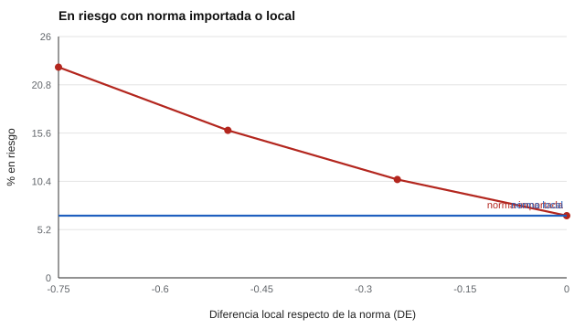

# 140 — Contexto chileno: referentes curriculares y normativos


<!-- NAV -->
[← 139 — Cribado del neurodesarrollo: alcances y deriv…](../139-cribado-del-neurodesarrollo-alcances-y-derivacion/README.md) · [📚 Parte 13](../README.md) · [🗺️ Índice 001–200](../../../PROGRAMA.md) · [141 — Comprensión lectora: niveles y evaluación →](../../part-14-aprendizaje-aptitudes-y-dificultades-escolares/141-comprension-lectora-niveles-y-evaluacion/README.md)
<!-- /NAV -->

**Parte 13 — Desarrollo infantil y evaluación psicoeducativa** · Nivel avanzado · 4 h · Estado `escrita`
**Pensada para:** quien evalúa en el sistema educativo chileno, y familias que quieren entender qué normas rigen.
**Prerrequisitos:** clases 062, 065 y 076.

> Material educativo, no asesoría jurídica. Las normas cambian y se modifican: **verifica el texto vigente** en la Biblioteca del Congreso Nacional (bcn.cl) y en el Ministerio de Educación (mineduc.cl).

## ¿Para qué te sirve esto?

Evaluar en Chile implica moverse entre normas (Ley General de Educación, decretos de evaluación, de necesidades educativas especiales, de inclusión) y entre instrumentos con baremos. Esta clase hace dos cosas: (1) te entrega un **mapa de estudio** de los referentes más citados, que debes verificar en la fuente; (2) te muestra el efecto práctico de un error común: **usar un baremo extranjero**. Si la población local rinde un poco distinto a la muestra normativa, un baremo importado puede duplicar las derivaciones sin que los niños sean distintos.

## Al terminar esta clase podrás

- Ubicar los referentes normativos y curriculares que enmarcan la evaluación educativa en Chile.
- Calcular el efecto de aplicar un baremo extranjero.
- Elegir instrumentos y baremos con equivalencia local.

## La idea en palabras simples

**Mapa de estudio (a verificar en la fuente):**

- Ley General de Educación (Ley 20.370): marco del sistema escolar.
- Bases Curriculares de la Educación Parvularia, y de educación básica y media.
- Ley 20.422: igualdad de oportunidades e inclusión de personas con discapacidad.
- Decreto 170/2009: evaluación diagnóstica de necesidades educativas especiales (subvención NEE).
- Decreto 83/2015: diversificación de la enseñanza (adecuaciones curriculares, DUA).
- Decreto 67/2018: evaluación, calificación y promoción en aula.
- Ley 21.545: inclusión y atención integral de personas con TEA.
- Ley 21.719: datos personales (ver clase 076).

Sobre los baremos: si la población local rinde 0,5 DE menos que la muestra extranjera, una norma importada marca «en riesgo» (< −1,5 DE) a más del doble de niños (Hambleton, Merenda y Spielberger, 2005, sobre adaptación de pruebas).

## Cómo funciona, paso a paso

**1. Ubicar** la norma que aplica a la decisión (diagnóstica, de aula, de datos).

**2. Calcular** el porcentaje «en riesgo» con la norma importada para distintos desplazamientos.

**3. Preferir** un baremo local o evidencia de equivalencia.

**Ejemplo resuelto.** P(z < −1,5 − (−0,5)) = P(z < −1,0) = 15,9 %: las derivaciones se duplican por un desplazamiento de referencia, no por los niños.



*Figura 1.* Con norma importada, el porcentaje en riesgo crece con la diferencia local; con norma local, se mantiene.

## Si construyes el instrumento

- Usa baremos con equivalencia local o desarrolla uno propio (clases 062 y 065).
- Cita normas con fecha y verifica su vigencia antes de decidir.
- Distingue la evaluación de aula de la evaluación diagnóstica de NEE.
- Define qué datos de estudiantes conservas y por cuánto tiempo (clase 076).

## Si eres evaluado (o eres la familia)

- Pregunta qué norma sustenta una evaluación y quién puede realizarla.
- Un resultado «en riesgo» con un baremo extranjero puede reflejar el baremo.
- Tienes derechos sobre tus datos y sobre la información que se te entrega.

## Qué muestra el laboratorio

| Diferencia local (DE) | En riesgo con norma importada | Con norma local |
|---:|---:|---:|
| 0,00 | 6,7 % | 6,7 % |
| −0,25 | 10,6 % | 6,7 % |
| −0,50 | 15,9 % | 6,7 % |
| −0,75 | 22,7 % | 6,7 % |

**Análisis.** (1) Con un desplazamiento de 0,5 DE, la norma importada marca ~16 % en vez de ~7 %. (2) Son más del doble de derivaciones por una diferencia de referencia, no de los niños. (3) Se exige evidencia de equivalencia o un baremo local. (4) Los instrumentos chilenos (por ejemplo TEPSI o EEDP, fichados en el catálogo) requieren verificar versión y baremo vigentes.

## Errores frecuentes

- Usar baremos extranjeros sin evidencia de equivalencia.
- Citar normas de memoria: cambian y se modifican.
- Confundir una evaluación de aula con una evaluación diagnóstica de NEE.
- Usar un instrumento chileno sin verificar su versión y baremo vigente.

## Lo mínimo que debes llevarte

1. Hay un conjunto de normas que enmarca la evaluación; se verifican en la fuente.
2. Un baremo extranjero puede duplicar las derivaciones.
3. La equivalencia local se demuestra, no se supone.
4. La evaluación de aula no es lo mismo que la diagnóstica.

## Ejercicios

- **Inicial.** ¿Qué diferencia hay entre evaluación formativa y diagnóstica? *Solución: la formativa apoya el aprendizaje en el aula; la diagnóstica identifica necesidades específicas de apoyo.*
- **Intermedio.** Con desplazamiento de −0,25 DE, ¿qué porcentaje queda < −1,5 DE de la norma? *Solución: 10,6 %.*
- **Avanzado.** Revisa en bcn.cl una de las normas del mapa y resume qué cambió en su última modificación.
- **Aplicación.** Para una evaluación que conozcas, identifica qué norma aplica y quién puede realizarla.

## Glosario

- **NEE:** necesidades educativas especiales.
- **DUA:** diseño universal para el aprendizaje.
- **Baremo:** tabla de normas para interpretar puntajes (clases 062 y 065).
- **Equivalencia:** demostración de que un instrumento funciona igual en otra población.

## Laboratorio

```bash
python classes/part-13-desarrollo-infantil-y-evaluacion-psicoeducativa/140-contexto-chileno-referentes-curriculares-y-normativos/lab.py
python classes/part-13-desarrollo-infantil-y-evaluacion-psicoeducativa/figuras.py
```

## Autoevaluación y criterios

1. ¿Qué normas aplican a tu contexto? 2. ¿Quién puede realizar la evaluación diagnóstica? 3. ¿Qué datos de estudiantes puedes conservar y cuánto tiempo?
Se logra la clase si vinculas normas con decisiones de evaluación y verificas fuentes.

## Bibliografía y fuentes

- Biblioteca del Congreso Nacional de Chile (bcn.cl): textos vigentes de las normas citadas.
- Ministerio de Educación de Chile (mineduc.cl): bases curriculares y orientaciones.
- Hambleton, R. K., Merenda, P. F., & Spielberger, C. D. (Eds.) (2005). *Adapting Educational and Psychological Tests for Cross-Cultural Assessment*. Lawrence Erlbaum. [DOI](https://doi.org/10.4324/9781410611758)

---

<!-- NAV -->
[← 139 — Cribado del neurodesarrollo: alcances y deriv…](../139-cribado-del-neurodesarrollo-alcances-y-derivacion/README.md)  
[📚 Parte 13](../README.md) · [🗺️ Índice 001–200](../../../PROGRAMA.md)  
[141 — Comprensión lectora: niveles y evaluación →](../../part-14-aprendizaje-aptitudes-y-dificultades-escolares/141-comprension-lectora-niveles-y-evaluacion/README.md)
<!-- /NAV -->
