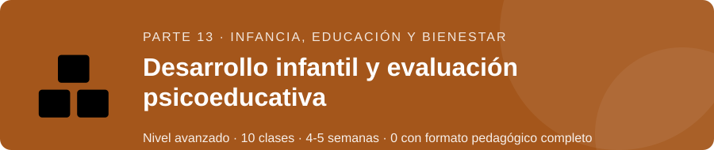
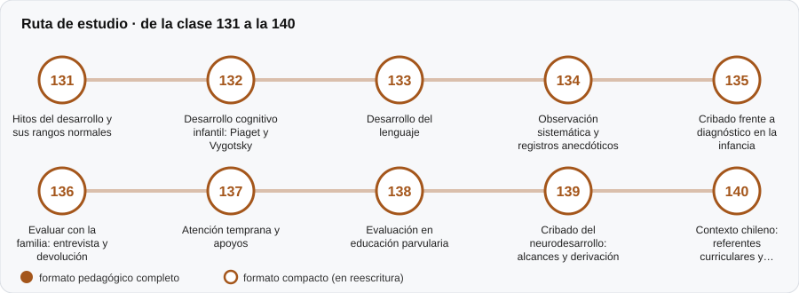

# 🧸 Parte 13 — Desarrollo infantil y evaluación psicoeducativa

**Nivel:** avanzado · **Duración estimada:** 4-5 semanas · **Clases:** 10

## De qué trata

Evaluación en la infancia: hitos del desarrollo, lenguaje, observación sistemática, cribado frente a diagnóstico y trabajo con la familia.

## Por qué importa

En la infancia el error de interpretación tiene consecuencias mayores y los rangos normales son amplios.

## Según tu papel

- **Si construyes o aplicas instrumentos:** Observación, cribado y entrevista con familias, con ética reforzada.
- **Si eres evaluado o recibes resultados:** Para familias: qué significan las señales de alerta y qué preguntar a los profesionales.

## Al terminar esta parte podrás

- Distinguir cribado de diagnóstico.
- Explicar los rangos normales del desarrollo.

## Cómo estudiarla

Material de formación; no reemplaza a un profesional de la salud o la educación.

## Ruta de estudio

## Clases en orden de estudio

Las clases están numeradas de forma consecutiva (001 a 200) en el orden de estudio: sigue el número.

| Orden | ID | Clase | Qué aprenderás | Formato | Horas |
|---:|---|---|---|---|---:|
| 1 | 131 | [Hitos del desarrollo y sus rangos normales](131-hitos-del-desarrollo-y-sus-rangos-normales/README.md) | Entender los hitos como distribuciones de edad, no como edades únicas. | ✅ pedagógico | 4 |
| 2 | 132 | [Desarrollo cognitivo infantil: Piaget y Vygotsky](132-desarrollo-cognitivo-infantil-piaget-y-vygotsky/README.md) | Contrastar estadios (Piaget) con desarrollo gradual dependiente de la tarea. | ✅ pedagógico | 4 |
| 3 | 133 | [Desarrollo del lenguaje](133-desarrollo-del-lenguaje/README.md) | Describir la variabilidad del vocabulario temprano. | ✅ pedagógico | 4 |
| 4 | 134 | [Observación sistemática y registros anecdóticos](134-observacion-sistematica-y-registros-anecdoticos/README.md) | Distinguir registro sistemático (con definiciones operacionales) de registro anecdótico. | ✅ pedagógico | 4 |
| 5 | 135 | [Cribado frente a diagnóstico en la infancia](135-cribado-frente-a-diagnostico-en-la-infancia/README.md) | Distinguir el propósito de un cribado del de un diagnóstico. | ✅ pedagógico | 4 |
| 6 | 136 | [Evaluar con la familia: entrevista y devolución](136-evaluar-con-la-familia-entrevista-y-devolucion/README.md) | Entender la discrepancia entre informantes. | ✅ pedagógico | 4 |
| 7 | 137 | [Atención temprana y apoyos](137-atencion-temprana-y-apoyos/README.md) | Monitorear el progreso de un niño con un diseño de caso único. | ✅ pedagógico | 4 |
| 8 | 138 | [Evaluación en educación parvularia](138-evaluacion-en-educacion-parvularia/README.md) | Evaluar con rúbricas de niveles observables. | ✅ pedagógico | 4 |
| 9 | 139 | [Cribado del neurodesarrollo: alcances y derivación](139-cribado-del-neurodesarrollo-alcances-y-derivacion/README.md) | Calcular el valor predictivo de un cribado en dos etapas. | ✅ pedagógico | 4 |
| 10 | 140 | [Contexto chileno: referentes curriculares y normativos](140-contexto-chileno-referentes-curriculares-y-normativos/README.md) | Ubicar los referentes normativos y curriculares que enmarcan la evaluación educativa en Chile. | ✅ pedagógico | 4 |

[← Volver al índice del programa](../../README.md) · [Índice numérico de las 200 clases](../../PROGRAMA.md)
