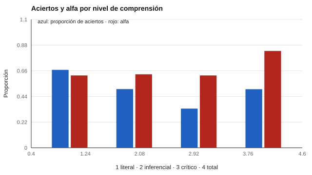

# 141 — Comprensión lectora: niveles y evaluación


<!-- NAV -->
[← 140 — Contexto chileno: referentes curriculares y n…](../../part-13-desarrollo-infantil-y-evaluacion-psicoeducativa/140-contexto-chileno-referentes-curriculares-y-normativos/README.md) · [📚 Parte 14](../README.md) · [🗺️ Índice 001–200](../../../PROGRAMA.md) · [142 — Fluidez y precisión lectora →](../142-fluidez-y-precision-lectora/README.md)
<!-- /NAV -->

**Parte 14 — Aprendizaje, aptitudes y dificultades escolares** · Nivel avanzado · 4 h · Estado `escrita`
**Pensada para:** docentes y evaluadores que informan resultados de lectura, y estudiantes o familias que los reciben.
**Prerrequisitos:** clases 084 y 088.

> Datos sintéticos, con una habilidad única por construcción.

## ¿Para qué te sirve esto?

Muchos informes de lectura dicen: «Literal: 80 %; Inferencial: 55 %; Crítico: 30 %». Parece un perfil de tres habilidades. Esta clase comprueba algo incómodo: los niveles se ordenan por dificultad (literal es más fácil que crítico), **pero no son habilidades separadas**: correlacionan alto, y con pocos ítems por nivel, la **diferencia entre niveles casi no es fiable**. Aprenderás a decidir qué se informa: el total, y el perfil solo con cautela.

## Al terminar esta clase podrás

- Describir niveles de comprensión (literal, inferencial, crítico).
- Comprobar la jerarquía de dificultad y la fiabilidad de subpuntajes.
- Decidir qué se informa: total o perfil por nivel.

## La idea en palabras simples

La comprensión lectora es la construcción de una representación mental del texto que integra información explícita, inferencias y conocimiento previo (Kintsch, 1998; Snow, 2002). Las pruebas clasifican ítems por nivel, pero los niveles **no son habilidades independientes**. Si dos subpuntajes con fiabilidad ρ correlacionan r, la fiabilidad de su diferencia es **(ρ + ρ − 2r) / (2 − 2r)**, que es baja cuando r es alta.

## Cómo funciona, paso a paso

**1. Simular** 24 ítems (8 por nivel) y 2 000 estudiantes con una sola habilidad.

**2. Calcular** el porcentaje de aciertos y el alfa por nivel.

**3. Estimar** la correlación entre niveles y la fiabilidad de la diferencia.

**Ejemplo resuelto.** Con ρ = 0,62 y r = 0,60: (0,62 + 0,62 − 1,20) / (2 − 1,20) = 0,05 (≈ 0,07 en la simulación).



*Figura 1.* La jerarquía de dificultad se reproduce, pero cada subescala tiene alfa ≈ 0,62.

## Si construyes el instrumento

- Si informas un perfil por niveles, usa más ítems por nivel.
- Informa el total con su fiabilidad (0,83 con 24 ítems).
- Controla la dificultad del texto aparte de la de la tarea.
- Considera el conocimiento previo del tema.

## Si eres evaluado (o eres la familia)

- «Va bien en literal y mal en crítico» con 8 ítems por nivel puede ser ruido.
- El total es más confiable que cada nivel.
- Pregunta cuántos ítems tiene cada nivel.

## Qué muestra el laboratorio

| Nivel | % de aciertos | Alfa (8 ítems) |
|---|---:|---:|
| Literal | 66,8 % | 0,62 |
| Inferencial | 50,3 % | 0,63 |
| Crítico | 33,6 % | 0,62 |
| Total (24) | 50,2 % | 0,83 |

Correlación literal–inferencial = 0,60; fiabilidad de la diferencia (inferencial − literal) = 0,07.

**Análisis.** (1) La jerarquía de dificultad se reproduce (literal > inferencial > crítico). (2) Los niveles no son habilidades separables. (3) Se informa el total y, si se informa por nivel, con cautela. (4) La dificultad también depende del texto y del conocimiento previo.

## Errores frecuentes

- Informar un «perfil por niveles» con 8 ítems por nivel.
- Confundir dificultad del texto con dificultad de la tarea.
- Ignorar el conocimiento previo del tema.
- Interpretar diferencias entre niveles sin su fiabilidad.

## Lo mínimo que debes llevarte

1. Literal, inferencial y crítico se ordenan por dificultad.
2. No son habilidades independientes.
3. La fiabilidad de una diferencia es baja si los niveles correlacionan alto.
4. El total es más fiable que el perfil.

## Ejercicios

- **Inicial.** ¿Qué es una inferencia? *Solución: una conclusión que se deduce del texto sin que esté dicha explícitamente.*
- **Intermedio.** ρ = 0,7 y r = 0,5. *Solución: (1,4 − 1,0) / (2 − 1,0) = 0,40.*
- **Avanzado.** Sube a 16 ítems por nivel en `lab.py` y observa los alfas.
- **Aplicación.** Redacta una frase para informar a un docente sobre los niveles sin sobreinterpretar.

## Glosario

- **Comprensión literal:** recuperar lo que el texto dice.
- **Comprensión inferencial:** deducir lo que el texto sugiere.
- **Comprensión crítica:** evaluar el texto y su intención.
- **Fiabilidad de una diferencia:** fiabilidad del contraste entre dos subpuntajes.

## Laboratorio

```bash
python classes/part-14-aprendizaje-aptitudes-y-dificultades-escolares/141-comprension-lectora-niveles-y-evaluacion/lab.py
python classes/part-14-aprendizaje-aptitudes-y-dificultades-escolares/figuras.py
```

## Autoevaluación y criterios

1. ¿Qué informarías a un docente? 2. ¿Cómo distinguirías un problema de decodificación de uno de comprensión? 3. ¿Cómo controlas la dificultad del texto?
Se logra la clase si verificas la jerarquía y decides con criterio qué reportar.

## Bibliografía

- Kintsch, W. (1998). *Comprehension: A Paradigm for Cognition*. Cambridge University Press.
- Snow, C. E. (2002). *Reading for Understanding: Toward an R&D Program in Reading Comprehension*. RAND. [DOI](https://doi.org/10.7249/mr1465.0)

---

<!-- NAV -->
[← 140 — Contexto chileno: referentes curriculares y n…](../../part-13-desarrollo-infantil-y-evaluacion-psicoeducativa/140-contexto-chileno-referentes-curriculares-y-normativos/README.md)  
[📚 Parte 14](../README.md) · [🗺️ Índice 001–200](../../../PROGRAMA.md)  
[142 — Fluidez y precisión lectora →](../142-fluidez-y-precision-lectora/README.md)
<!-- /NAV -->
