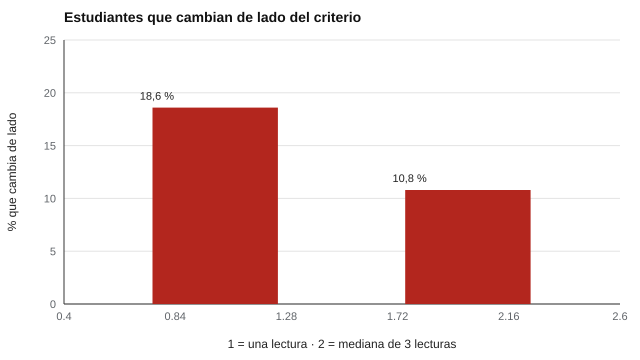

# 142 — Fluidez y precisión lectora


<!-- NAV -->
[← 141 — Comprensión lectora: niveles y evaluación](../141-comprension-lectora-niveles-y-evaluacion/README.md) · [📚 Parte 14](../README.md) · [🗺️ Índice 001–200](../../../PROGRAMA.md) · [143 — Escritura y producción textual con rúbricas →](../143-escritura-y-produccion-textual-con-rubricas/README.md)
<!-- /NAV -->

**Parte 14 — Aprendizaje, aptitudes y dificultades escolares** · Nivel avanzado · 4 h · Estado `escrita`
**Pensada para:** docentes y evaluadores que miden fluidez, y familias que reciben «palabras por minuto».
**Prerrequisitos:** clases 025 y 133.

> Los valores del laboratorio son ilustrativos; los criterios de logro por curso se verifican en fuentes oficiales o estudios locales.

## ¿Para qué te sirve esto?

«Lee 54 palabras por minuto; el mínimo para su curso es 60.» Una frase así puede decidir apoyos. Pero esa cifra sale de **una lectura de un minuto**, y el resultado depende del texto elegido y del día. Esta clase te muestra cuánto error tiene una sola lectura (≈ 12 PCM), qué porcentaje de estudiantes queda en la **zona de incertidumbre** alrededor del criterio, y cómo mejora la decisión al usar la **mediana de tres lecturas**.

## Al terminar esta clase podrás

- Calcular el error de medida de las palabras correctas por minuto (PCM).
- Comparar una lectura con la mediana de varias.
- Estimar la zona de incertidumbre alrededor de un criterio de logro.

## La idea en palabras simples

La **fluidez lectora** incluye precisión, velocidad y prosodia. Se evalúa con lecturas de un minuto (**PCM**, palabras correctas por minuto). Existen normas de referencia (Hasbrouck y Tindal, 2006), pero el error de una lectura es grande: depende del texto y del día (Christ y Silberglitt, 2007). El **error típico de medida** combina ambas fuentes: **ETM = √(DE_texto² + DE_día²)**. Usar la **mediana de varias lecturas** lo reduce.

## Cómo funciona, paso a paso

**1. Simular** 500 estudiantes (habilidad ~ N(80; 25)), con ruido de texto (DE 8) y de día (DE 9).

**2. Fijar** un criterio de 60 PCM y clasificar con una lectura y con la mediana de tres.

**3. Contar** cuántos cambian de lado del criterio entre dos mediciones.

**Ejemplo resuelto.** ETM = √(8² + 9²) = 12,04. Un estudiante con 54 PCM tiene intervalo 54 ± 23,6: el criterio de 60 cae dentro.



*Figura 1.* La mediana de tres lecturas reduce los cambios de clasificación casi a la mitad.

## Si construyes el instrumento

- Usa varios textos equivalentes y toma la mediana.
- Registra los errores de lectura, no solo la velocidad.
- Evalúa prosodia y comprensión, además de velocidad.
- Define qué hacer con quienes están cerca del criterio.

## Si eres evaluado (o eres la familia)

- Una lectura de un minuto es una fotografía; puede cambiar con otro texto u otro día.
- Leer más rápido no es leer mejor.
- Si estás cerca del criterio, pide otra medición antes de decidir.

## Qué muestra el laboratorio

| Procedimiento | Fiabilidad (test-retest) | Cambian de lado del criterio |
|---|---:|---:|
| 1 lectura | 0,80 | 18,6 % |
| Mediana de 3 lecturas | 0,90 | 10,8 % |

Error típico de una lectura = 12,0 PCM; 55 % de los estudiantes está a menos de ±24 PCM del criterio.

**Análisis.** (1) Una sola lectura clasifica distinto a una parte importante de los estudiantes cerca del corte. (2) La mediana de tres textos reduce el error. (3) Fluidez incluye precisión y prosodia, no solo velocidad. (4) Los valores son ilustrativos.

## Errores frecuentes

- Clasificar con una sola lectura.
- Tomar la velocidad por comprensión.
- Aplicar criterios de logro de otro país o curso sin verificarlos.
- Ignorar la zona de incertidumbre.

## Lo mínimo que debes llevarte

1. Una lectura tiene un error típico de ~12 PCM.
2. La mediana de varias lecturas lo reduce.
3. Muchos estudiantes están cerca del criterio.
4. Fluidez no es solo velocidad.

## Ejercicios

- **Inicial.** ¿Qué componentes tiene la fluidez? *Solución: precisión, velocidad y prosodia.*
- **Intermedio.** ETM con texto 6 y día 6. *Solución: 8,5.*
- **Avanzado.** Usa la media de 5 lecturas en `lab.py` y reporta el error de clasificación.
- **Aplicación.** Define un procedimiento para decidir qué hacer con estudiantes dentro de ±1 ETM del criterio.

## Glosario

- **PCM:** palabras correctas por minuto.
- **ETM:** error típico de medida.
- **Prosodia:** entonación y expresividad al leer.
- **Zona de incertidumbre:** rango alrededor del criterio donde la clasificación es dudosa.

## Laboratorio

```bash
python classes/part-14-aprendizaje-aptitudes-y-dificultades-escolares/142-fluidez-y-precision-lectora/lab.py
python classes/part-14-aprendizaje-aptitudes-y-dificultades-escolares/figuras.py
```

## Autoevaluación y criterios

1. ¿Cómo eliges textos equivalentes? 2. ¿Cómo registras errores de lectura? 3. ¿Qué haces con quienes están cerca del criterio?
Se logra la clase si cuantificas el error y propones un procedimiento de decisión.

## Bibliografía

- Hasbrouck, J., & Tindal, G. A. (2006). Oral reading fluency norms: A valuable assessment tool for reading teachers. *The Reading Teacher*, 59(7), 636-644. ✅ [DOI](https://doi.org/10.1598/rt.59.7.3)
- Christ, T. J., & Silberglitt, B. (2007). Estimates of the standard error of measurement for curriculum-based measures of oral reading fluency. *School Psychology Review*, 36(1), 130-146. ✅ [DOI](https://doi.org/10.1080/02796015.2007.12087956)

Leyenda: ✅ existe en Crossref con título y año coincidentes (enlace al DOI); ⚠️ hay una obra de título parecido con otro año (no se enlaza: comprobar la edición); 🔎 no verificada automáticamente (libros sin DOI, normas y sitios web). Crossref confirma la existencia de la fuente, no que respalde cada afirmación de la clase. Ver [`docs/VERIFICACION_BIBLIOGRAFIA.md`](../../../docs/VERIFICACION_BIBLIOGRAFIA.md).

---

<!-- NAV -->
[← 141 — Comprensión lectora: niveles y evaluación](../141-comprension-lectora-niveles-y-evaluacion/README.md)  
[📚 Parte 14](../README.md) · [🗺️ Índice 001–200](../../../PROGRAMA.md)  
[143 — Escritura y producción textual con rúbricas →](../143-escritura-y-produccion-textual-con-rubricas/README.md)
<!-- /NAV -->
