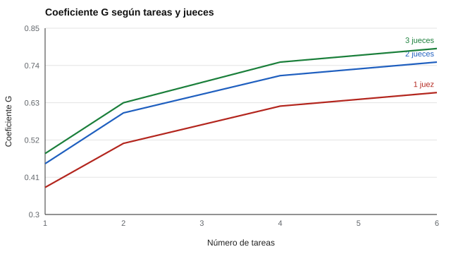

# 143 — Escritura y producción textual con rúbricas


<!-- NAV -->
[← 142 — Fluidez y precisión lectora](../142-fluidez-y-precision-lectora/README.md) · [📚 Parte 14](../README.md) · [🗺️ Índice 001–200](../../../PROGRAMA.md) · [144 — Razonamiento matemático y cálculo →](../144-razonamiento-matematico-y-calculo/README.md)
<!-- /NAV -->

**Parte 14 — Aprendizaje, aptitudes y dificultades escolares** · Nivel avanzado · 4 h · Estado `escrita`
**Pensada para:** docentes que evalúan escritura, y estudiantes que reciben una nota de rúbrica.
**Prerrequisitos:** clases 029 y 037.

> Los componentes de varianza del laboratorio son supuestos; un estudio real los estima con un diseño cruzado.

## ¿Para qué te sirve esto?

Una rúbrica ayuda a evaluar escritura con criterios claros. Pero la nota que un estudiante recibe depende de **qué tema le tocó** y de **quién corrigió**. Si tomas un solo texto y un solo corrector, parte de la nota es azar. La **teoría de la generalizabilidad** permite preguntar: ¿cuántas tareas y cuántos jueces necesito para que la nota sea confiable? Esta clase te enseña a responderlo con un **estudio D**, y muestra que **agregar tareas ayuda más que agregar jueces**.

## Al terminar esta clase podrás

- Diseñar una rúbrica analítica.
- Planificar cuántas tareas y jueces se necesitan (estudio D).
- Calcular el coeficiente de generalizabilidad.

## La idea en palabras simples

Las rúbricas aumentan la transparencia y el acuerdo, pero su fiabilidad depende del diseño (Jonsson y Svingby, 2007). Con un diseño personas × tareas × jueces, el **coeficiente de generalizabilidad relativo** es:

```
G = σ²_p / ( σ²_p + σ²_pt/n_t + σ²_pj/n_j + σ²_ptj,e/(n_t·n_j) )
```

(Shavelson y Webb, 1991; Brennan, 2001). Componentes supuestos: persona 1,00; persona × tarea 0,80; persona × juez 0,30; residual 0,50. La mayor fuente de error es **persona × tarea**: un estudiante escribe distinto según el tema.

## Cómo funciona, paso a paso

**1. Fijar** los componentes de varianza (supuestos).

**2. Calcular** G para distintos números de tareas y jueces (estudio D).

**3. Elegir** el diseño más barato que alcance el G objetivo.

**Ejemplo resuelto.** 2 tareas y 2 jueces: 1 / (1 + 0,80/2 + 0,30/2 + 0,50/4) = 1 / (1 + 0,4 + 0,15 + 0,125) = 0,60.



*Figura 1.* Más tareas elevan G más rápido que más jueces.

## Si construyes el instrumento

- Usa varias tareas (idealmente 4 o más).
- Redacta descriptores concretos y capacita a los jueces.
- Define un G objetivo antes de diseñar.
- Da retroalimentación formativa, no solo una nota.

## Si eres evaluado

- Una nota basada en un solo texto es frágil.
- Pide la rúbrica antes de escribir y ejemplos de cada nivel.
- Si es posible, pide que se consideren varios trabajos.

## Qué muestra el laboratorio

| Tareas \ Jueces | 1 | 2 | 3 |
|---:|---:|---:|---:|
| 1 | 0,38 | 0,45 | 0,48 |
| 2 | 0,51 | 0,60 | 0,63 |
| 4 | 0,62 | 0,71 | 0,75 |
| 6 | 0,66 | 0,75 | 0,79 |

Simulación con 2 tareas × 2 jueces: G teórico 0,60; r² simulado 0,59.

**Análisis.** (1) Agregar tareas mejora más la fiabilidad que agregar jueces. (2) Una sola tarea con varios jueces no basta. (3) Con rúbricas claras y jueces calibrados, el error de juez baja. (4) Los componentes son supuestos.

## Errores frecuentes

- Evaluar con una sola tarea.
- Añadir jueces cuando la mayor fuente de error es la tarea.
- Usar rúbricas con descriptores vagos.
- Tomar los componentes supuestos como estimaciones reales.

## Lo mínimo que debes llevarte

1. La nota depende de persona, tarea y juez.
2. G resume la fiabilidad relativa del diseño.
3. Las tareas pesan más que los jueces.
4. El estudio D permite planificar el diseño.

## Ejercicios

- **Inicial.** ¿Qué es un estudio D? *Solución: un cálculo de G para distintos diseños, para planificar cuántas tareas y jueces usar.*
- **Intermedio.** G con 3 tareas y 1 juez. *Solución: 1 / (1 + 0,267 + 0,30 + 0,167) = 0,58.*
- **Avanzado.** Reduce σ²_pt a 0,4 en `lab.py` y redibuja la tabla.
- **Aplicación.** Diseña una evaluación de escritura con G objetivo ≥ 0,70.

## Glosario

- **Rúbrica analítica:** descripción por criterios y niveles.
- **Generalizabilidad:** extensión de la fiabilidad a múltiples fuentes de error.
- **Estudio D:** planificación del diseño de medición.
- **Componente de varianza:** parte de la variación atribuible a una fuente.

## Laboratorio

```bash
python classes/part-14-aprendizaje-aptitudes-y-dificultades-escolares/143-escritura-y-produccion-textual-con-rubricas/lab.py
python classes/part-14-aprendizaje-aptitudes-y-dificultades-escolares/figuras.py
```

## Autoevaluación y criterios

1. ¿Qué criterios incluiría tu rúbrica? 2. ¿Cómo entrenas a los jueces? 3. ¿Cómo das retroalimentación formativa?
Se logra la clase si diseñas una evaluación de escritura con un G objetivo.

## Bibliografía

- Jonsson, A., & Svingby, G. (2007). The use of scoring rubrics: Reliability, validity and educational consequences. *Educational Research Review*, 2(2), 130-144. ✅ [DOI](https://doi.org/10.1016/j.edurev.2007.05.002)
- Shavelson, R. J., & Webb, N. M. (1991). *Generalizability Theory: A Primer*. Sage. ⚠️ hay una obra de título parecido en Crossref con otro año (2004): comprobar la edición a mano
- Brennan, R. L. (2001). *Generalizability Theory*. Springer. ✅ [DOI](https://doi.org/10.1007/978-1-4757-3456-0)

Leyenda: ✅ existe en Crossref con título y año coincidentes (enlace al DOI); ⚠️ hay una obra de título parecido con otro año (no se enlaza: comprobar la edición); 🔎 no verificada automáticamente (libros sin DOI, normas y sitios web). Crossref confirma la existencia de la fuente, no que respalde cada afirmación de la clase. Ver [`docs/VERIFICACION_BIBLIOGRAFIA.md`](../../../docs/VERIFICACION_BIBLIOGRAFIA.md).

---

<!-- NAV -->
[← 142 — Fluidez y precisión lectora](../142-fluidez-y-precision-lectora/README.md)  
[📚 Parte 14](../README.md) · [🗺️ Índice 001–200](../../../PROGRAMA.md)  
[144 — Razonamiento matemático y cálculo →](../144-razonamiento-matematico-y-calculo/README.md)
<!-- /NAV -->
