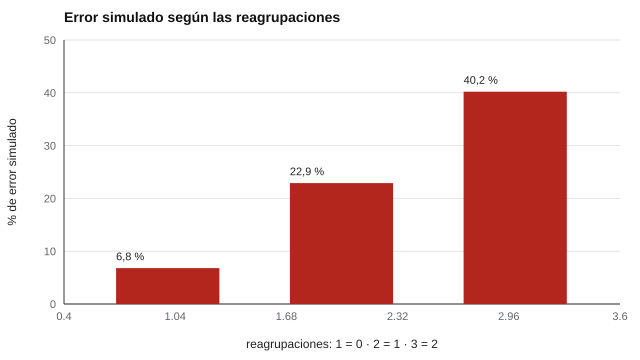

# 144 — Razonamiento matemático y cálculo


<!-- NAV -->
[← 143 — Escritura y producción textual con rúbricas](../143-escritura-y-produccion-textual-con-rubricas/README.md) · [📚 Parte 14](../README.md) · [🗺️ Índice 001–200](../../../PROGRAMA.md) · [145 — Dificultades específicas de aprendizaje: crib… →](../145-dificultades-especificas-de-aprendizaje-cribado-y-derivacion/README.md)
<!-- /NAV -->

**Parte 14 — Aprendizaje, aptitudes y dificultades escolares** · Nivel avanzado · 4 h · Estado `escrita`
**Pensada para:** docentes y evaluadores que construyen ítems de cálculo, y estudiantes que los resuelven.
**Prerrequisitos:** clases 083 y 085.

> Las probabilidades de error del laboratorio son **supuestas**: la relación dificultad–reagrupaciones se comprueba con datos reales antes de usarla.

## ¿Para qué te sirve esto?

«534 − 278 = ?» ¿Qué hace que este ítem sea difícil? En buena medida, que obliga a **pedir prestado dos veces**. La dificultad de un ítem de cálculo se puede explicar y controlar por sus características. Y los errores no son al azar: un estudiante que **resta siempre la cifra menor de la mayor** produce respuestas características (344 en vez de 256). Esta clase te enseña a generar ítems con dificultad explicada, a verificar la clave con dos implementaciones y a usar los errores para **enseñar mejor**.

## Al terminar esta clase podrás

- Controlar la dificultad de un ítem de cálculo por sus características.
- Verificar claves con dos implementaciones.
- Usar errores sistemáticos con fin diagnóstico.

## La idea en palabras simples

Una propiedad observable del ítem, como el número de **reagrupaciones** (préstamos) en una resta, explica parte de su dificultad. Los **errores sistemáticos** («bugs»; Brown y Burton, 1978; VanLehn, 1990) producen respuestas características que orientan la enseñanza. Distinguir cálculo, razonamiento y comprensión del problema es clave para no confundir una dificultad aislada con una dificultad de aprendizaje (Geary, 2004).

## Cómo funciona, paso a paso

**1. Generar** restas de 3 cifras y contar sus reagrupaciones.

**2. Verificar** la clave con el algoritmo escrito y con la resta de Python (concordancia 600/600).

**3. Asignar** probabilidades de error por reagrupaciones (supuestas) y simular.

**Ejemplo resuelto.** 534 − 278: unidades 4 < 8 → préstamo (14 − 8 = 6); decenas 2 < 7 → préstamo (12 − 7 = 5); centenas 4 − 2 = 2 → 256. El error típico «cifra menor − mayor» da 344.



*Figura 1.* Cada reagrupación adicional eleva mucho la dificultad supuesta.

## Si construyes el instrumento

- Explica la dificultad por características del ítem y compruébala con datos.
- Verifica la clave con dos implementaciones independientes.
- Separa fluidez de cálculo y razonamiento en puntajes distintos.
- Diseña distractores a partir de errores sistemáticos conocidos.

## Si eres evaluado

- Un error repetido suele tener una lógica: entenderla ayuda a corregirla.
- Un solo error no indica una dificultad de aprendizaje.
- Pide que el docente te muestre qué tipo de error cometiste.

## Qué muestra el laboratorio

| Reagrupaciones | Ítems | P(error) supuesta | % error simulado |
|---:|---:|---:|---:|
| 0 | 206 | 0,05 | 6,8 % |
| 1 | 260 | 0,23 | 22,9 % |
| 2 | 134 | 0,41 | 40,2 % |

Ejemplo: 534 − 278 = 256 (2 reagrupaciones); un error típico da 344.

**Análisis.** (1) La dificultad se puede explicar y controlar por diseño. (2) Un error sistemático es identificable por su respuesta, lo que orienta la enseñanza. (3) Las probabilidades de error son supuestas. (4) La enseñanza informada por errores requiere entrevistar al estudiante.

## Errores frecuentes

- Declarar la relación dificultad–reagrupaciones sin datos.
- Interpretar un solo error como «dificultad de aprendizaje».
- Mezclar fluidez de cálculo con razonamiento en un mismo puntaje.
- Omitir la entrevista al estudiante.

## Lo mínimo que debes llevarte

1. La dificultad de un ítem de cálculo se explica por sus características.
2. La clave se verifica con dos implementaciones.
3. Los errores sistemáticos orientan la enseñanza.
4. La relación se comprueba con datos.

## Ejercicios

- **Inicial.** ¿Cuántas reagrupaciones tiene 305 − 168? *Solución: 2.*
- **Intermedio.** Calcula la respuesta con el error típico para 83 − 47. *Solución: |8−4|·10 + |3−7| = 44.*
- **Avanzado.** Agrega restas de 4 cifras al generador y verifica la clave.
- **Aplicación.** Diseña tres distractores para 534 − 278 a partir de errores sistemáticos.

## Glosario

- **Reagrupación (préstamo):** traspaso de una unidad de un orden mayor a uno menor.
- **Bug (error sistemático):** procedimiento erróneo repetido.
- **Fluidez de cálculo:** rapidez y precisión en operaciones.
- **Distractor:** opción incorrecta plausible.

## Laboratorio

```bash
python classes/part-14-aprendizaje-aptitudes-y-dificultades-escolares/144-razonamiento-matematico-y-calculo/lab.py
python classes/part-14-aprendizaje-aptitudes-y-dificultades-escolares/figuras.py
```

## Autoevaluación y criterios

1. ¿Cómo estimarías la dificultad con datos? 2. ¿Qué haces ante un error sistemático? 3. ¿Cuándo derivas a evaluación especializada?
Se logra la clase si generas ítems con dificultad explicada y usas errores con fin formativo.

## Bibliografía

- Brown, J. S., & Burton, R. R. (1978). Diagnostic models for procedural bugs in basic mathematical skills. *Cognitive Science*, 2(2), 155-192.80004-4) ✅ [DOI](https://doi.org/10.1016/s0364-0213(78)80004-4)
- VanLehn, K. (1990). *Mind Bugs: The Origins of Procedural Misconceptions*. MIT Press. ⚠️ hay una obra de título parecido en Crossref con otro año (1991): comprobar la edición a mano
- Geary, D. C. (2004). Mathematics and learning disabilities. *Journal of Learning Disabilities*, 37(1), 4-15. ✅ [DOI](https://doi.org/10.1177/00222194040370010201)

Leyenda: ✅ existe en Crossref con título y año coincidentes (enlace al DOI); ⚠️ hay una obra de título parecido con otro año (no se enlaza: comprobar la edición); 🔎 no verificada automáticamente (libros sin DOI, normas y sitios web). Crossref confirma la existencia de la fuente, no que respalde cada afirmación de la clase. Ver [`docs/VERIFICACION_BIBLIOGRAFIA.md`](../../../docs/VERIFICACION_BIBLIOGRAFIA.md).

---

<!-- NAV -->
[← 143 — Escritura y producción textual con rúbricas](../143-escritura-y-produccion-textual-con-rubricas/README.md)  
[📚 Parte 14](../README.md) · [🗺️ Índice 001–200](../../../PROGRAMA.md)  
[145 — Dificultades específicas de aprendizaje: crib… →](../145-dificultades-especificas-de-aprendizaje-cribado-y-derivacion/README.md)
<!-- /NAV -->
