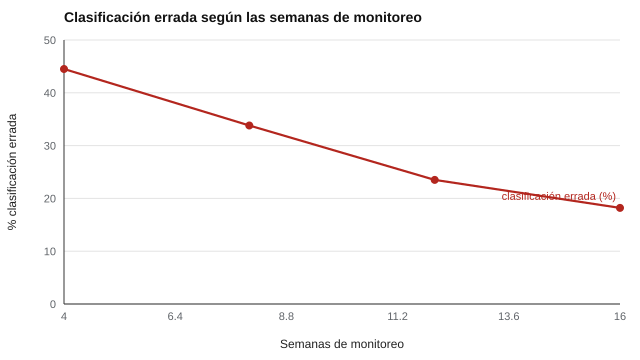

# 145 — Dificultades específicas de aprendizaje: cribado y derivación


<!-- NAV -->
[← 144 — Razonamiento matemático y cálculo](../144-razonamiento-matematico-y-calculo/README.md) · [📚 Parte 14](../README.md) · [🗺️ Índice 001–200](../../../PROGRAMA.md) · [146 — Hábitos de estudio y técnicas de estudio →](../146-habitos-de-estudio-y-tecnicas-de-estudio/README.md)
<!-- /NAV -->

**Parte 14 — Aprendizaje, aptitudes y dificultades escolares** · Nivel avanzado · 5 h · Estado `escrita`
**Pensada para:** quien decide si derivar a un estudiante, y familias que reciben esa decisión.
**Prerrequisitos:** clases 135, 142 y 175.

> Datos sintéticos. La evaluación de una dificultad específica de aprendizaje es un proceso profesional; los criterios reales de decisión se definen con evidencia local.

## ¿Para qué te sirve esto?

«Le damos apoyo cuatro semanas; si no mejora, lo derivamos.» Es la lógica de la **respuesta a la intervención**: usar el progreso del estudiante como información. Suena razonable, pero tiene una trampa estadística: la **pendiente de progreso** estimada con pocas mediciones es muy imprecisa. Con cuatro semanas, el error de la pendiente es **mayor que la pendiente que se quiere juzgar**, y la mitad de los estudiantes queda mal clasificada. Esta clase te muestra cuántas semanas hacen falta y cómo diseñar un cribado escalonado antes de derivar.

## Al terminar esta clase podrás

- Estimar la pendiente de progreso con monitoreo semanal.
- Cuantificar los errores de clasificación según la duración del monitoreo.
- Diseñar un cribado escalonado antes de derivar.

## La idea en palabras simples

La **respuesta a la intervención** (Fuchs y Fuchs, 2006) usa el progreso bajo apoyo para decidir. La pendiente (por ejemplo, PCM ganadas por semana) se estima por regresión lineal, y su error típico es **EE = σ / √Σ(t − t̄)²**: cae rápido con más semanas, pero es grande al inicio (Christ, 2006). Medir con más fiabilidad (clase 142) también ayuda.

## Cómo funciona, paso a paso

**1. Simular** 400 estudiantes con ruido de 8 PCM y un umbral de respuesta de 1,5 PCM por semana.

**2. Estimar** la pendiente con 4, 8, 12 y 16 semanas.

**3. Contar** cuántos quedan mal clasificados (responde / no responde).

**Ejemplo resuelto.** Con σ = 8 y *n* = 8 semanales, EE(pendiente) = 8 / √42 = 1,23 (≈ 1,20 simulado).



*Figura 1.* Con pocas semanas, la pendiente es demasiado imprecisa para decidir (su error típico baja de 3,46 a 0,45).

## Si construyes el instrumento

- Monitorea al menos 8 a 12 semanas antes de concluir.
- Usa mediciones fiables (varias lecturas o textos equivalentes).
- No uses el progreso como único criterio: considera calidad de la intervención y asistencia.
- Diseña un cribado escalonado: universal, apoyo, monitoreo y recién después derivación.

## Si eres evaluado (o eres la familia)

- «No mejoró en cuatro semanas» puede ser ruido de medición.
- Pregunta cuántas mediciones hubo y cómo se calculó el progreso.
- Mientras se espera, el apoyo debe continuar.

## Qué muestra el laboratorio

| Semanas | Error típico de la pendiente | Clasificación errada | Falsos «no responde» |
|---:|---:|---:|---:|
| 4 | 3,46 | 44,5 % | 45,3 % |
| 8 | 1,20 | 33,8 % | 32,8 % |
| 12 | 0,68 | 23,5 % | 25,5 % |
| 16 | 0,45 | 18,2 % | 15,6 % |

**Análisis.** (1) Con 4 semanas el error de la pendiente es mayor que la pendiente a juzgar: muchos que sí responden parecen no hacerlo. (2) Un monitoreo breve no sustenta una derivación. (3) Requiere más semanas, mediciones más fiables y un cribado escalonado. (4) Los datos son sintéticos.

## Errores frecuentes

- Derivar por un monitoreo corto.
- Usar el progreso como único criterio.
- Ignorar la calidad de la intervención y la asistencia.
- Tratar la derivación como un diagnóstico.

## Lo mínimo que debes llevarte

1. La pendiente se estima con error.
2. Ese error cae con más semanas de monitoreo.
3. Con 4 semanas casi la mitad queda mal clasificada.
4. La derivación es un proceso escalonado y profesional.

## Ejercicios

- **Inicial.** ¿Qué es monitoreo del progreso? *Solución: medir con regularidad una habilidad para ver su evolución.*
- **Intermedio.** EE de la pendiente con σ = 6 y 10 semanas (Σ(t − t̄)² = 82,5). *Solución: 0,66.*
- **Avanzado.** Reduce el ruido a 4 PCM en `lab.py` y observa cuántas semanas bastan.
- **Aplicación.** Diseña un cribado escalonado de cuatro etapas para lectura en primero básico.

## Glosario

- **Respuesta a la intervención (RTI):** decisiones basadas en el progreso bajo apoyo.
- **Pendiente de progreso:** cambio por semana en la habilidad medida.
- **EE de la pendiente:** error típico de la estimación de la pendiente.
- **Cribado escalonado:** secuencia de etapas antes de derivar.

## Laboratorio

```bash
python classes/part-14-aprendizaje-aptitudes-y-dificultades-escolares/145-dificultades-especificas-de-aprendizaje-cribado-y-derivacion/lab.py
python classes/part-14-aprendizaje-aptitudes-y-dificultades-escolares/figuras.py
```

## Autoevaluación y criterios

1. ¿Qué otra información reúnes antes de derivar? 2. ¿Cómo involucras a la familia? 3. ¿Qué apoyos das mientras esperan?
Se logra la clase si diseñas un cribado escalonado y justificas la duración del monitoreo.

## Bibliografía

- Fuchs, D., & Fuchs, L. S. (2006). Introduction to response to intervention: What, why, and how valid is it? *Reading Research Quarterly*, 41(1), 93-99. ✅ [DOI](https://doi.org/10.1598/rrq.41.1.4)
- Christ, T. J. (2006). Short-term estimates of growth using curriculum-based measurement of oral reading fluency. *School Psychology Review*, 35(1), 128-133. ✅ [DOI](https://doi.org/10.1080/02796015.2006.12088006)

Leyenda: ✅ existe en Crossref con título y año coincidentes (enlace al DOI); ⚠️ hay una obra de título parecido con otro año (no se enlaza: comprobar la edición); 🔎 no verificada automáticamente (libros sin DOI, normas y sitios web). Crossref confirma la existencia de la fuente, no que respalde cada afirmación de la clase. Ver [`docs/VERIFICACION_BIBLIOGRAFIA.md`](../../../docs/VERIFICACION_BIBLIOGRAFIA.md).

---

<!-- NAV -->
[← 144 — Razonamiento matemático y cálculo](../144-razonamiento-matematico-y-calculo/README.md)  
[📚 Parte 14](../README.md) · [🗺️ Índice 001–200](../../../PROGRAMA.md)  
[146 — Hábitos de estudio y técnicas de estudio →](../146-habitos-de-estudio-y-tecnicas-de-estudio/README.md)
<!-- /NAV -->
