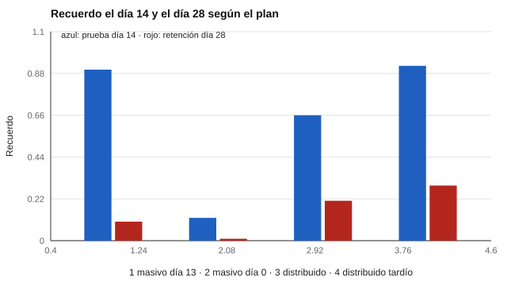

# 146 — Hábitos de estudio y técnicas de estudio


<!-- NAV -->
[← 145 — Dificultades específicas de aprendizaje: crib…](../145-dificultades-especificas-de-aprendizaje-cribado-y-derivacion/README.md) · [📚 Parte 14](../README.md) · [🗺️ Índice 001–200](../../../PROGRAMA.md) · [147 — Estrategias metacognitivas y autorregulación… →](../147-estrategias-metacognitivas-y-autorregulacion-del-aprendizaje/README.md)
<!-- /NAV -->

**Parte 14 — Aprendizaje, aptitudes y dificultades escolares** · Nivel avanzado · 4 h · Estado `escrita`
**Pensada para:** docentes y orientadores que recomiendan técnicas de estudio, y estudiantes que quieren estudiar mejor.
**Prerrequisitos:** clases 094 y 096.

> Modelo con parámetros supuestos: las cifras son ilustrativas y no son predicciones.

## ¿Para qué te sirve esto?

«Subraya y relee.» «Estudia según tu estilo de aprendizaje.» Son consejos muy difundidos, pero con **poco respaldo**. Lo que sí tiene respaldo es la **práctica distribuida** (repartir el estudio en el tiempo) y la **práctica de recuperación** (autoevaluarse en vez de releer). Esta clase te muestra con un modelo simple de olvido por qué el estudio repartido no brilla para una prueba inmediata, pero sí para **retener a largo plazo**, y por qué un inventario de hábitos autoinformado no mide cómo estudias realmente.

## Al terminar esta clase podrás

- Distinguir técnicas de estudio con respaldo de las populares sin él.
- Ilustrar el efecto de espaciado con un modelo de olvido.
- Reconocer los límites de los inventarios de hábitos autoinformados.

## La idea en palabras simples

Una revisión amplia concluyó que la práctica distribuida y la de recuperación tienen **alta utilidad**, mientras que subrayar y releer tienen utilidad baja (Dunlosky et al., 2013). El efecto del espaciado depende del intervalo de retención (Cepeda et al., 2006). El modelo de olvido de Ebbinghaus (1885) se aproxima con **recuerdo = exp(−t / S)**, donde *t* son los días desde el estudio y *S* la «fuerza» de la memoria, que crece con cada sesión espaciada.

## Cómo funciona, paso a paso

**1. Definir** cuatro planes de 4 sesiones (masivo, distribuido, etc.).

**2. Calcular** el recuerdo el día 14 (prueba) y el día 28 (retención).

**3. Comparar** qué plan rinde mejor en cada momento.

**Ejemplo resuelto.** Con S = 6 y t = 15 días: exp(−2,5) = 0,08. Con S = 12: exp(−1,25) = 0,29.



*Figura 1.* El estudio masivo rinde para una prueba inmediata, pero se pierde después.

## Si construyes el instrumento

- No midas «hábitos» solo con autoinforme: complementa con registros de conducta.
- Recomienda técnicas con respaldo y declara los límites.
- Mide el efecto en tu curso con una prueba de retención posterior.
- No prometas notas por una técnica: depende del material y del estudiante.

## Si eres evaluado

- Estudiar pegado a la prueba rinde para esa prueba, pero se olvida pronto.
- Autoevaluarte (recuperar sin mirar) enseña más que releer.
- «Mi estilo de aprendizaje» no tiene respaldo sólido como guía de estudio.

## Qué muestra el laboratorio

| Plan | Prueba día 14 | Retención día 28 |
|---|---:|---:|
| Masivo (4 sesiones el día 13) | 0,90 | 0,10 |
| Masivo (4 sesiones el día 0) | 0,12 | 0,01 |
| Distribuido (días 0, 3, 6, 9) | 0,66 | 0,21 |
| Distribuido tardío (días 4, 7, 10, 13) | 0,92 | 0,29 |

**Análisis.** (1) Para una prueba inmediata, estudiar pegado a la prueba rinde bien. (2) El espaciado destaca en la retención duradera. (3) El efecto está bien respaldado en la literatura; las cifras del modelo son ilustrativas. (4) Un inventario autoinformado no mide cuánto ni cómo se estudia.

## Errores frecuentes

- Recomendar técnicas por popularidad o por «estilo de aprendizaje».
- Interpretar un inventario de hábitos como medida de conducta real.
- Prometer notas por una técnica.
- Tomar las cifras del modelo como predicciones.

## Lo mínimo que debes llevarte

1. Distribuir y recuperar tienen alta utilidad.
2. Subrayar y releer, baja.
3. El espaciado favorece la retención.
4. Los autoinformes de hábitos tienen límites.

## Ejercicios

- **Inicial.** ¿Qué es la práctica de recuperación? *Solución: intentar recordar la información sin mirarla, por ejemplo con autoevaluaciones.*
- **Intermedio.** Calcula exp(−10/5). *Solución: 0,135.*
- **Avanzado.** Cambia la ganancia por esfuerzo (4,0) a 0 en `lab.py` y describe qué pierde el espaciado.
- **Aplicación.** Diseña un plan de estudio de dos semanas con práctica distribuida y de recuperación.

## Glosario

- **Práctica distribuida:** repartir el estudio en el tiempo.
- **Práctica de recuperación:** evocar lo aprendido para fortalecerlo.
- **Retención:** recuerdo tras un intervalo.
- **Estilos de aprendizaje:** idea de adaptar la enseñanza a preferencias; con evidencia limitada.

## Laboratorio

```bash
python classes/part-14-aprendizaje-aptitudes-y-dificultades-escolares/146-habitos-de-estudio-y-tecnicas-de-estudio/lab.py
python classes/part-14-aprendizaje-aptitudes-y-dificultades-escolares/figuras.py
```

## Autoevaluación y criterios

1. ¿Cómo enseñarías a planificar el estudio? 2. ¿Cómo medirías el efecto en tu curso? 3. ¿Qué rol tiene la motivación?
Se logra la clase si recomiendas técnicas con respaldo y declaras los límites.

## Bibliografía

- Cepeda, N. J., Pashler, H., Vul, E., Wixted, J. T., & Rohrer, D. (2006). Distributed practice in verbal recall tasks. *Psychological Bulletin*, 132(3), 354-380. ✅ [DOI](https://doi.org/10.1037/0033-2909.132.3.354)
- Dunlosky, J., Rawson, K. A., Marsh, E. J., Nathan, M. J., & Willingham, D. T. (2013). Improving students' learning with effective learning techniques. *Psychological Science in the Public Interest*, 14(1), 4-58. ✅ [DOI](https://doi.org/10.1177/1529100612453266)
- Ebbinghaus, H. (1885). *Über das Gedächtnis*. Duncker & Humblot. 🔎 sin verificar (libro, norma o sitio no hallado en Crossref: comprobar a mano)

Leyenda: ✅ existe en Crossref con título y año coincidentes (enlace al DOI); ⚠️ hay una obra de título parecido con otro año (no se enlaza: comprobar la edición); 🔎 no verificada automáticamente (libros sin DOI, normas y sitios web). Crossref confirma la existencia de la fuente, no que respalde cada afirmación de la clase. Ver [`docs/VERIFICACION_BIBLIOGRAFIA.md`](../../../docs/VERIFICACION_BIBLIOGRAFIA.md).

---

<!-- NAV -->
[← 145 — Dificultades específicas de aprendizaje: crib…](../145-dificultades-especificas-de-aprendizaje-cribado-y-derivacion/README.md)  
[📚 Parte 14](../README.md) · [🗺️ Índice 001–200](../../../PROGRAMA.md)  
[147 — Estrategias metacognitivas y autorregulación… →](../147-estrategias-metacognitivas-y-autorregulacion-del-aprendizaje/README.md)
<!-- /NAV -->
