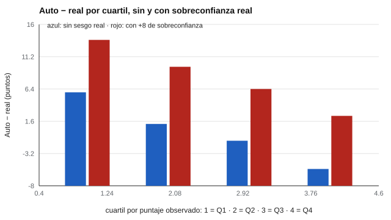

# 147 — Estrategias metacognitivas y autorregulación del aprendizaje


<!-- NAV -->
[← 146 — Hábitos de estudio y técnicas de estudio](../146-habitos-de-estudio-y-tecnicas-de-estudio/README.md) · [📚 Parte 14](../README.md) · [🗺️ Índice 001–200](../../../PROGRAMA.md) · [148 — Motivación académica →](../148-motivacion-academica/README.md)
<!-- /NAV -->

**Parte 14 — Aprendizaje, aptitudes y dificultades escolares** · Nivel avanzado · 4 h · Estado `escrita`
**Pensada para:** quien mide metacognición o calibración, y quien se pregunta «¿sé lo que sé?».
**Prerrequisitos:** clases 021 y 146.

> Simulación con supuestos de normalidad.

## ¿Para qué te sirve esto?

«Los que menos saben son los que más se sobreestiman.» Esta idea (efecto Dunning-Kruger) se cita mucho. Esta clase te muestra algo incómodo: **aun sin ningún sesgo real**, si agrupas a las personas por su puntaje observado, el cuartil inferior parecerá «sobreestimar» y el superior «subestimar». Es un **artefacto estadístico** (regresión a la media). Aprenderás a medir la calibración de forma que distinga un sesgo real de este artefacto.

## Al terminar esta clase podrás

- Medir la calibración entre confianza y desempeño.
- Distinguir sobreconfianza real de un artefacto estadístico.
- Evitar agrupar por la misma variable que se compara.

## La idea en palabras simples

La metacognición incluye el **monitoreo** (¿cuánto sé?) y el **control** (¿qué hago?). La **calibración** compara la confianza con el desempeño, por ítem o global (Schraw, 2009). Kruger y Dunning (1999) mostraron que los de menor puntaje sobreestiman más; Krueger y Mueller (2002) señalaron que parte de ese patrón es un artefacto de agrupar por un puntaje con error: quien obtuvo un puntaje muy bajo probablemente tuvo también mala suerte, y su habilidad real es algo mayor.

## Cómo funciona, paso a paso

**1. Simular** 20 000 estudiantes con autoestimación sin sesgo y ruido de 8 puntos en ambas medidas.

**2. Agrupar** por cuartiles del puntaje observado y calcular auto − real.

**3. Repetir** agrupando por la habilidad verdadera, y con +8 puntos de sobreconfianza real.

**Ejemplo resuelto.** Con fiabilidad del puntaje observado 0,7, la habilidad esperada de quien obtuvo z = −1,5 es −1,05: su autoestimación (insesgada) queda por encima de su puntaje sin que haya sesgo.



*Figura 1.* Sin ningún sesgo, el cuartil inferior parece sobreestimar.

## Si construyes el instrumento

- Mide calibración por ítem (confianza en cada respuesta).
- Evita agrupar por el mismo puntaje que se compara.
- Enseña metacognición con práctica y retroalimentación.
- No midas autorregulación solo con inventarios generales.

## Si eres evaluado

- Que tu autoestimación supere tu puntaje en una prueba no prueba que te sobreestimes.
- Compara tu confianza con tus aciertos en varias ocasiones.
- La retroalimentación mejora la calibración.

## Qué muestra el laboratorio

| Cuartil (por puntaje observado) | Auto − real (sin sesgo) | Auto − real (con +8 de sobreconfianza real) |
|---|---:|---:|
| Q1 | +5,9 | +13,7 |
| Q2 | +1,2 | +9,7 |
| Q3 | −1,3 | +6,4 |
| Q4 | −5,5 | +2,4 |

Agrupando por la habilidad verdadera, el sesgo es +0,1 sin sobreconfianza y +8 con ella: el artefacto desaparece.

**Análisis.** (1) Sin ningún sesgo, el cuartil inferior «sobreestima» unos +6 puntos y el superior «subestima» unos 5 por regresión a la media. (2) Lo que se llama efecto Dunning-Kruger puede ser en parte un artefacto de agrupar por el puntaje ruidoso. (3) Se usan medidas de calibración por ítem. (4) Es una simulación con supuestos simples.

## Errores frecuentes

- Concluir «los menos competentes no se dan cuenta» a partir de cuartiles del mismo puntaje.
- Medir autorregulación solo con inventarios generales.
- Enseñar «metacognición» sin práctica con retroalimentación.
- Atribuir toda diferencia a la persona y no a la medición.

## Lo mínimo que debes llevarte

1. Calibración = confianza frente a desempeño.
2. Agrupar por un puntaje con error crea un artefacto.
3. El sesgo real se ve agrupando por habilidad verdadera.
4. La calibración se mide por ítem.

## Ejercicios

- **Inicial.** ¿Qué es calibración? *Solución: la correspondencia entre cuánto cree uno que sabe y cuánto sabe realmente.*
- **Intermedio.** Autoestimación 70 y puntaje 55. *Solución: sobreestimación de 15.*
- **Avanzado.** Aumenta el ruido del puntaje y observa el cambio del artefacto.
- **Aplicación.** Diseña una tarea en que cada respuesta lleve un nivel de confianza y calcula la calibración.

## Glosario

- **Metacognición:** conocimiento y control del propio aprendizaje.
- **Calibración:** ajuste entre confianza y desempeño.
- **Regresión a la media:** acercamiento al promedio de valores extremos.
- **Artefacto estadístico:** efecto aparente producto del método.

## Laboratorio

```bash
python classes/part-14-aprendizaje-aptitudes-y-dificultades-escolares/147-estrategias-metacognitivas-y-autorregulacion-del-aprendizaje/lab.py
python classes/part-14-aprendizaje-aptitudes-y-dificultades-escolares/figuras.py
```

## Autoevaluación y criterios

1. ¿Cómo diseñarías una tarea de calibración por ítem? 2. ¿Qué retroalimentación das? 3. ¿Cómo evitas el artefacto?
Se logra la clase si distingues sesgo real de artefacto estadístico.

## Bibliografía

- Kruger, J., & Dunning, D. (1999). Unskilled and unaware of it: How difficulties in recognizing one's own incompetence lead to inflated self-assessments. *Journal of Personality and Social Psychology*, 77(6), 1121-1134.
- Krueger, J., & Mueller, R. A. (2002). Unskilled, unaware, or both? The better-than-average heuristic and statistical regression predict errors in estimates of own performance. *Journal of Personality and Social Psychology*, 82(2), 180-188.
- Schraw, G. (2009). A conceptual analysis of five measures of metacognitive monitoring. *Metacognition and Learning*, 4(1), 33-45. [DOI](https://doi.org/10.1007/s11409-008-9031-3)

---

<!-- NAV -->
[← 146 — Hábitos de estudio y técnicas de estudio](../146-habitos-de-estudio-y-tecnicas-de-estudio/README.md)  
[📚 Parte 14](../README.md) · [🗺️ Índice 001–200](../../../PROGRAMA.md)  
[148 — Motivación académica →](../148-motivacion-academica/README.md)
<!-- /NAV -->
