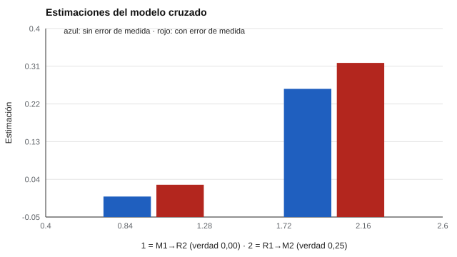

# 148 — Motivación académica


<!-- NAV -->
[← 147 — Estrategias metacognitivas y autorregulación…](../147-estrategias-metacognitivas-y-autorregulacion-del-aprendizaje/README.md) · [📚 Parte 14](../README.md) · [🗺️ Índice 001–200](../../../PROGRAMA.md) · [149 — Habilidades digitales del estudiantado →](../149-habilidades-digitales-del-estudiantado/README.md)
<!-- /NAV -->

**Parte 14 — Aprendizaje, aptitudes y dificultades escolares** · Nivel avanzado · 4 h · Estado `escrita`
**Pensada para:** quien investiga o evalúa motivación escolar, y quien lee estudios del tipo «la motivación mejora las notas».
**Prerrequisitos:** clases 021 y 175.

> Simulación con un mecanismo simple.

## ¿Para qué te sirve esto?

«Los estudiantes más motivados rinden más.» ¿Es la motivación la que mejora el rendimiento, o el buen rendimiento el que motiva? Probablemente ambas cosas. Para estudiarlo se miden motivación y rendimiento en **dos momentos** y se estima el efecto cruzado (motivación 1 → rendimiento 2, y rendimiento 1 → motivación 2). Esta clase te muestra una trampa: si la motivación se mide con **error**, aparece un **efecto espurio** de la motivación y se **sobreestima** el efecto del éxito sobre la motivación.

## Al terminar esta clase podrás

- Distinguir modelos de motivación (expectativa–valor, autodeterminación).
- Estimar efectos cruzados entre motivación y rendimiento.
- Reconocer el sesgo por error de medida.

## La idea en palabras simples

Las teorías de **expectativa–valor** (Eccles y Wigfield, 2002) y de **autodeterminación** (Ryan y Deci, 2000) describen cómo creencias y razones se relacionan con el rendimiento. En un diseño de dos ondas, se controla la variable previa para estimar el efecto cruzado. Pero con una medida ruidosa, ese control es **incompleto**: parte de la motivación verdadera queda sin controlar y se atribuye a otra variable correlacionada (Hamaker et al., 2015 discuten las limitaciones de estos modelos).

## Cómo funciona, paso a paso

**1. Simular** 50 000 casos con efecto verdadero éxito → motivación = 0,25 y motivación → rendimiento = 0,00.

**2. Estimar** el modelo cruzado sin error de medida y con fiabilidades 0,7 (motivación) y 0,9 (rendimiento).

**3. Comparar** las estimaciones con la verdad.

**Ejemplo resuelto.** El control de M₁ medida con fiabilidad 0,7 es incompleto: parte de la varianza de la motivación verdadera queda «sin controlar» y se atribuye a R₁, que está correlacionada con ella.



*Figura 1.* Con medidas ruidosas aparece un efecto espurio y se sobreestima el otro.

## Si construyes el instrumento

- Mide motivación con más de un método y con buena fiabilidad.
- Usa modelos con variables latentes o con descomposición entre y dentro de personas.
- No concluyas causalidad con solo dos ondas.
- Considera intervenciones sustentadas en evidencia.

## Si eres evaluado

- Un estudio que dice «la motivación mejora las notas» puede estar sesgado por el error de medida.
- Tu motivación y tu rendimiento se influyen mutuamente.
- Un autoinforme único de motivación tiene límites.

## Qué muestra el laboratorio

| Condición de medida | M₁→R₂ (verdad 0,00) | R₁→M₂ (verdad 0,25) |
|---|---:|---:|
| Sin error de medida | −0,001 | 0,256 |
| Fiabilidad M = 0,7 y R = 0,9 | 0,027 | 0,318 |

**Análisis.** (1) Con medidas ruidosas el control de la variable previa es incompleto. (2) Aparece un efecto espurio pequeño de la motivación sobre el rendimiento. (3) El efecto del éxito sobre la motivación se sobreestima (0,32 frente a 0,25). (4) No se concluye causalidad desde un par de ondas.

## Errores frecuentes

- Concluir que «motivar mejora las notas» desde un estudio de dos ondas.
- Usar un solo autoinforme de motivación.
- Ignorar efectos entre y dentro de personas.
- No considerar el error de medida en los modelos cruzados.

## Lo mínimo que debes llevarte

1. Motivación y rendimiento se influyen mutuamente.
2. Los modelos cruzados son sensibles al error de medida.
3. El error genera efectos espurios y sesgo.
4. Dos ondas no bastan para concluir causalidad.

## Ejercicios

- **Inicial.** ¿Qué es un efecto cruzado? *Solución: el efecto de una variable medida antes sobre otra medida después.*
- **Intermedio.** ¿Qué pasa si M tiene fiabilidad 0,5? *Solución: mayor sesgo.*
- **Avanzado.** Cambia el efecto verdadero M → R a 0,15 y observa la estimación.
- **Aplicación.** Diseña un estudio de tres ondas con medidas múltiples de motivación.

## Glosario

- **Expectativa–valor:** modelo según el cual el esfuerzo depende de la expectativa de éxito y del valor de la tarea.
- **Autodeterminación:** teoría de motivaciones intrínseca y extrínseca.
- **Modelo cruzado (cross-lagged):** efectos de variables medidas en un momento sobre otras en el siguiente.
- **Variable latente:** constructo no observado directamente, que se infiere de varios indicadores.

## Laboratorio

```bash
python classes/part-14-aprendizaje-aptitudes-y-dificultades-escolares/148-motivacion-academica/lab.py
python classes/part-14-aprendizaje-aptitudes-y-dificultades-escolares/figuras.py
```

## Autoevaluación y criterios

1. ¿Qué diseño sostiene mejor una conclusión causal? 2. ¿Cómo medirías motivación con más de un método? 3. ¿Qué intervención sustentada en evidencia conoces?
Se logra la clase si identificas el sesgo por error de medida en un modelo cruzado.

## Bibliografía

- Eccles, J. S., & Wigfield, A. (2002). Motivational beliefs, values, and goals. *Annual Review of Psychology*, 53, 109-132. ✅ [DOI](https://doi.org/10.1146/annurev.psych.53.100901.135153)
- Ryan, R. M., & Deci, E. L. (2000). Self-determination theory and the facilitation of intrinsic motivation, social development, and well-being. *American Psychologist*, 55(1), 68-78. ✅ [DOI](https://doi.org/10.1037/0003-066x.55.1.68)
- Hamaker, E. L., Kuiper, R. M., & Grasman, R. P. P. P. (2015). A critique of the cross-lagged panel model. *Psychological Methods*, 20(1), 102-116. ✅ [DOI](https://doi.org/10.1037/a0038889)

Leyenda: ✅ existe en Crossref con título y año coincidentes (enlace al DOI); ⚠️ hay una obra de título parecido con otro año (no se enlaza: comprobar la edición); 🔎 no verificada automáticamente (libros sin DOI, normas y sitios web). Crossref confirma la existencia de la fuente, no que respalde cada afirmación de la clase. Ver [`docs/VERIFICACION_BIBLIOGRAFIA.md`](../../../docs/VERIFICACION_BIBLIOGRAFIA.md).

---

<!-- NAV -->
[← 147 — Estrategias metacognitivas y autorregulación…](../147-estrategias-metacognitivas-y-autorregulacion-del-aprendizaje/README.md)  
[📚 Parte 14](../README.md) · [🗺️ Índice 001–200](../../../PROGRAMA.md)  
[149 — Habilidades digitales del estudiantado →](../149-habilidades-digitales-del-estudiantado/README.md)
<!-- /NAV -->
