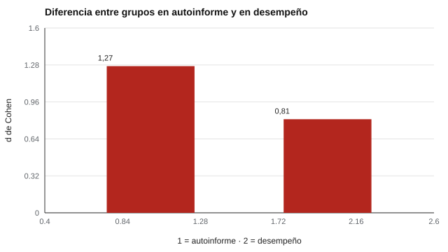

# 149 — Habilidades digitales del estudiantado


<!-- NAV -->
[← 148 — Motivación académica](../148-motivacion-academica/README.md) · [📚 Parte 14](../README.md) · [🗺️ Índice 001–200](../../../PROGRAMA.md) · [150 — Evaluación de apoyos educativos y evaluación… →](../150-evaluacion-de-apoyos-educativos-y-evaluacion-inclusiva/README.md)
<!-- /NAV -->

**Parte 14 — Aprendizaje, aptitudes y dificultades escolares** · Nivel avanzado · 4 h · Estado `escrita`
**Pensada para:** quien evalúa competencia digital, y estudiantes o familias que reciben resultados.
**Prerrequisitos:** clases 045 y 141.

> Datos sintéticos. La versión vigente del marco de competencias se consulta en su fuente.

## ¿Para qué te sirve esto?

«Los jóvenes son nativos digitales.» Si les preguntas, muchos dirán que son muy buenos con la tecnología. Pero la **confianza** no es lo mismo que la **habilidad**, y la confianza varía según el contexto: quienes han tenido más acceso suelen sentirse más seguros. Si se usa solo el autoinforme, la brecha entre grupos **se exagera**. Esta clase te enseña a contrastar autoinforme y desempeño, y a no atribuir las brechas a la persona.

## Al terminar esta clase podrás

- Contrastar autoinforme y desempeño en habilidades digitales.
- Reconocer sesgos de confianza distintos entre grupos.
- Relacionar una evaluación con un marco de competencias.

## La idea en palabras simples

Los marcos de competencia digital (por ejemplo **DigComp**; Carretero, Vuorikari y Punie, 2017) organizan áreas como información, comunicación, creación de contenido, seguridad y resolución de problemas. Los autoinformes de habilidad digital correlacionan solo moderadamente con el desempeño (Hargittai, 2005). Una tarea de desempeño es más informativa, aunque más costosa y sensible al dispositivo y la conectividad.

## Cómo funciona, paso a paso

**1. Simular** 4 000 estudiantes, 60 % con acceso previo (confianza mayor).

**2. Medir** autoinforme y desempeño, y la correlación entre ambos.

**3. Comparar** la diferencia entre grupos (d) en cada medida.

**Ejemplo resuelto.** Dos estudiantes con igual habilidad: el del grupo con acceso se autoevalúa 0,7 puntos más alto por confianza. Un cribado por autoinforme los clasifica distinto.



*Figura 1.* La diferencia es mayor en autoinforme: la confianza se suma a la habilidad.

## Si construyes el instrumento

- Incluye tareas de desempeño además del autoinforme.
- Garantiza equidad de acceso a dispositivos y conectividad durante la evaluación.
- Relaciona cada tarea con un área de un marco de competencias.
- Describe la brecha sin culpar al estudiante.

## Si eres evaluado

- Sentirte «bueno con la tecnología» no es lo mismo que serlo en una tarea concreta, y viceversa.
- Un puntaje bajo en una tarea puede reflejar poco acceso previo.
- Pide que las tareas funcionen con los dispositivos que tienes.

## Qué muestra el laboratorio

| Medida | Valor |
|---|---:|
| Correlación autoinforme – desempeño | 0,68 |
| Diferencia entre grupos (d), autoinforme | 1,27 |
| Diferencia entre grupos (d), desempeño | 0,81 |
| Se creen «altos» pero rinden «bajo» / al revés | 1,6 % / 1,8 % |

**Análisis.** (1) El autoinforme mezcla habilidad con confianza, y la confianza difiere por contexto. (2) Una diferencia entre grupos en autoinforme no equivale a una diferencia de habilidad. (3) Una tarea de desempeño es más informativa. (4) Medir habilidades digitales implica considerar acceso y brechas: describir no es culpar.

## Errores frecuentes

- Interpretar brechas como falta de interés o de capacidad.
- Asumir que «nativo digital» equivale a competente.
- Usar tareas de desempeño que dependen del dispositivo o la conectividad.
- Basarse solo en el autoinforme.

## Lo mínimo que debes llevarte

1. Autoinforme y desempeño correlacionan moderadamente.
2. La confianza difiere entre grupos.
3. Las brechas se explican por contexto y acceso.
4. Un marco de competencias organiza la evaluación.

## Ejercicios

- **Inicial.** ¿Qué áreas tiene un marco de competencia digital? *Solución: información, comunicación, creación de contenido, seguridad y resolución de problemas.*
- **Intermedio.** Si d(auto) = 1,27 y d(desempeño) = 0,81, ¿cuánta diferencia aparente es confianza? *Solución: ≈ 0,46 DE.*
- **Avanzado.** Elimina la diferencia de confianza en `lab.py` y compara los d.
- **Aplicación.** Diseña una tarea de desempeño para el área de seguridad digital.

## Glosario

- **Competencia digital:** conjunto de habilidades para usar tecnologías de forma crítica y segura.
- **DigComp:** marco europeo de competencia digital.
- **Autoinforme:** lo que la persona dice de sí misma.
- **Brecha digital:** diferencias de acceso y uso.

## Laboratorio

```bash
python classes/part-14-aprendizaje-aptitudes-y-dificultades-escolares/149-habilidades-digitales-del-estudiantado/lab.py
python classes/part-14-aprendizaje-aptitudes-y-dificultades-escolares/figuras.py
```

## Autoevaluación y criterios

1. ¿Qué tarea de desempeño diseñarías? 2. ¿Cómo garantizas equidad de acceso en la evaluación? 3. ¿Qué haces con la brecha encontrada?
Se logra la clase si contrastas ambas medidas y evitas atribuir brechas a la persona.

## Bibliografía

- Carretero, S., Vuorikari, R., & Punie, Y. (2017). *DigComp 2.1: The Digital Competence Framework for Citizens*. Joint Research Centre, European Commission. 🔎 sin verificar (libro, norma o sitio no hallado en Crossref: comprobar a mano)
- Hargittai, E. (2005). Survey measures of web-oriented digital literacy. *Social Science Computer Review*, 23(3), 371-379. ✅ [DOI](https://doi.org/10.1177/0894439305275911)

Leyenda: ✅ existe en Crossref con título y año coincidentes (enlace al DOI); ⚠️ hay una obra de título parecido con otro año (no se enlaza: comprobar la edición); 🔎 no verificada automáticamente (libros sin DOI, normas y sitios web). Crossref confirma la existencia de la fuente, no que respalde cada afirmación de la clase. Ver [`docs/VERIFICACION_BIBLIOGRAFIA.md`](../../../docs/VERIFICACION_BIBLIOGRAFIA.md).

---

<!-- NAV -->
[← 148 — Motivación académica](../148-motivacion-academica/README.md)  
[📚 Parte 14](../README.md) · [🗺️ Índice 001–200](../../../PROGRAMA.md)  
[150 — Evaluación de apoyos educativos y evaluación… →](../150-evaluacion-de-apoyos-educativos-y-evaluacion-inclusiva/README.md)
<!-- /NAV -->
