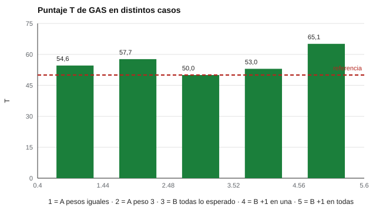

# 150 — Evaluación de apoyos educativos y evaluación inclusiva


<!-- NAV -->
[← 149 — Habilidades digitales del estudiantado](../149-habilidades-digitales-del-estudiantado/README.md) · [📚 Parte 14](../README.md) · [🗺️ Índice 001–200](../../../PROGRAMA.md) · [151 — Teoría de intereses de Holland →](../../part-15-orientacion-vocacional-y-competencias-profesionales/151-teoria-de-intereses-de-holland/README.md)
<!-- /NAV -->

**Parte 14 — Aprendizaje, aptitudes y dificultades escolares** · Nivel avanzado · 4 h · Estado `escrita`
**Pensada para:** quien define metas individuales de apoyo, y familias y estudiantes que las acuerdan.
**Prerrequisitos:** clases 069 y 137.

> ρ = 0,3 es una convención histórica. El T depende de ρ y de los pesos.

## ¿Para qué te sirve esto?

Cuando un estudiante recibe apoyos, las metas son individuales: «mantener la atención 10 minutos», «pedir ayuda con una frase». No hay una prueba estándar para eso. El **escalamiento de logro de metas (GAS)** permite seguir metas individualizadas y resumir los logros en un puntaje T. Pero ese puntaje se malinterpreta fácilmente: T = 50 significa «se logró lo esperado», no dice nada sobre el nivel de partida ni permite comparar estudiantes. Esta clase te enseña a calcularlo y a interpretarlo con cautela.

## Al terminar esta clase podrás

- Calcular el puntaje T de escalamiento de logro de metas (GAS).
- Entender su sensibilidad a los pesos y su no comparabilidad entre estudiantes.
- Relacionar la evaluación con el diseño universal para el aprendizaje.

## La idea en palabras simples

El **diseño universal para el aprendizaje** (CAST, 2018) busca ofrecer múltiples formas de representación, acción y compromiso para reducir la necesidad de ajustes individuales. Para metas individuales se usa **GAS** (Kiresuk y Sherman, 1968; Turner-Stokes, 2009): cada meta se redacta con niveles de −2 a +2 (0 = lo esperado). El puntaje T resume los logros ponderados:

```
T = 50 + 10·Σ(wᵢxᵢ) / √( (1 − ρ)Σwᵢ² + ρ(Σwᵢ)² ),   ρ = 0,3
```

## Cómo funciona, paso a paso

**1. Redactar** cada meta con cinco niveles observables (−2 a +2).

**2. Acordar** con la familia y el estudiante los pesos antes de medir.

**3. Registrar** el logro de cada meta y calcular T.

**Ejemplo resuelto.** Tres metas con peso 1 y logros (0, +1, 0): numerador = 1; denominador = √(0,7·3 + 0,3·9) = √4,8 = 2,19; T = 50 + 10 · 0,456 = 54,6.



*Figura 1.* T = 50 es lo esperado; el peso y la cantidad de metas cambian el resultado.

## Si construyes el instrumento

- Redacta metas observables y alcanzables, con niveles claros.
- Fija los pesos antes de ver los resultados.
- No compares el T entre estudiantes: las metas y su dificultad son distintas.
- Complementa con la evaluación del progreso curricular, sin reemplazarla.

## Si eres evaluado (o eres la familia)

- T = 50 significa que se logró lo esperado en las metas fijadas, no un nivel «promedio».
- Participa en la redacción de las metas.
- Pregunta qué apoyos universales podrían reducir los ajustes individuales.

## Qué muestra el laboratorio

| Caso | T |
|---|---:|
| A: logros (0, +1, 0), pesos iguales | 54,6 |
| A: logros (0, +1, 0), peso 3 en la meta 2 | 57,7 |
| A: logros (+1, 0, 0), peso 3 en la meta 1 | 57,7 |
| B: 5 metas, todas «lo esperado» | 50,0 |
| B: +1 en una sola meta | 53,0 |
| B: +1 en todas | 65,1 |

**Análisis.** (1) T = 50 no dice nada sobre el nivel de partida ni la dificultad de las metas. (2) No permite comparar estudiantes. (3) Es útil para seguir el logro de objetivos individualizados con redacción observable y acuerdo con la familia. (4) El T depende de ρ y de los pesos.

## Errores frecuentes

- Comparar el T de dos estudiantes.
- Fijar metas poco observables o inalcanzables.
- Cambiar los pesos después de ver los resultados.
- Usar GAS como sustituto de la evaluación del progreso curricular.

## Lo mínimo que debes llevarte

1. GAS sigue metas individuales con niveles −2 a +2.
2. T = 50 es «lo esperado».
3. T no se compara entre estudiantes.
4. Los pesos y ρ influyen en el resultado.

## Ejercicios

- **Inicial.** ¿Qué significa T = 50 en GAS? *Solución: que se logró lo esperado en las metas fijadas.*
- **Intermedio.** Un solo logro +2 y una sola meta de peso 1. *Solución: 50 + 10·2/√(0,7 + 0,3) = 70.*
- **Avanzado.** Redacta tres metas observables con niveles −2 a +2 para un estudiante.
- **Aplicación.** Acuerda (con un colega) los pesos de tres metas antes de medir y calcula T.

## Glosario

- **GAS:** escalamiento de logro de metas.
- **Puntaje T:** puntaje con media 50 y desviación 10.
- **DUA:** diseño universal para el aprendizaje.
- **Meta observable:** meta cuyo logro se puede registrar sin interpretaciones.

## Laboratorio

```bash
python classes/part-14-aprendizaje-aptitudes-y-dificultades-escolares/150-evaluacion-de-apoyos-educativos-y-evaluacion-inclusiva/lab.py
python classes/part-14-aprendizaje-aptitudes-y-dificultades-escolares/figuras.py
```

## Autoevaluación y criterios

1. ¿Cómo acuerdas las metas con la familia y el estudiante? 2. ¿Cómo evitas el efecto techo? 3. ¿Qué apoyos universales reducirían los ajustes individuales?
Se logra la clase si redactas metas medibles y calculas e interpretas el T con cautela.

## Bibliografía

- Kiresuk, T. J., & Sherman, R. E. (1968). Goal attainment scaling: A general method for evaluating comprehensive community mental health programs. *Community Mental Health Journal*, 4(6), 443-453. [DOI](https://doi.org/10.1007/bf01530764)
- Turner-Stokes, L. (2009). Goal attainment scaling (GAS) in rehabilitation: A practical guide. *Clinical Rehabilitation*, 23(4), 362-370. [DOI](https://doi.org/10.1177/0269215508101742)
- CAST (2018). *Universal Design for Learning Guidelines* (versión 2.2). CAST.

---

<!-- NAV -->
[← 149 — Habilidades digitales del estudiantado](../149-habilidades-digitales-del-estudiantado/README.md)  
[📚 Parte 14](../README.md) · [🗺️ Índice 001–200](../../../PROGRAMA.md)  
[151 — Teoría de intereses de Holland →](../../part-15-orientacion-vocacional-y-competencias-profesionales/151-teoria-de-intereses-de-holland/README.md)
<!-- /NAV -->
