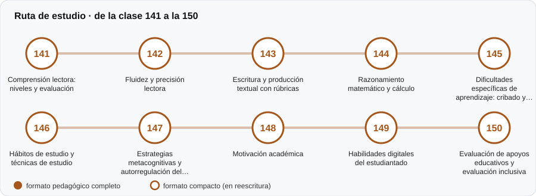

# 📖 Parte 14 — Aprendizaje, aptitudes y dificultades escolares

**Nivel:** avanzado · **Duración estimada:** 4-5 semanas · **Clases:** 10

## De qué trata

Lectura, escritura, matemática y dificultades de aprendizaje desde una óptica pedagógica.

## Por qué importa

Detectar a tiempo y apoyar bien cambia trayectorias escolares; etiquetar mal también las cambia.

## Según tu papel

- **Si construyes o aplicas instrumentos:** Evaluación de comprensión, fluidez, escritura y razonamiento, con rúbricas.
- **Si eres evaluado o recibes resultados:** Para estudiantes y familias: qué se evalúa y cómo se usa el resultado para apoyar.

## Al terminar esta parte podrás

- Evaluar comprensión lectora por niveles.
- Explicar qué es y qué no es un cribado de dificultades.

## Cómo estudiarla

Después de la parte 13.

## Ruta de estudio

## Clases en orden de estudio

Las clases están numeradas de forma consecutiva (001 a 200) en el orden de estudio: sigue el número.

| Orden | ID | Clase | Qué aprenderás | Formato | Horas |
|---:|---|---|---|---|---:|
| 1 | 141 | [Comprensión lectora: niveles y evaluación](141-comprension-lectora-niveles-y-evaluacion/README.md) | Describir niveles de comprensión (literal, inferencial, crítico). | ✅ pedagógico | 4 |
| 2 | 142 | [Fluidez y precisión lectora](142-fluidez-y-precision-lectora/README.md) | Calcular el error de medida de las palabras correctas por minuto (PCM). | ✅ pedagógico | 4 |
| 3 | 143 | [Escritura y producción textual con rúbricas](143-escritura-y-produccion-textual-con-rubricas/README.md) | Diseñar una rúbrica analítica. | ✅ pedagógico | 4 |
| 4 | 144 | [Razonamiento matemático y cálculo](144-razonamiento-matematico-y-calculo/README.md) | Controlar la dificultad de un ítem de cálculo por sus características. | ✅ pedagógico | 4 |
| 5 | 145 | [Dificultades específicas de aprendizaje: cribado y derivación](145-dificultades-especificas-de-aprendizaje-cribado-y-derivacion/README.md) | Estimar la pendiente de progreso con monitoreo semanal. | ✅ pedagógico | 4 |
| 6 | 146 | [Hábitos de estudio y técnicas de estudio](146-habitos-de-estudio-y-tecnicas-de-estudio/README.md) | Distinguir técnicas de estudio con respaldo de las populares sin él. | ✅ pedagógico | 4 |
| 7 | 147 | [Estrategias metacognitivas y autorregulación del aprendizaje](147-estrategias-metacognitivas-y-autorregulacion-del-aprendizaje/README.md) | Medir la calibración entre confianza y desempeño. | ✅ pedagógico | 4 |
| 8 | 148 | [Motivación académica](148-motivacion-academica/README.md) | Distinguir modelos de motivación (expectativa–valor, autodeterminación). | ✅ pedagógico | 4 |
| 9 | 149 | [Habilidades digitales del estudiantado](149-habilidades-digitales-del-estudiantado/README.md) | Contrastar autoinforme y desempeño en habilidades digitales. | ✅ pedagógico | 4 |
| 10 | 150 | [Evaluación de apoyos educativos y evaluación inclusiva](150-evaluacion-de-apoyos-educativos-y-evaluacion-inclusiva/README.md) | Calcular el puntaje T de escalamiento de logro de metas (GAS). | ✅ pedagógico | 4 |

[← Volver al índice del programa](../../README.md) · [Índice numérico de las 200 clases](../../PROGRAMA.md)
