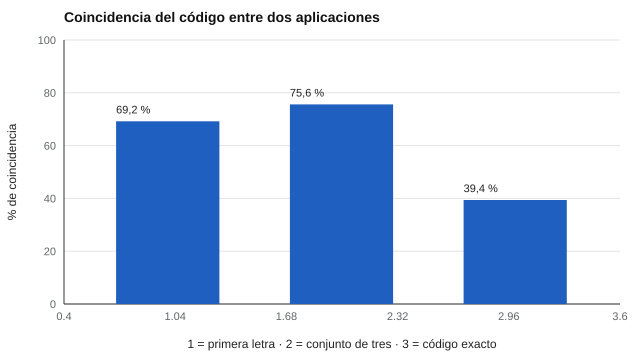

# 151 — Teoría de intereses de Holland


<!-- NAV -->
[← 150 — Evaluación de apoyos educativos y evaluación…](../../part-14-aprendizaje-aptitudes-y-dificultades-escolares/150-evaluacion-de-apoyos-educativos-y-evaluacion-inclusiva/README.md) · [📚 Parte 15](../README.md) · [🗺️ Índice 001–200](../../../PROGRAMA.md) · [152 — Intereses y O*NET Interest Profiler →](../152-intereses-y-o-net-interest-profiler/README.md)
<!-- /NAV -->

**Parte 15 — Orientación vocacional y competencias profesionales** · Nivel intermedio · 4 h · Estado `escrita`
**Pensada para:** quien usa un test de intereses en orientación, y quien recibe un «código Holland».
**Prerrequisitos:** clases 044 y 107.

> La adaptación `onet-riasec-sf` tiene **validación pendiente** (ver `DISCLAIMER.md`): sirve para aprender, no para decidir sobre personas. Datos sintéticos.

## ¿Para qué te sirve esto?

«Tu código es SEA: Social, Emprendedor, Artístico.» Los tests de intereses vocacionales entregan un código de tres letras y, con él, ocupaciones sugeridas. Pero ¿cuán estable es ese código? Si respondes dos veces, ¿te sale el mismo? Esta clase usa el **instrumento real del repositorio** con el motor para mostrarte que el **código exacto cambia en 6 de cada 10 personas**, mientras que el conjunto de letras y la primera letra son más estables. La conclusión práctica: se conversa con el perfil completo, no se decide por tres letras.

## Al terminar esta clase podrás

- Describir los seis tipos RIASEC y el código de tres letras.
- Puntuar un instrumento real del repositorio con el motor.
- Cuantificar la estabilidad del código ante el error de respuesta.

## La idea en palabras simples

Holland (1997) propone seis tipos de intereses (**R**ealista, **I**nvestigador, **A**rtístico, **S**ocial, **E**mprendedor, **C**onvencional) dispuestos en un **hexágono**: los adyacentes se parecen más que los opuestos. Describe personas y ambientes con un **código de tres letras** (los tres tipos más altos, en orden). La estructura circular es una predicción falsable (Rounds y Tracey, 1993; Nauta, 2010 revisa el estado de la teoría).

## Cómo funciona, paso a paso

**1. Puntuar** el instrumento `onet-riasec-sf` (60 ítems) con el motor del repositorio.

**2. Simular** 500 personas que responden dos veces con ruido de respuesta (DE 1,0).

**3. Comparar** el código de las dos aplicaciones: primera letra, conjunto de tres y código exacto.

**Ejemplo resuelto.** Medias por escala S = 4,1; E = 4,0; A = 3,9; I = 2,5; R = 2,2; C = 2,0: código SEA. Con error de ±0,2, E y S pueden intercambiarse: el conjunto {S, E, A} es estable, el orden no.



*Figura 1.* El código exacto es la lectura más inestable.

## Si construyes el instrumento

- Presenta el perfil de las seis escalas, no solo el código.
- Informa la estabilidad esperada del código.
- Distingue interés de capacidad.
- Si adaptas un instrumento, declara su estado de validación.

## Si eres evaluado

- Tu código puede cambiar si repites la prueba; el conjunto de intereses es más estable.
- Un interés no es una capacidad ni una garantía de satisfacción.
- Úsalo para explorar, no para cerrar opciones.

## Qué muestra el laboratorio

`lab.py` puntúa `onet-riasec-sf` (60 ítems, licencia O\*NET Tools Developer) con 500 personas simuladas que responden dos veces.

| Coincidencia entre aplicaciones | Valor |
|---|---:|
| Primera letra | 69,2 % |
| Conjunto de tres letras | 75,6 % |
| Código exacto | 39,4 % |

Ejemplo: SEA en una aplicación y ESA en la otra.

**Análisis.** (1) El código exacto es la lectura más inestable; la primera letra y el conjunto son más estables. (2) Por eso se presenta el perfil completo y se conversa. (3) Los intereses orientan la exploración; no determinan capacidades, desempeño ni oportunidades. (4) La estructura hexagonal se asumió en la simulación.

## Errores frecuentes

- Decidir una carrera por el código.
- Interpretar interés como capacidad.
- Usar la adaptación con validación pendiente para decisiones.
- Presentar el código como una característica fija de la persona.

## Lo mínimo que debes llevarte

1. RIASEC: seis tipos en un hexágono.
2. El código de tres letras resume los tres tipos más altos.
3. El código exacto es inestable; el conjunto es más estable.
4. Los intereses orientan, no deciden.

## Ejercicios

- **Inicial.** ¿Qué letras son adyacentes a R en el hexágono? *Solución: I y C.*
- **Intermedio.** ¿Cuántos códigos de tres letras ordenados existen con 6 tipos? *Solución: 6·5·4 = 120.*
- **Avanzado.** Reduce el ruido a 0,5 en `lab.py` y observa las coincidencias.
- **Aplicación.** Redacta cómo presentarías un perfil RIASEC a un estudiante de enseñanza media.

## Glosario

- **RIASEC:** los seis tipos de intereses de Holland.
- **Código Holland:** las tres letras de los tipos más altos.
- **Hexágono:** disposición circular de los seis tipos.
- **Interés:** preferencia por actividades, distinta de capacidad.

## Laboratorio

```bash
python classes/part-15-orientacion-vocacional-y-competencias-profesionales/151-teoria-de-intereses-de-holland/lab.py
python classes/part-15-orientacion-vocacional-y-competencias-profesionales/figuras.py
```

## Autoevaluación y criterios

1. ¿Cómo presentarías un perfil a un estudiante? 2. ¿Qué información adicional recogerías? 3. ¿Qué límites tiene un test de intereses?
Se logra la clase si usas el motor, cuantificas la estabilidad y matizas el uso.

## Bibliografía

- Holland, J. L. (1997). *Making Vocational Choices* (3.ª ed.). Psychological Assessment Resources.
- Rounds, J., & Tracey, T. J. (1993). Prediger's dimensional representation of Holland's RIASEC circumplex. *Journal of Applied Psychology*, 78(6), 875-890. [DOI](https://doi.org/10.1037//0021-9010.78.6.875)
- Nauta, M. M. (2010). The development, evolution, and status of Holland's theory of vocational personalities. *Journal of Counseling Psychology*, 57(1), 11-22. [DOI](https://doi.org/10.1037/a0018213)

---

<!-- NAV -->
[← 150 — Evaluación de apoyos educativos y evaluación…](../../part-14-aprendizaje-aptitudes-y-dificultades-escolares/150-evaluacion-de-apoyos-educativos-y-evaluacion-inclusiva/README.md)  
[📚 Parte 15](../README.md) · [🗺️ Índice 001–200](../../../PROGRAMA.md)  
[152 — Intereses y O*NET Interest Profiler →](../152-intereses-y-o-net-interest-profiler/README.md)
<!-- /NAV -->
