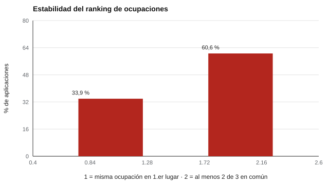

# 152 — Intereses y O\*NET Interest Profiler


<!-- NAV -->
[← 151 — Teoría de intereses de Holland](../151-teoria-de-intereses-de-holland/README.md) · [📚 Parte 15](../README.md) · [🗺️ Índice 001–200](../../../PROGRAMA.md) · [153 — Valores laborales y de vida →](../153-valores-laborales-y-de-vida/README.md)
<!-- /NAV -->

**Parte 15 — Orientación vocacional y competencias profesionales** · Nivel intermedio · 4 h · Estado `escrita`
**Pensada para:** quien construye o usa listados de ocupaciones a partir de intereses, y quien los recibe.
**Prerrequisitos:** clase 151.

> Las ocupaciones y sus perfiles del laboratorio son **inventados**. La adaptación `onet-riasec-sf` tiene una obligación de validación pendiente declarada en su ficha: no se usa para decidir.

## ¿Para qué te sirve esto?

«Con tu perfil te recomendamos: docente, orientador, enfermero.» Un perfil de intereses se puede cruzar con ocupaciones. Pero ¿cuán estable es ese ranking? Y, antes, ¿de dónde viene el instrumento y bajo qué licencia se puede usar? Esta clase te enseña a **leer la ficha de procedencia y licencia** de un instrumento adaptado, y te muestra que la ocupación en 1.er lugar es la misma en menos de **un tercio** de las aplicaciones, por eso se entrega un **listado de opciones a explorar**, no una «ocupación ideal».

## Al terminar esta clase podrás

- Leer la ficha de procedencia y licencia de un instrumento adaptado.
- Relacionar un perfil de intereses con ocupaciones.
- Medir la estabilidad del ranking de ocupaciones.

## La idea en palabras simples

El *O\*NET Interest Profiler* es una herramienta del Departamento del Trabajo de EE. UU. (fuente primaria: onetcenter.org). `onet-riasec-sf` es una **adaptación propia** al español con licencia *O\*NET Tools Developer* y una **obligación de validación pendiente** para contenido modificado (sección 3(b)). Por eso la ficha declara qué se modificó y qué falta. Armstrong et al. (2008) sitúan el modelo RIASEC como marco integrador de diferencias individuales. Para relacionar un perfil con una ocupación se correlacionan sus seis valores.

## Cómo funciona, paso a paso

**1. Leer** la ficha: procedencia, licencia, modificaciones y validación pendiente.

**2. Correlacionar** el perfil de la persona con el de 12 ocupaciones ficticias.

**3. Repetir** con error de medida (escala de 10 ítems; DE 0,20) para ver la estabilidad del ranking.

**Ejemplo resuelto.** La correlación entre el perfil de una persona (S alto, I medio) y el de «docente» es 0,92; con «contador», 0,15. El orden de dos ocupaciones cercanas se invierte con poco error.



*Figura 1.* El «top 3» es más estable que el «top 1».

## Si construyes el instrumento

- Cita siempre la fuente primaria, la licencia y la fecha de los datos de ocupaciones.
- Declara las modificaciones y las obligaciones pendientes.
- Entrega «opciones a explorar», no una ocupación ideal.
- Usa datos locales del mercado laboral cuando existan.

## Si eres evaluado

- Un listado de ocupaciones es un punto de partida para conversar.
- Si el instrumento tiene validación pendiente, no debería usarse para decisiones.
- Pregunta de dónde salen los datos de las ocupaciones.

## Qué muestra el laboratorio

El laboratorio lee la ficha de `onet-riasec-sf` (licencia O-NET-Tools-Developer, fuente onetcenter.org) y muestra sus notas: *modificaciones_y_descargo*, *validacion_de_licencia_pendiente*, *marco*, *codigo_holland* y *traduccion* (sin estudio de equivalencia transcultural).

| Estabilidad entre dos aplicaciones | Valor |
|---|---:|
| Misma ocupación en el 1.er lugar | 33,9 % |
| Al menos 2 de 3 ocupaciones en común | 60,6 % |

**Análisis.** (1) El ranking exacto de ocupaciones es inestable. (2) Un listado de opciones a explorar es más honesto que una «ocupación ideal». (3) La adaptación tiene una validación pendiente declarada. (4) Las ocupaciones son ficticias.

## Errores frecuentes

- Presentar una ocupación como «la ideal».
- Citar datos de ocupaciones sin su fuente y fecha.
- Usar un instrumento con validación pendiente para decisiones.
- Ignorar la licencia y sus obligaciones.

## Lo mínimo que debes llevarte

1. Un instrumento adaptado tiene procedencia, licencia y obligaciones.
2. El perfil se cruza con ocupaciones por similitud.
3. El «top 1» es inestable; el «top 3», más.
4. Se entregan opciones a explorar.

## Ejercicios

- **Inicial.** ¿Qué dice la sección de validación pendiente de la ficha? *Solución: que falta el estudio de validación exigido por la licencia para contenido modificado.*
- **Intermedio.** ¿Por qué un «top 3» es más estable que un «top 1»? *Solución: porque tolera cambios de orden entre las primeras opciones.*
- **Avanzado.** Agrega tres ocupaciones ficticias y observa la estabilidad.
- **Aplicación.** Redacta un párrafo que presente un listado de ocupaciones como opciones a explorar.

## Glosario

- **Adaptación:** versión modificada de un instrumento de otra fuente.
- **Licencia:** condiciones de uso de un instrumento.
- **Validación pendiente:** estudio exigido que aún no se ha hecho.
- **Opciones a explorar:** listado orientativo, no una recomendación cerrada.

## Laboratorio

```bash
python classes/part-15-orientacion-vocacional-y-competencias-profesionales/152-intereses-y-o-net-interest-profiler/lab.py
python classes/part-15-orientacion-vocacional-y-competencias-profesionales/figuras.py
```

## Autoevaluación y criterios

1. ¿Cómo presentarías un listado de opciones a explorar? 2. ¿Qué datos locales del mercado laboral usarías? 3. ¿Cuándo se puede retirar la advertencia de validación?
Se logra la clase si auditas la licencia y presentas resultados como opciones a explorar.

## Bibliografía y fuentes

- O\*NET Resource Center. *O\*NET Interest Profiler* (onetcenter.org). U.S. Department of Labor/ETA.
- Armstrong, P. I., Day, S. X., McVay, J. P., & Rounds, J. (2008). Holland's RIASEC model as an integrative framework for individual differences. *Journal of Counseling Psychology*, 55(1), 1-18. [DOI](https://doi.org/10.1037/0022-0167.55.1.1)
- `instruments/onet-riasec-sf.yaml` y `DISCLAIMER.md` del repositorio.

---

<!-- NAV -->
[← 151 — Teoría de intereses de Holland](../151-teoria-de-intereses-de-holland/README.md)  
[📚 Parte 15](../README.md) · [🗺️ Índice 001–200](../../../PROGRAMA.md)  
[153 — Valores laborales y de vida →](../153-valores-laborales-y-de-vida/README.md)
<!-- /NAV -->
