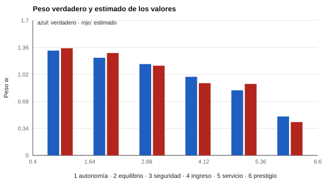

# 153 — Valores laborales y de vida


<!-- NAV -->
[← 152 — Intereses y O*NET Interest Profiler](../152-intereses-y-o-net-interest-profiler/README.md) · [📚 Parte 15](../README.md) · [🗺️ Índice 001–200](../../../PROGRAMA.md) · [154 — Madurez y toma de decisiones vocacionales →](../154-madurez-y-toma-de-decisiones-vocacionales/README.md)
<!-- /NAV -->

**Parte 15 — Orientación vocacional y competencias profesionales** · Nivel intermedio · 4 h · Estado `escrita`
**Pensada para:** quien ayuda a explorar valores en orientación, y quien ordena sus valores en una actividad.
**Prerrequisitos:** clases 107 y 108.

> Datos sintéticos; los pesos verdaderos son supuestos.

## ¿Para qué te sirve esto?

«¿Qué es más importante para ti: la autonomía o la seguridad?» Para conocer qué valora una persona se puede pedir que **compare valores de a pares**. Es más difícil responder «todo es importante» que en una escala Likert, y por eso se evita la aquiescencia. Pero las comparaciones por pares son relativas (quién valora **más**, no **cuánto**), crecen con el cuadrado del número de valores y, con valores de fuerza parecida, el orden exacto es **inestable**. Esta clase te enseña a estimar una escala por pares con el modelo de Bradley–Terry y a informar el orden con su incertidumbre.

## Al terminar esta clase podrás

- Escalar valores a partir de comparaciones por pares.
- Estimar el modelo de Bradley–Terry.
- Evaluar la estabilidad de un ordenamiento de valores.

## La idea en palabras simples

En el modelo de Bradley y Terry (1952), la probabilidad de que el valor *i* supere al *j* en una comparación es **wᵢ / (wᵢ + wⱼ)**. Los pesos *w* se estiman iterativamente (Zermelo, 1929). Con *k* valores hay **k(k − 1)/2** pares. Las comparaciones evitan la aquiescencia, pero la escala resultante es relativa.

## Cómo funciona, paso a paso

**1. Definir** 6 valores y sus 15 pares.

**2. Simular** 60 personas que comparan todos los pares según pesos verdaderos.

**3. Estimar** los pesos y repetir con otras muestras para ver cuán estable es el top 3.

**Ejemplo resuelto.** w₁ = 1,6 y w₂ = 1,0: P(1 supera a 2) = 1,6 / 2,6 = 0,615.



*Figura 1.* El orden estimado coincide, pero los pesos son parecidos entre sí.

## Si construyes el instrumento

- Limita el número de valores para evitar fatiga.
- Informa el grupo de valores más importantes, no el puesto exacto de cada uno.
- Incluye la incertidumbre de la estimación.
- Complementa con otros métodos (ranking, Likert, centrado).

## Si eres evaluado

- Tu orden de valores puede cambiar con pequeñas variaciones; los valores de fuerza parecida se intercambian.
- «Valorar más» no es «valorar mucho».
- Los valores orientan; no predicen por sí solos la satisfacción.

## Qué muestra el laboratorio

| Valor | w verdadero | w estimado | Puesto estimado |
|---|---:|---:|---:|
| Autonomía | 1,32 | 1,35 | 1 |
| Equilibrio | 1,23 | 1,29 | 2 |
| Seguridad | 1,15 | 1,13 | 3 |
| Ingreso | 0,99 | 0,91 | 4 |
| Servicio | 0,82 | 0,90 | 5 |
| Prestigio | 0,49 | 0,42 | 6 |

Repitiendo el estudio con otra muestra de 60, el top 3 coincide con el orden verdadero en solo 34 % de las repeticiones.

**Análisis.** (1) Las comparaciones por pares evitan los sesgos de aquiescencia de la Likert. (2) Pero son relativas y crecen con el cuadrado del número de valores. (3) Con valores de fuerza parecida, el orden exacto es inestable: se informa el grupo, no el puesto. (4) Los pesos verdaderos son supuestos.

## Errores frecuentes

- Informar el puesto exacto de cada valor.
- Interpretar «valorar más» como «valorar mucho».
- Usar comparaciones por pares con muchos valores (fatiga).
- Omitir la incertidumbre.

## Lo mínimo que debes llevarte

1. Bradley–Terry: P(i supera a j) = wᵢ/(wᵢ + wⱼ).
2. El número de pares crece con k(k − 1)/2.
3. Son comparaciones relativas.
4. El orden exacto es inestable cuando los valores se parecen.

## Ejercicios

- **Inicial.** ¿Cuántos pares hay con 8 valores? *Solución: 28.*
- **Intermedio.** Si w₁ = 2 y w₂ = 1. *Solución: P(1 supera a 2) = 0,667.*
- **Avanzado.** Aumenta a 200 personas en `lab.py` y observa la estabilidad del top 3.
- **Aplicación.** Diseña una actividad de 10 comparaciones por pares para una sesión de orientación.

## Glosario

- **Comparación por pares:** elegir entre dos opciones.
- **Bradley–Terry:** modelo de probabilidad de preferencia por pares.
- **Aquiescencia:** tendencia a estar de acuerdo con todo.
- **Escala relativa:** dice cuál es mayor, no cuánto.

## Laboratorio

```bash
python classes/part-15-orientacion-vocacional-y-competencias-profesionales/153-valores-laborales-y-de-vida/lab.py
python classes/part-15-orientacion-vocacional-y-competencias-profesionales/figuras.py
```

## Autoevaluación y criterios

1. ¿Cómo usarías los valores en una conversación de orientación? 2. ¿Qué otros métodos hay (ranking, Likert, centrado)? 3. ¿Cómo informarías la incertidumbre?
Se logra la clase si estimas una escala por pares y comunicas un orden con su incertidumbre.

## Bibliografía

- Bradley, R. A., & Terry, M. E. (1952). Rank analysis of incomplete block designs: I. The method of paired comparisons. *Biometrika*, 39(3-4), 324-345. [DOI](https://doi.org/10.1093/biomet/39.3-4.324)
- Zermelo, E. (1929). Die Berechnung der Turnier-Ergebnisse als ein Maximumproblem der Wahrscheinlichkeitsrechnung. *Mathematische Zeitschrift*, 29, 436-460. [DOI](https://doi.org/10.1007/bf01180541)

---

<!-- NAV -->
[← 152 — Intereses y O*NET Interest Profiler](../152-intereses-y-o-net-interest-profiler/README.md)  
[📚 Parte 15](../README.md) · [🗺️ Índice 001–200](../../../PROGRAMA.md)  
[154 — Madurez y toma de decisiones vocacionales →](../154-madurez-y-toma-de-decisiones-vocacionales/README.md)
<!-- /NAV -->
