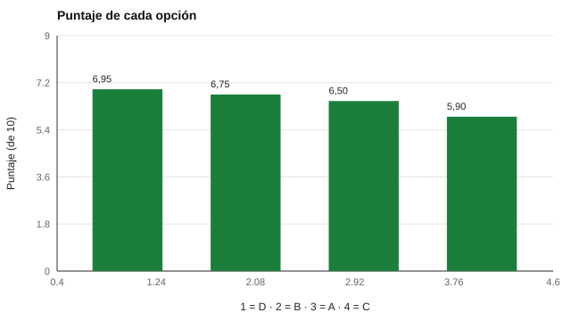

# 154 — Madurez y toma de decisiones vocacionales


<!-- NAV -->
[← 153 — Valores laborales y de vida](../153-valores-laborales-y-de-vida/README.md) · [📚 Parte 15](../README.md) · [🗺️ Índice 001–200](../../../PROGRAMA.md) · [155 — Competencias transversales y empleabilidad →](../155-competencias-transversales-y-empleabilidad/README.md)
<!-- /NAV -->

**Parte 15 — Orientación vocacional y competencias profesionales** · Nivel intermedio · 4 h · Estado `escrita`
**Pensada para:** quien acompaña decisiones de carrera, y quien debe elegir entre opciones.
**Prerrequisitos:** clases 151 y 153.

> Las opciones y números del laboratorio son **inventados**. La persona decide.

## ¿Para qué te sirve esto?

Elegir qué estudiar o dónde trabajar es difícil: falta información, hay valores en conflicto y las opciones se parecen. Un **análisis multicriterio** ordena la conversación: se listan criterios (interés, empleabilidad, costo…), se acuerdan pesos y se puntúa cada opción. Su valor no está en «dar la respuesta» sino en **hacer explícitos los supuestos**. Esta clase te enseña a ver si la opción ganadora es **robusta**: cuando dos opciones quedan cerca, un pequeño cambio de pesos las intercambia y esa fragilidad es información útil.

## Al terminar esta clase podrás

- Estructurar una decisión con un análisis multicriterio.
- Evaluar la sensibilidad del resultado a los pesos.
- Distinguir ayudar a decidir de decidir por la persona.

## La idea en palabras simples

La decisión vocacional puede dificultarse por falta de información, de preparación o por inconsistencias (Gati, Krausz y Osipow, 1996). El **análisis multicriterio** (Keeney y Raiffa, 1976) calcula un puntaje ponderado: **Σ (peso × puntaje)**. El **análisis de sensibilidad** varía los pesos (±30 %) y cuenta con qué frecuencia cada opción queda primera. Savickas (2005) enfatiza que la orientación es una construcción de la persona, no un cálculo del orientador.

## Cómo funciona, paso a paso

**1. Acordar** los criterios y sus pesos con la persona (0,35 / 0,25 / 0,15 / 0,15 / 0,10).

**2. Puntuar** cada opción en cada criterio con fuentes verificables.

**3. Variar** los pesos ±30 % en 5 000 simulaciones.

**Ejemplo resuelto.** Opción D: 8·0,35 + 6·0,25 + 6·0,15 + 7·0,15 + 7·0,10 = 2,8 + 1,5 + 0,9 + 1,05 + 0,7 = 6,95.



*Figura 1.* D y B están a solo 0,20 puntos: la opción ganadora es frágil.

## Si construyes el instrumento

- Que los pesos los fije la persona, no el orientador.
- Que los puntajes de empleabilidad o costo provengan de fuentes verificables.
- Muestra siempre el análisis de sensibilidad.
- Cierra con una conversación sobre qué información falta.

## Si eres evaluado

- El puntaje no decide por ti: tú decides.
- Si dos opciones quedan cerca, es señal de que conviene explorar más.
- Cambiar los pesos y ver qué pasa es parte del ejercicio.

## Qué muestra el laboratorio

| Opción | Puntaje | Probabilidad de quedar primera |
|---|---:|---:|
| D | 6,95 | 88,5 % |
| B | 6,75 | 11,5 % |
| A | 6,50 | 0,0 % |
| C | 5,90 | 0,0 % |

Diferencia entre la primera y la segunda: 0,20 puntos de 10.

**Análisis.** (1) Cuando dos opciones quedan cerca, el «ganador» cambia con pequeñas variaciones de pesos. (2) La decisión es frágil, y eso es información útil. (3) El análisis multicriterio ordena la conversación; no decide por la persona. (4) Los puntajes del laboratorio son inventados.

## Errores frecuentes

- Tratar el puntaje como decisión.
- Pesos impuestos por el orientador.
- Puntajes de empleabilidad o costo sin fuente verificable.
- Omitir el análisis de sensibilidad.

## Lo mínimo que debes llevarte

1. El análisis multicriterio hace explícitos los supuestos.
2. Los pesos los define la persona.
3. La sensibilidad muestra la fragilidad de la decisión.
4. La persona decide.

## Ejercicios

- **Inicial.** ¿Qué es el análisis de sensibilidad? *Solución: ver cómo cambia el resultado al variar los supuestos, como los pesos.*
- **Intermedio.** Si el peso del interés sube a 0,50 y los demás bajan proporcionalmente, ¿favorece a A? *Solución: sí.*
- **Avanzado.** Añade una quinta opción y vuelve a calcular.
- **Aplicación.** Haz un análisis multicriterio de tres opciones reales con una persona y revisa la sensibilidad.

## Glosario

- **Análisis multicriterio:** ordenar opciones según varios criterios ponderados.
- **Peso:** importancia relativa de un criterio.
- **Sensibilidad:** cambio del resultado ante cambios de supuestos.
- **Madurez vocacional:** preparación para tomar decisiones de carrera.

## Laboratorio

```bash
python classes/part-15-orientacion-vocacional-y-competencias-profesionales/154-madurez-y-toma-de-decisiones-vocacionales/lab.py
python classes/part-15-orientacion-vocacional-y-competencias-profesionales/figuras.py
```

## Autoevaluación y criterios

1. ¿Qué información falta para decidir? 2. ¿Qué criterios añadirías? 3. ¿Cómo acompañas una decisión frágil?
Se logra la clase si modelas una decisión y explicas su sensibilidad.

## Bibliografía

- Gati, I., Krausz, M., & Osipow, S. H. (1996). A taxonomy of difficulties in career decision making. *Journal of Counseling Psychology*, 43(4), 510-526. ✅ [DOI](https://doi.org/10.1037/0022-0167.43.4.510)
- Keeney, R. L., & Raiffa, H. (1976). *Decisions with Multiple Objectives*. Wiley. ⚠️ hay una obra de título parecido en Crossref con otro año (1993): comprobar la edición a mano
- Savickas, M. L. (2005). The theory and practice of career construction. En S. D. Brown & R. W. Lent (Eds.), *Career Development and Counseling*. Wiley. 🔎 sin verificar (libro, norma o sitio no hallado en Crossref: comprobar a mano)

Leyenda: ✅ existe en Crossref con título y año coincidentes (enlace al DOI); ⚠️ hay una obra de título parecido con otro año (no se enlaza: comprobar la edición); 🔎 no verificada automáticamente (libros sin DOI, normas y sitios web). Crossref confirma la existencia de la fuente, no que respalde cada afirmación de la clase. Ver [`docs/VERIFICACION_BIBLIOGRAFIA.md`](../../../docs/VERIFICACION_BIBLIOGRAFIA.md).

---

<!-- NAV -->
[← 153 — Valores laborales y de vida](../153-valores-laborales-y-de-vida/README.md)  
[📚 Parte 15](../README.md) · [🗺️ Índice 001–200](../../../PROGRAMA.md)  
[155 — Competencias transversales y empleabilidad →](../155-competencias-transversales-y-empleabilidad/README.md)
<!-- /NAV -->
