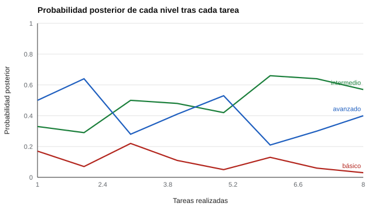

# 155 — Competencias transversales y empleabilidad


<!-- NAV -->
[← 154 — Madurez y toma de decisiones vocacionales](../154-madurez-y-toma-de-decisiones-vocacionales/README.md) · [📚 Parte 15](../README.md) · [🗺️ Índice 001–200](../../../PROGRAMA.md) · [156 — Portafolios de evidencias →](../156-portafolios-de-evidencias/README.md)
<!-- /NAV -->

**Parte 15 — Orientación vocacional y competencias profesionales** · Nivel intermedio · 4 h · Estado `escrita`
**Pensada para:** quien diseña insignias o certificaciones de competencias, y quien las obtiene.
**Prerrequisitos:** clases 111 y 115.

> Parámetros supuestos; en la práctica se calibran con datos.

## ¿Para qué te sirve esto?

«Comunicación», «trabajo en equipo», «resolución de problemas»: las competencias transversales se piden en casi todo trabajo, pero un cuestionario de autopercepción no las demuestra. Se evidencian en **tareas** situadas. La pregunta práctica: **¿cuántas tareas hacen falta para decidir con confianza el nivel de alguien?** Esta clase te enseña a acumular evidencia con una **actualización bayesiana**, a calcular cuántas tareas se necesitan y a declarar el criterio de una insignia o certificación.

## Al terminar esta clase podrás

- Acumular evidencia sobre una competencia con una actualización bayesiana.
- Calcular cuántas tareas se necesitan para un criterio de decisión.
- Declarar el criterio de «insignia» o certificación de competencias.

## La idea en palabras simples

El diseño centrado en la evidencia (Mislevy, Steinberg y Almond, 2003) formaliza cómo cada observación cambia lo que creemos del nivel de competencia; las redes bayesianas (Almond et al., 2015) lo hacen explícito. Con tres niveles y probabilidades supuestas de resolver bien una tarea (0,30; 0,60; 0,90), cada resultado **actualiza** la probabilidad de cada nivel:

**posterior ∝ previo × probabilidad del resultado en ese nivel.**

Se decide cuando un nivel supera un umbral (aquí, 90 %).

## Cómo funciona, paso a paso

**1. Partir** de un previo uniforme sobre tres niveles (básico, intermedio, avanzado).

**2. Actualizar** tras cada tarea (bien o mal).

**3. Decidir** cuando un nivel supera 90 % (hasta 20 tareas).

**Ejemplo resuelto.** Previo uniforme y una tarea bien resuelta: posterior ∝ (0,30; 0,60; 0,90) → (0,17; 0,33; 0,50).



*Figura 1.* La evidencia se acumula, pero con tareas poco discriminantes el avance es lento.

## Si construyes el instrumento

- Usa tareas situadas, con evidencia observable.
- Calibra las probabilidades con datos, no solo con supuestos.
- Declara el criterio de decisión y el máximo de tareas.
- Informa la incertidumbre y qué pasa con quienes quedan sin decisión.

## Si eres evaluado

- Un 90 % de probabilidad posterior no es un 90 % de acierto garantizado.
- Pocas tareas no bastan para decidir un nivel.
- Pregunta cuál es el criterio de la insignia y cuántas oportunidades hay.

## Qué muestra el laboratorio

| Medida | Valor |
|---|---:|
| Tareas necesarias en promedio | 10,6 |
| Clasificados en un nivel equivocado | 8,7 % |
| Sin decisión tras 20 tareas | 13,1 % |

Ejemplo (estudiante de nivel intermedio): tras 8 tareas, posterior intermedio = 0,57; avanzado = 0,40.

**Análisis.** (1) Un 90 % de probabilidad posterior no es un acierto garantizado: depende del modelo supuesto. (2) Con tareas poco discriminantes (0,60 frente a 0,30) hacen falta muchas para separar niveles contiguos. (3) Las insignias exigen evidencia suficiente y un criterio declarado. (4) Las competencias transversales se evidencian en situaciones, no en un cuestionario.

## Errores frecuentes

- Decidir un nivel con 2 o 3 tareas.
- Tratar el 90 % como acierto garantizado.
- Evaluar competencias transversales solo con autopercepción.
- No calibrar los parámetros con datos.

## Lo mínimo que debes llevarte

1. Las competencias transversales se evidencian en tareas.
2. Cada tarea actualiza la probabilidad de cada nivel.
3. El número de tareas depende de qué tan discriminantes sean.
4. El criterio de la insignia se declara.

## Ejercicios

- **Inicial.** ¿Qué es una probabilidad posterior? *Solución: la probabilidad de un nivel después de considerar la evidencia.*
- **Intermedio.** Con previo uniforme y dos tareas mal resueltas. *Solución: ∝ (0,49; 0,16; 0,01) → (0,74; 0,24; 0,02).*
- **Avanzado.** Cambia P(bien) del nivel intermedio a 0,70 y observa tareas necesarias.
- **Aplicación.** Define el criterio de una insignia de «trabajo en equipo» con tipos de tarea y umbral.

## Glosario

- **Competencia transversal:** habilidad útil en muchos puestos (comunicación, equipo).
- **Posterior:** probabilidad actualizada tras la evidencia.
- **Previo:** probabilidad inicial.
- **Insignia:** reconocimiento de una competencia con criterios declarados.

## Laboratorio

```bash
python classes/part-15-orientacion-vocacional-y-competencias-profesionales/155-competencias-transversales-y-empleabilidad/lab.py
python classes/part-15-orientacion-vocacional-y-competencias-profesionales/figuras.py
```

## Autoevaluación y criterios

1. ¿Qué evidencia mínima exiges para una insignia? 2. ¿Cómo equilibras costo y precisión? 3. ¿Cómo informas la incertidumbre?
Se logra la clase si modelas evidencia acumulada y defines un criterio de decisión.

## Bibliografía

- Mislevy, R. J., Steinberg, L. S., & Almond, R. G. (2003). On the structure of educational assessments. *Measurement: Interdisciplinary Research and Perspectives*, 1(1), 3-62. [DOI](https://doi.org/10.1207/s15366359mea0101_02)
- Almond, R. G., Mislevy, R. J., Steinberg, L. S., Yan, D., & Williamson, D. M. (2015). *Bayesian Networks in Educational Assessment*. Springer. [DOI](https://doi.org/10.1007/978-1-4939-2125-6)

---

<!-- NAV -->
[← 154 — Madurez y toma de decisiones vocacionales](../154-madurez-y-toma-de-decisiones-vocacionales/README.md)  
[📚 Parte 15](../README.md) · [🗺️ Índice 001–200](../../../PROGRAMA.md)  
[156 — Portafolios de evidencias →](../156-portafolios-de-evidencias/README.md)
<!-- /NAV -->
