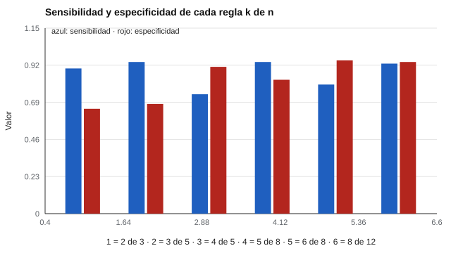

# 156 — Portafolios de evidencias


<!-- NAV -->
[← 155 — Competencias transversales y empleabilidad](../155-competencias-transversales-y-empleabilidad/README.md) · [📚 Parte 15](../README.md) · [🗺️ Índice 001–200](../../../PROGRAMA.md) · [157 — Orientación en educación media técnico-profes… →](../157-orientacion-en-educacion-media-tecnico-profesional/README.md)
<!-- /NAV -->

**Parte 15 — Orientación vocacional y competencias profesionales** · Nivel intermedio · 4 h · Estado `escrita`
**Pensada para:** quien diseña portafolios de evaluación, y quien arma uno para ser evaluado.
**Prerrequisitos:** clases 143 y 155.

> Las probabilidades del laboratorio son supuestos, no estimaciones.

## ¿Para qué te sirve esto?

Un portafolio reúne trabajos reales de una persona como evidencia de lo que sabe hacer. Aporta validez (se parece al trabajo real), pero tiene un problema histórico: es difícil que su puntuación sea **fiable**. Además hay que decidir una regla: «¿cuántas evidencias deben cumplir el estándar?». Esta clase te enseña a calcular cuántas personas **no competentes** aprobarían con «2 de 3» y cuántas evidencias hacen falta para que la regla separe bien, con su costo en tiempo.

## Al terminar esta clase podrás

- Calcular las características de operación de una regla «al menos k de n».
- Elegir el número de evidencias según el costo de los errores.
- Reconocer los problemas de fiabilidad y autoría del portafolio.

## La idea en palabras simples

Los portafolios aportan validez de contenido y ecológica, pero la fiabilidad de su puntuación es un reto histórico (Gipps, 1994; Koretz, 1998). Una regla «al menos *k* de *n* evidencias cumplen el estándar» tiene:

- **Sensibilidad** = P(Bin(n, p_competente) ≥ k).
- **Especificidad** = P(Bin(n, p_no competente) < k).

Con la prevalencia de competencia se obtienen el VPP y el VPN.

## Cómo funciona, paso a paso

**1. Fijar** p = 0,80 para quien es competente y p = 0,40 para quien no lo es.

**2. Calcular** sensibilidad, especificidad, VPP y VPN para varias reglas.

**3. Elegir** n y k según el costo de aprobar a un no competente y de reprobar a un competente.

**Ejemplo resuelto.** «2 de 3» con p = 0,40: P(≥ 2) = 3·0,16·0,6 + 0,064 = 0,352 → especificidad = 0,648.



*Figura 1.* Más evidencias separan mejor, pero cuestan más tiempo.

## Si construyes el instrumento

- Evita reglas con pocas evidencias.
- Verifica la autoría y el contexto de producción.
- Califica con rúbricas y evaluadores calibrados (clase 143).
- Define un proceso de apelación.

## Si eres evaluado

- Pregunta cuántas evidencias se piden, cuántas deben cumplir y con qué rúbrica.
- Conserva constancia de que las evidencias son tuyas.
- Tienes derecho a conocer el proceso de apelación.

## Qué muestra el laboratorio

| Regla | Sensibilidad | Especificidad | VPP (prev. 70 %) | VPN |
|---|---:|---:|---:|---:|
| 2 de 3 | 0,90 | 0,65 | 0,86 | 0,73 |
| 3 de 5 | 0,94 | 0,68 | 0,87 | 0,83 |
| 4 de 5 | 0,74 | 0,91 | 0,95 | 0,60 |
| 5 de 8 | 0,94 | 0,83 | 0,93 | 0,86 |
| 6 de 8 | 0,80 | 0,95 | 0,97 | 0,67 |
| 8 de 12 | 0,93 | 0,94 | 0,97 | 0,85 |

**Análisis.** (1) Con 3 evidencias y «al menos 2», aprueba cerca de un 35 % de quienes no son competentes (especificidad 0,65). (2) Con 8 a 12 evidencias la regla separa mejor, pero cuesta mucho tiempo producir y evaluar. (3) El portafolio exige criterios explícitos, evaluadores calibrados y autoría verificable. (4) Las probabilidades son supuestos.

## Errores frecuentes

- Reglas con pocas evidencias.
- No verificar autoría ni contexto de producción.
- Evaluadores sin calibración.
- Tomar las probabilidades supuestas como estimaciones.

## Lo mínimo que debes llevarte

1. Una regla «k de n» tiene sensibilidad y especificidad calculables.
2. Más evidencias, mejor separación y mayor costo.
3. La fiabilidad del portafolio depende de rúbricas y calibración.
4. La autoría debe poder verificarse.

## Ejercicios

- **Inicial.** ¿Qué es una regla «k de n»? *Solución: una regla que exige que al menos k de n evidencias cumplan el estándar.*
- **Intermedio.** Sensibilidad de «2 de 3» con p = 0,8. *Solución: 3·0,64·0,2 + 0,512 = 0,896.*
- **Avanzado.** Agrega la regla «5 de 8» con otro p y compara.
- **Aplicación.** Diseña un portafolio de 5 evidencias con rúbrica y regla de decisión.

## Glosario

- **Portafolio:** colección de evidencias de trabajo.
- **Regla k de n:** criterio de aprobación por número de evidencias.
- **VPN:** proporción de negativos que realmente no tienen la condición.
- **Validez ecológica:** parecido con el contexto real de uso.

## Laboratorio

```bash
python classes/part-15-orientacion-vocacional-y-competencias-profesionales/156-portafolios-de-evidencias/lab.py
python classes/part-15-orientacion-vocacional-y-competencias-profesionales/figuras.py
```

## Autoevaluación y criterios

1. ¿Qué rúbrica usarías para cada evidencia? 2. ¿Cómo aseguras la autoría? 3. ¿Qué proceso de apelación defines?
Se logra la clase si calculas las características de una regla y justificas n y k.

## Bibliografía

- Gipps, C. V. (1994). *Beyond Testing: Towards a Theory of Educational Assessment*. Falmer Press.
- Koretz, D. (1998). Large-scale portfolio assessments in the US: Evidence pertaining to the quality of measurement. *Assessment in Education*, 5(3), 309-334. [DOI](https://doi.org/10.1080/0969595980050302)

---

<!-- NAV -->
[← 155 — Competencias transversales y empleabilidad](../155-competencias-transversales-y-empleabilidad/README.md)  
[📚 Parte 15](../README.md) · [🗺️ Índice 001–200](../../../PROGRAMA.md)  
[157 — Orientación en educación media técnico-profes… →](../157-orientacion-en-educacion-media-tecnico-profesional/README.md)
<!-- /NAV -->
