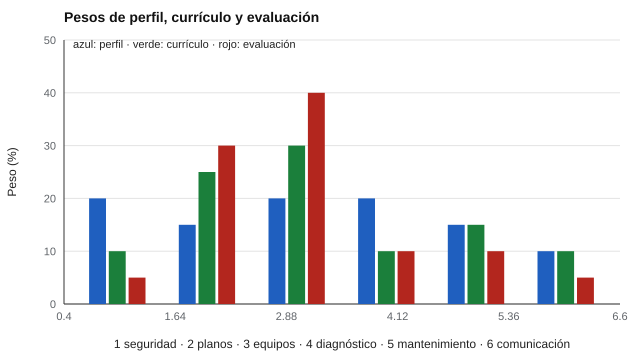

# 157 — Orientación en educación media técnico-profesional


<!-- NAV -->
[← 156 — Portafolios de evidencias](../156-portafolios-de-evidencias/README.md) · [📚 Parte 15](../README.md) · [🗺️ Índice 001–200](../../../PROGRAMA.md) · [158 — Orientación en educación superior y transició… →](../158-orientacion-en-educacion-superior-y-transicion-laboral/README.md)
<!-- /NAV -->

**Parte 15 — Orientación vocacional y competencias profesionales** · Nivel intermedio · 4 h · Estado `escrita`
**Pensada para:** quien diseña o evalúa programas técnico-profesionales, y estudiantes y familias que los eligen.
**Prerrequisitos:** clases 032 y 111.

> Especialidad **ficticia** y pesos inventados; el perfil real viene de un levantamiento con el sector productivo.

## ¿Para qué te sirve esto?

En la educación media técnico-profesional, el **perfil de egreso** dice qué debe saber hacer un estudiante, el **currículo** lo que se enseña y la **evaluación** lo que se mide. Si no coinciden, se enseña una cosa, se evalúa otra y el título promete una tercera. Esta clase te enseña a medir el **alineamiento** con una cifra simple (distancia de variación total) y a detectar competencias **sub-representadas**: aquellas que el sector considera críticas y que casi no se evalúan.

## Al terminar esta clase podrás

- Medir el alineamiento entre perfil de egreso, currículo y evaluación.
- Detectar competencias sub-representadas.
- Fundamentar la orientación en información laboral verificable.

## La idea en palabras simples

El **alineamiento** entre lo esperado (perfil), lo enseñado (currículo) y lo evaluado es evidencia de validez de contenido (Webb, 1997; Porter, 2002). Se resume con la **distancia de variación total (TV)** entre dos distribuciones de pesos:

**TV = ½ Σ |pᵢ − qᵢ|** → 0 si coinciden, 1 si son disjuntas.

Una competencia está **sub-representada** si su peso en la evaluación es mucho menor que en el perfil (razón eval/perfil < 0,7, por ejemplo).

## Cómo funciona, paso a paso

**1. Listar** las competencias con su peso en perfil, currículo y evaluación.

**2. Calcular** la TV perfil–currículo y perfil–evaluación.

**3. Identificar** las competencias sub-representadas y rediseñar la evaluación.

**Ejemplo resuelto.** TV(perfil, evaluación) = ½(0,15 + 0,15 + 0,20 + 0,10 + 0,05 + 0,05) = 0,35.



*Figura 1.* La evaluación sobrerrepresenta operación de equipos y casi no evalúa seguridad.

## Si construyes el instrumento

- Levanta el perfil con el sector productivo.
- Revisa el alineamiento antes de cada ciclo evaluativo.
- No evalúes solo lo que es cómodo de evaluar.
- Fundamenta la orientación en información laboral actual, local y verificable.

## Si eres evaluado (o eres familia)

- Pregunta cómo se evalúan las competencias que el sector considera críticas.
- Una especialidad técnica no es una «segunda opción».
- Pide información laboral con fuente y fecha.

## Qué muestra el laboratorio

| Competencia | Perfil | Currículo | Evaluación | Eval/perfil |
|---|---:|---:|---:|---:|
| Seguridad y prevención | 20 % | 10 % | 5 % | 0,25 (sub-representada) |
| Lectura de planos | 15 % | 25 % | 30 % | 2,00 |
| Operación de equipos | 20 % | 30 % | 40 % | 2,00 |
| Diagnóstico de fallas | 20 % | 10 % | 10 % | 0,50 (sub-representada) |
| Mantenimiento preventivo | 15 % | 15 % | 10 % | 0,67 (sub-representada) |
| Comunicación técnica | 10 % | 10 % | 5 % | 0,50 (sub-representada) |

Distancia perfil–currículo = 0,20; perfil–evaluación = 0,35; con la evaluación rediseñada = 0,02.

**Análisis.** (1) El examen premia lo que se enseña más (operación de equipos) y casi no evalúa lo que el sector considera crítico (seguridad, diagnóstico). (2) La validez de contenido exige que lo evaluado represente el perfil. (3) Rediseñar la evaluación reduce la distancia a 0,02. (4) Los pesos son inventados.

## Errores frecuentes

- Evaluar lo que es cómodo de evaluar.
- Orientar con datos de empleo desactualizados o sin matiz regional.
- Presentar la especialidad técnica como «segunda opción».
- Usar pesos sin levantamiento con el sector.

## Lo mínimo que debes llevarte

1. Perfil, currículo y evaluación deben alinearse.
2. TV resume la distancia entre dos distribuciones de pesos.
3. Hay competencias sub-representadas.
4. La orientación necesita información laboral verificable.

## Ejercicios

- **Inicial.** ¿Qué es validez de contenido? *Solución: que el contenido evaluado represente el dominio que se quiere medir.*
- **Intermedio.** TV entre (0,5; 0,5) y (0,8; 0,2). *Solución: 0,30.*
- **Avanzado.** Rediseña una evaluación para igualar los pesos y comprueba la TV.
- **Aplicación.** Haz una tabla perfil–currículo–evaluación para una especialidad que conozcas.

## Glosario

- **Perfil de egreso:** competencias que debe tener quien egresa.
- **Alineamiento:** coherencia entre perfil, currículo y evaluación.
- **TV (variación total):** distancia entre dos distribuciones.
- **Sub-representada:** competencia con menor peso evaluado que el esperado.

## Laboratorio

```bash
python classes/part-15-orientacion-vocacional-y-competencias-profesionales/157-orientacion-en-educacion-media-tecnico-profesional/lab.py
python classes/part-15-orientacion-vocacional-y-competencias-profesionales/figuras.py
```

## Autoevaluación y criterios

1. ¿Qué fuentes de información laboral usarías? 2. ¿Cómo involucras al sector productivo? 3. ¿Qué trayectorias posteriores existen?
Se logra la clase si mides el alineamiento y propones ajustes evaluativos.

## Bibliografía

- Webb, N. L. (1997). *Criteria for Alignment of Expectations and Assessments in Mathematics and Science Education* (Research Monograph No. 6). National Institute for Science Education. 🔎 sin verificar (libro, norma o sitio no hallado en Crossref: comprobar a mano)
- Porter, A. C. (2002). Measuring the content of instruction: Uses in research and practice. *Educational Researcher*, 31(7), 3-14. ✅ [DOI](https://doi.org/10.3102/0013189x031007003)

Leyenda: ✅ existe en Crossref con título y año coincidentes (enlace al DOI); ⚠️ hay una obra de título parecido con otro año (no se enlaza: comprobar la edición); 🔎 no verificada automáticamente (libros sin DOI, normas y sitios web). Crossref confirma la existencia de la fuente, no que respalde cada afirmación de la clase. Ver [`docs/VERIFICACION_BIBLIOGRAFIA.md`](../../../docs/VERIFICACION_BIBLIOGRAFIA.md).

---

<!-- NAV -->
[← 156 — Portafolios de evidencias](../156-portafolios-de-evidencias/README.md)  
[📚 Parte 15](../README.md) · [🗺️ Índice 001–200](../../../PROGRAMA.md)  
[158 — Orientación en educación superior y transició… →](../158-orientacion-en-educacion-superior-y-transicion-laboral/README.md)
<!-- /NAV -->
