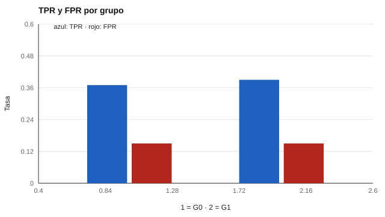

# 158 — Orientación en educación superior y transición laboral


<!-- NAV -->
[← 157 — Orientación en educación media técnico-profes…](../157-orientacion-en-educacion-media-tecnico-profesional/README.md) · [📚 Parte 15](../README.md) · [🗺️ Índice 001–200](../../../PROGRAMA.md) · [159 — Formación continua y reconversión laboral →](../159-formacion-continua-y-reconversion-laboral/README.md)
<!-- /NAV -->

**Parte 15 — Orientación vocacional y competencias profesionales** · Nivel intermedio · 4 h · Estado `escrita`
**Pensada para:** quien administra apoyo estudiantil en educación superior, y estudiantes cuyo riesgo se estima.
**Prerrequisitos:** clases 064, 100 y 135.

> Datos sintéticos; las causas de deserción reales son múltiples. Un sistema de alerta es para ofrecer apoyo, no para etiquetar.

## ¿Para qué te sirve esto?

Muchas instituciones usan **modelos de alerta temprana** para detectar estudiantes con riesgo de abandonar. La promesa es ofrecerles apoyo a tiempo. Los riesgos son tres: (1) la capacidad predictiva suele ser **modesta**; (2) se puede **etiquetar** a estudiantes en registros visibles; (3) los errores pueden repartirse **desigualmente** entre grupos. Esta clase te enseña a evaluar un modelo con AUC, calibración y tasas de acierto y error por grupo, y a definir un uso respetuoso.

## Al terminar esta clase podrás

- Evaluar un sistema de alerta temprana con AUC y calibración.
- Auditar su desempeño por grupo.
- Definir un uso de apoyo, no de etiquetado.

## La idea en palabras simples

La deserción se relaciona con factores académicos y sociales (Tinto, 1993). Los modelos de alerta temprana tienen capacidad predictiva modesta (Bowers, Sprott y Taff, 2013) y pueden distribuir desigualmente cargas y errores (Barocas, Hardt y Narayanan, 2019). Se evalúan con: **AUC** (discriminación), **calibración** (lo predicho coincide con lo observado) y **TPR/FPR por grupo** (detección y falsas alertas).

## Cómo funciona, paso a paso

**1. Ajustar** una regresión logística sin usar el grupo (6 000 estudiantes).

**2. Alertar** al 20 % de mayor riesgo.

**3. Auditar** TPR y FPR por grupo y la proporción alertada.

**Ejemplo resuelto.** Con 1 000 estudiantes, 218 desertarán; el modelo detecta ≈ 0,38 · 218 = 83 y alerta a 200: 117 alertados no desertarán.



*Figura 1.* TPR y FPR son parecidas entre grupos, pero se alerta a más estudiantes de G1 (22,8 % frente a 18,1 %).

## Si construyes el instrumento

- Ofrece una oferta concreta de apoyo ligada a cada alerta.
- Audita el modelo por grupo y reporta sus límites.
- Recalibra al cambiar de cohorte.
- Restringe quién ve las alertas y no las uses como etiqueta visible.

## Si eres evaluado

- Una alerta describe una probabilidad, no tu futuro.
- Tienes derecho a saber si estás en un sistema de alerta y cómo se usa tu información.
- El apoyo ofrecido debe ser voluntario y útil.

## Qué muestra el laboratorio

| Medida | Valor |
|---|---:|
| Deserción observada / media predicha | 21,8 % / 21,8 % |
| AUC aproximado | 0,69 |

| Grupo | Deserción | Alertados | TPR | FPR |
|---|---:|---:|---:|---:|
| G0 | 14,6 % | 18,1 % | 0,37 | 0,15 |
| G1 | 32,2 % | 22,8 % | 0,39 | 0,15 |

**Análisis.** (1) El modelo no usa el grupo y tiene TPR y FPR parecidas, pero alerta a más estudiantes del grupo con deserción basal mayor. (2) En ambos grupos detecta solo ~4 de cada 10 desertores. (3) Se usa para ofrecer apoyo, no para etiquetar. (4) Datos sintéticos.

## Errores frecuentes

- Etiquetar a estudiantes como «de riesgo» en registros visibles.
- Usar la alerta sin una oferta de apoyo concreta.
- Calibrar en una cohorte y aplicar en otra sin reevaluar.
- Interpretar la alerta como destino.

## Lo mínimo que debes llevarte

1. Los modelos de alerta tienen capacidad predictiva modesta.
2. Se evalúan con AUC, calibración y tasas por grupo.
3. La mayoría de los alertados no desertará.
4. Se usan para apoyar, no para etiquetar.

## Ejercicios

- **Inicial.** ¿Qué es la calibración? *Solución: que las probabilidades predichas coincidan con las frecuencias observadas.*
- **Intermedio.** TPR 0,39 con 322 desertores en G1. *Solución: ≈ 126 detectados.*
- **Avanzado.** Cambia el corte al 10 % superior y compara TPR y FPR.
- **Aplicación.** Diseña un protocolo de apoyo ante una alerta, con consentimiento del estudiante.

## Glosario

- **Alerta temprana:** aviso basado en un modelo de riesgo.
- **AUC:** capacidad de discriminar entre quienes desertan y quienes no.
- **TPR / FPR:** tasas de verdaderos y falsos positivos.
- **Calibración:** correspondencia entre probabilidad predicha y observada.

## Laboratorio

```bash
python classes/part-15-orientacion-vocacional-y-competencias-profesionales/158-orientacion-en-educacion-superior-y-transicion-laboral/lab.py
python classes/part-15-orientacion-vocacional-y-competencias-profesionales/figuras.py
```

## Autoevaluación y criterios

1. ¿Qué apoyos ofrecerías? 2. ¿Quién ve las alertas? 3. ¿Cómo evalúas si el apoyo funciona?
Se logra la clase si evalúas un modelo de alerta, lo auditas por grupo y defines un uso respetuoso.

## Bibliografía

- Tinto, V. (1993). *Leaving College: Rethinking the Causes and Cures of Student Attrition* (2.ª ed.). University of Chicago Press. ⚠️ hay una obra de título parecido en Crossref con otro año (1987): comprobar la edición a mano
- Bowers, A. J., Sprott, R., & Taff, S. A. (2013). Do we know who will drop out? A review of the predictors of dropping out of high school. *The High School Journal*, 96(2), 77-100. ✅ [DOI](https://doi.org/10.1353/hsj.2013.0000)
- Barocas, S., Hardt, M., & Narayanan, A. (2019). *Fairness and Machine Learning*. fairmlbook.org. 🔎 sin verificar (libro, norma o sitio no hallado en Crossref: comprobar a mano)

Leyenda: ✅ existe en Crossref con título y año coincidentes (enlace al DOI); ⚠️ hay una obra de título parecido con otro año (no se enlaza: comprobar la edición); 🔎 no verificada automáticamente (libros sin DOI, normas y sitios web). Crossref confirma la existencia de la fuente, no que respalde cada afirmación de la clase. Ver [`docs/VERIFICACION_BIBLIOGRAFIA.md`](../../../docs/VERIFICACION_BIBLIOGRAFIA.md).

---

<!-- NAV -->
[← 157 — Orientación en educación media técnico-profes…](../157-orientacion-en-educacion-media-tecnico-profesional/README.md)  
[📚 Parte 15](../README.md) · [🗺️ Índice 001–200](../../../PROGRAMA.md)  
[159 — Formación continua y reconversión laboral →](../159-formacion-continua-y-reconversion-laboral/README.md)
<!-- /NAV -->
