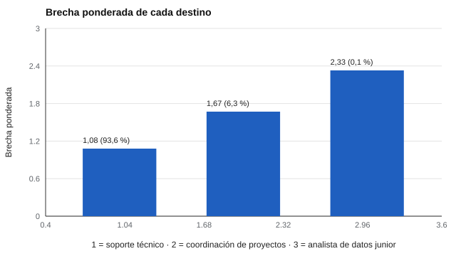

# 159 — Formación continua y reconversión laboral


<!-- NAV -->
[← 158 — Orientación en educación superior y transició…](../158-orientacion-en-educacion-superior-y-transicion-laboral/README.md) · [📚 Parte 15](../README.md) · [🗺️ Índice 001–200](../../../PROGRAMA.md) · [160 — Diseño de un programa de orientación basado e… →](../160-diseno-de-un-programa-de-orientacion-basado/README.md)
<!-- /NAV -->

**Parte 15 — Orientación vocacional y competencias profesionales** · Nivel intermedio · 4 h · Estado `escrita`
**Pensada para:** quien orienta procesos de reconversión, y quien está pensando cambiar de ocupación.
**Prerrequisitos:** clases 111 y 155.

> Las ocupaciones, requisitos y horas son ficticios. Las horas son un supuesto, no una promesa.

## ¿Para qué te sirve esto?

Quien quiere cambiar de rubro se pregunta: «¿cuánto me falta para ser X?». Una forma ordenada es comparar sus habilidades actuales con las que exige la ocupación destino y calcular la **brecha**. Pero la mayoría de las veces la persona se **autoevalúa**, y esa autoevaluación tiene error. Esta clase te enseña a calcular una brecha ponderada, a ver con qué probabilidad un destino es realmente el de menor brecha y a planificar una ruta de formación con supuestos explícitos.

## Al terminar esta clase podrás

- Calcular una brecha ponderada de habilidades hacia ocupaciones destino.
- Propagar la incertidumbre de la autoevaluación.
- Planificar una ruta de formación con supuestos explícitos.

## La idea en palabras simples

Los análisis de brechas comparan las habilidades actuales con las requeridas (OECD, 2019). La **brecha ponderada** es:

**Σ wᵢ · max(0, requeridoᵢ − actualᵢ) / Σ wᵢ**

donde *w* es el peso de cada habilidad. El `max(0, …)` indica que tener más de lo requerido no compensa la falta en otra habilidad. Como la autoevaluación tiene error, se simula con una desviación (aquí 1,2) para ver qué tan estable es el «mejor destino». Savickas (2005) recuerda que la reconversión también es una construcción personal.

## Cómo funciona, paso a paso

**1. Listar** las habilidades requeridas por cada destino, con sus pesos.

**2. Calcular** la brecha ponderada y las horas estimadas (6 horas por punto de brecha, supuesto).

**3. Simular** el error de autoevaluación y contar con qué frecuencia cada destino tiene la menor brecha.

**Ejemplo resuelto.** Habilidad requerida 8 con peso 3, actual 3: brecha = 3 · 5 = 15 (antes de dividir por Σw).



*Figura 1.* El mejor destino (entre paréntesis, su probabilidad de tener la menor brecha) es estable porque su ventaja es amplia.

## Si construyes el instrumento

- Usa evidencia de habilidades además de la autoevaluación (pruebas de desempeño).
- Presenta las horas como supuesto, no como promesa.
- Considera el mercado local, el tiempo disponible y el apoyo.
- Informa la incertidumbre del resultado.

## Si eres evaluado

- Una brecha es una estimación; mejora con evidencia más allá de tu autoevaluación.
- Las horas no incluyen factores como mercado, edad o redes.
- Pregunta qué apoyos financieros y de tiempo existen (a verificar).

## Qué muestra el laboratorio

| Destino | Brecha ponderada | Horas estimadas | Prob. de menor brecha |
|---|---:|---:|---:|
| Soporte técnico | 1,08 | 52 | 93,6 % |
| Coordinación de proyectos | 1,67 | 80 | 6,3 % |
| Analista de datos junior | 2,33 | 112 | 0,1 % |

**Análisis.** (1) Aquí el mejor destino es estable (94 %) porque su ventaja es amplia; con brechas más parejas no lo sería. (2) Mejorar la medida reduce la incertidumbre antes de invertir tiempo y dinero. (3) Las horas son un supuesto. (4) La reconversión depende del mercado local, la edad, las redes y el apoyo disponible.

## Errores frecuentes

- Prometer horas o empleabilidad que dependen del mercado.
- Usar solo autoevaluación para decisiones costosas.
- Ignorar la brecha de apoyo y de tiempo disponible.
- Tratar los datos ficticios como reales.

## Lo mínimo que debes llevarte

1. La brecha ponderada compara actual y requerido por habilidad.
2. La autoevaluación tiene error que se propaga.
3. El mejor destino puede ser estable o no.
4. Las horas son un supuesto.

## Ejercicios

- **Inicial.** ¿Qué es una brecha ponderada? *Solución: la diferencia entre lo requerido y lo actual, ponderada por la importancia de cada habilidad.*
- **Intermedio.** Requerido 7, actual 9. *Solución: brecha 0 (no se compensa).*
- **Avanzado.** Reduce el error de autoevaluación a 0,5 y observa las probabilidades.
- **Aplicación.** Calcula la brecha para dos ocupaciones que te interesen, con evidencia además de tu autoevaluación.

## Glosario

- **Brecha de habilidades:** diferencia entre lo requerido y lo actual.
- **Reconversión laboral:** cambio de ocupación o rubro.
- **Formación continua:** aprendizaje a lo largo de la vida laboral.
- **Autoevaluación:** estimación de la propia habilidad.

## Laboratorio

```bash
python classes/part-15-orientacion-vocacional-y-competencias-profesionales/159-formacion-continua-y-reconversion-laboral/lab.py
python classes/part-15-orientacion-vocacional-y-competencias-profesionales/figuras.py
```

## Autoevaluación y criterios

1. ¿Qué evidencia de habilidades usarías además de la autoevaluación? 2. ¿Qué apoyos financieros y de tiempo existen (a verificar)? 3. ¿Cómo evalúas el avance?
Se logra la clase si calculas brechas, incorporas incertidumbre y planificas una ruta realista.

## Bibliografía

- OECD (2019). *OECD Skills Outlook 2019: Thriving in a Digital World*. OECD Publishing. 🔎 sin verificar (libro, norma o sitio no hallado en Crossref: comprobar a mano)
- Savickas, M. L. (2005). The theory and practice of career construction. En S. D. Brown & R. W. Lent (Eds.), *Career Development and Counseling*. Wiley. 🔎 sin verificar (libro, norma o sitio no hallado en Crossref: comprobar a mano)

Leyenda: ✅ existe en Crossref con título y año coincidentes (enlace al DOI); ⚠️ hay una obra de título parecido con otro año (no se enlaza: comprobar la edición); 🔎 no verificada automáticamente (libros sin DOI, normas y sitios web). Crossref confirma la existencia de la fuente, no que respalde cada afirmación de la clase. Ver [`docs/VERIFICACION_BIBLIOGRAFIA.md`](../../../docs/VERIFICACION_BIBLIOGRAFIA.md).

---

<!-- NAV -->
[← 158 — Orientación en educación superior y transició…](../158-orientacion-en-educacion-superior-y-transicion-laboral/README.md)  
[📚 Parte 15](../README.md) · [🗺️ Índice 001–200](../../../PROGRAMA.md)  
[160 — Diseño de un programa de orientación basado e… →](../160-diseno-de-un-programa-de-orientacion-basado/README.md)
<!-- /NAV -->
