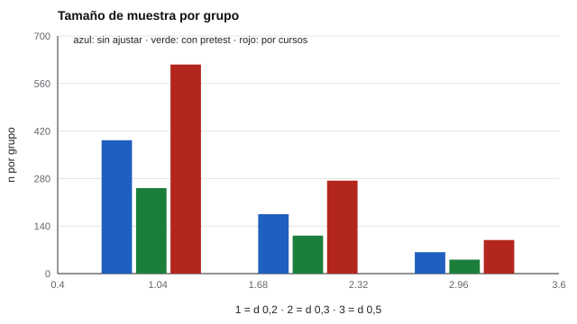

# 160 — Diseño de un programa de orientación basado en evidencia


<!-- NAV -->
[← 159 — Formación continua y reconversión laboral](../159-formacion-continua-y-reconversion-laboral/README.md) · [📚 Parte 15](../README.md) · [🗺️ Índice 001–200](../../../PROGRAMA.md) · [161 — Bienestar subjetivo y calidad de vida →](../../part-16-evaluacion-socioemocional-y-bienestar/161-bienestar-subjetivo-y-calidad-de-vida/README.md)
<!-- /NAV -->

**Parte 15 — Orientación vocacional y competencias profesionales** · Nivel intermedio · 5 h · Estado `escrita`
**Pensada para:** quien diseña y evalúa un programa de orientación, y quien participa en uno.
**Prerrequisitos:** clases 172 y 155.

> Efectos y correlaciones supuestos.

## ¿Para qué te sirve esto?

«Hicimos un programa de orientación y a los estudiantes les gustó.» Eso no dice si el programa **funcionó**. Para saberlo hay que comparar con un grupo de contraste y detectar un efecto probablemente pequeño. La pregunta práctica: **¿cuántos estudiantes necesito?** Y una trampa común: si el programa se asigna por **cursos** (no por estudiante), los estudiantes de un mismo curso se parecen y el tamaño efectivo de la muestra es menor. Esta clase te enseña a calcular el tamaño de muestra con ajuste por pretest y por cursos, y a declarar la lógica del programa antes de empezar.

## Al terminar esta clase podrás

- Calcular el tamaño de muestra para detectar un efecto con un diseño pre-post.
- Incorporar el ajuste por pretest y el agrupamiento por cursos.
- Declarar la lógica y la medida del programa antes de empezar.

## La idea en palabras simples

Para comparar dos grupos con potencia 1 − β y nivel α, el tamaño por grupo es **n = 2·((z₁₋α/₂ + z₁₋β) / d)²** (Cohen, 1988). Medir el **pretest** y ajustar por él reduce la varianza residual en **(1 − r²)**. Si se asigna por cursos, el **efecto de diseño** es **DEFF = 1 + (m − 1)·ICC** (Donner y Klar, 2000), con *m* estudiantes por curso. La literatura sugiere que la orientación tiene efectos moderados y que el formato importa (Whiston, Brecheisen y Stephens, 2003).

## Cómo funciona, paso a paso

**1. Declarar** la lógica del programa: insumos, actividades y resultados esperados.

**2. Elegir** la medida de resultado, validada para la población.

**3. Calcular** el tamaño de muestra sin ajustar, con ajuste por pretest y por cursos.

**Ejemplo resuelto.** d = 0,5: n = 2 · (2,80 / 0,5)² = 62,7 → 63 sin ajustar; con r = 0,6: 62,7 · 0,64 = 40,1 → 41.



*Figura 1.* Detectar un efecto pequeño exige muchos estudiantes, y más si se asigna por curso.

## Si construyes el instrumento

- Fija el tamaño muestral **antes** de ver los datos.
- Mide un pretest y ajusta por él.
- Considera el agrupamiento por curso.
- Informa también si no encuentras efectos.

## Si eres evaluado

- Un programa que «gustó» no es lo mismo que uno que «funcionó».
- Pregunta qué se midió, con qué instrumento y contra qué grupo se comparó.
- Participar en una evaluación es voluntario.

## Qué muestra el laboratorio

Potencia 80 %, α = 0,05.

| Efecto d | Sin ajustar | Ajuste (r = 0,6) | Por cursos (m = 30, ICC = 0,05) |
|---:|---:|---:|---:|
| 0,2 | 393 | 252 | 616 |
| 0,3 | 175 | 112 | 274 |
| 0,5 | 63 | 41 | 99 |

Verificación: d = 0,5, r = 0,6, n = 41 por grupo → potencia simulada 0,81.

**Análisis.** (1) Detectar un efecto pequeño exige muchos estudiantes, y más si se asigna por curso. (2) Medir el pretest y ajustar por él reduce el tamaño necesario. (3) Un programa basado en evidencia declara su lógica, su medida y su tamaño de muestra antes de empezar. (4) Efectos y correlaciones supuestos.

## Errores frecuentes

- Fijar el tamaño muestral después de ver los datos.
- Ignorar el agrupamiento por curso: infla falsamente la significación.
- Medir el resultado con un instrumento no validado para la población.
- Ocultar los resultados sin efecto.

## Lo mínimo que debes llevarte

1. n depende del efecto que se quiere detectar.
2. El pretest reduce el n necesario.
3. El agrupamiento por cursos lo aumenta (DEFF).
4. La lógica y la medida se declaran antes.

## Ejercicios

- **Inicial.** ¿Qué es el efecto de diseño? *Solución: el factor por el cual aumenta la varianza (y el tamaño de muestra necesario) por el agrupamiento.*
- **Intermedio.** DEFF con m = 20 e ICC = 0,10. *Solución: 2,9.*
- **Avanzado.** Calcula n para d = 0,4 y r = 0,5 con potencia 90 %.
- **Aplicación.** Escribe la lógica (insumos, actividades, resultados) de un programa de orientación de 4 sesiones.

## Glosario

- **Potencia:** probabilidad de detectar un efecto que existe.
- **Pretest / postest:** medición antes / después del programa.
- **ICC:** parecido entre estudiantes de un mismo curso.
- **Efecto de diseño (DEFF):** factor de aumento del tamaño de muestra por agrupamiento.

## Laboratorio

```bash
python classes/part-15-orientacion-vocacional-y-competencias-profesionales/160-diseno-de-un-programa-de-orientacion-basado/lab.py
python classes/part-15-orientacion-vocacional-y-competencias-profesionales/figuras.py
```

## Autoevaluación y criterios

1. ¿Cuál es la lógica de tu programa? 2. ¿Qué resultado medirás y con qué instrumento? 3. ¿Qué harás si no hay efecto?
Se logra la clase si diseñas una evaluación del programa con tamaño muestral justificado.

## Bibliografía

- Cohen, J. (1988). *Statistical Power Analysis for the Behavioral Sciences* (2.ª ed.). Lawrence Erlbaum.
- Donner, A., & Klar, N. (2000). *Design and Analysis of Cluster Randomization Trials in Health Research*. Arnold.
- Whiston, S. C., Brecheisen, B. K., & Stephens, J. (2003). Does treatment modality affect career counseling effectiveness? *Journal of Vocational Behavior*, 62(3), 390-410. [DOI](https://doi.org/10.1016/s0001-8791(02)00050-7)

---

<!-- NAV -->
[← 159 — Formación continua y reconversión laboral](../159-formacion-continua-y-reconversion-laboral/README.md)  
[📚 Parte 15](../README.md) · [🗺️ Índice 001–200](../../../PROGRAMA.md)  
[161 — Bienestar subjetivo y calidad de vida →](../../part-16-evaluacion-socioemocional-y-bienestar/161-bienestar-subjetivo-y-calidad-de-vida/README.md)
<!-- /NAV -->
