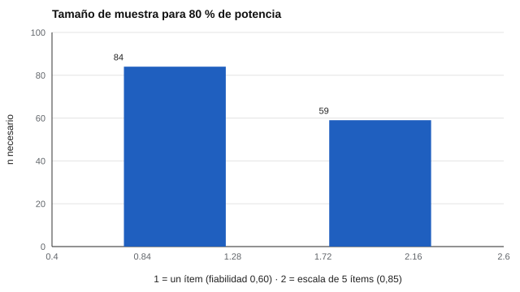

# 161 — Bienestar subjetivo y calidad de vida


<!-- NAV -->
[← 160 — Diseño de un programa de orientación basado e…](../../part-15-orientacion-vocacional-y-competencias-profesionales/160-diseno-de-un-programa-de-orientacion-basado/README.md) · [📚 Parte 16](../README.md) · [🗺️ Índice 001–200](../../../PROGRAMA.md) · [162 — Estrés percibido →](../162-estres-percibido/README.md)
<!-- /NAV -->

**Parte 16 — Evaluación socioemocional y bienestar** · Nivel avanzado · 4 h · Estado `escrita`
**Pensada para:** quien mide bienestar en estudios o programas, y quien responde una escala de satisfacción.
**Prerrequisitos:** clases 014 y 039.

> Parámetros supuestos. Una escala de satisfacción con la vida no mide salud mental ni diagnostica.

## ¿Para qué te sirve esto?

«En una escala del 1 al 7, ¿cuán satisfecho está con su vida?» Un solo ítem así se usa mucho en encuestas grandes. ¿Es suficiente? Depende de para qué. Esta clase te enseña a distinguir **bienestar subjetivo**, **satisfacción con la vida** y **calidad de vida**, y a calcular el **costo en tamaño de muestra** de usar un ítem en lugar de una escala de cinco. También te recuerda que ningún puntaje de satisfacción decide algo sobre una persona: describe una percepción.

## Al terminar esta clase podrás

- Distinguir bienestar subjetivo, satisfacción con la vida y calidad de vida.
- Comparar un ítem único con una escala.
- Calcular el tamaño de muestra según la fiabilidad de la medida.

## La idea en palabras simples

El bienestar subjetivo incluye juicios de satisfacción con la vida y afecto positivo y negativo (Diener et al., 2018). La *Satisfaction With Life Scale* (Diener et al., 1985) tiene 5 ítems. Un **ítem único** tiene validez razonable para estudios poblacionales, pero menor fiabilidad (Cheung y Lucas, 2014). La menor fiabilidad **atenúa** la correlación observada: **r_obs ≈ r_verdadera × √ρ**, y exige más personas para detectar la misma relación.

## Cómo funciona, paso a paso

**1. Fijar** una relación verdadera de 0,40 con un criterio.

**2. Comparar** un ítem (fiabilidad 0,60) con una escala de 5 ítems (0,85).

**3. Calcular** la r observada y el n necesario para 80 % de potencia.

**Ejemplo resuelto.** r_obs = 0,40 · √0,60 = 0,31 (con criterio perfecto).



*Figura 1.* El ítem único cuesta un 40 % más de personas para detectar la misma relación.

## Si construyes el instrumento

- Elige la medida según el propósito: un ítem para encuestas grandes; una escala para precisión.
- Calcula el tamaño de muestra con la fiabilidad de la medida.
- Revisa el efecto techo en escalas de 1 a 7.
- Compara entre culturas solo con invarianza (clase 070).

## Si eres evaluado

- Un puntaje de satisfacción describe cómo ves tu vida hoy; cambia con las circunstancias.
- No es un indicador de salud mental.
- Si hay malestar importante, la ayuda es profesional (clase 168).

## Qué muestra el laboratorio

| Medida | Fiabilidad | r observada | r esperada | n para 80 % de potencia |
|---|---:|---:|---:|---:|
| 1 ítem | 0,60 | 0,303 | 0,310 | 84 |
| Escala de 5 ítems | 0,85 | 0,359 | 0,369 | 59 |

Efecto techo de un ítem 1–7 con media alta: 40,8 % responde 6 o 7.

**Análisis.** (1) Un solo ítem pierde validez observada por su menor fiabilidad y exige más personas. (2) Sirve para estudios con muchas personas y poco tiempo. (3) En un individuo, un ítem no es suficiente para ninguna decisión. (4) El bienestar es multidimensional.

## Errores frecuentes

- Usar un ítem para decisiones individuales.
- Considerar una escala de satisfacción como medida de salud mental.
- Comparar culturas sin invarianza.
- Ignorar el efecto techo.

## Lo mínimo que debes llevarte

1. Bienestar incluye satisfacción y afecto.
2. Un ítem es menos fiable que una escala.
3. La menor fiabilidad atenúa la correlación y exige más muestra.
4. Ningún puntaje de bienestar decide por sí solo.

## Ejercicios

- **Inicial.** ¿Qué es bienestar subjetivo? *Solución: la evaluación que una persona hace de su vida, incluyendo satisfacción y afecto.*
- **Intermedio.** r_obs con ρ = 0,85. *Solución: 0,40 · 0,92 = 0,37.*
- **Avanzado.** Cambia la relación verdadera a 0,20 y recalcula el tamaño de muestra.
- **Aplicación.** Decide entre un ítem y una escala para una encuesta escolar de 2 000 estudiantes y justifica.

## Glosario

- **Bienestar subjetivo:** evaluación personal de la propia vida.
- **Satisfacción con la vida:** juicio cognitivo global.
- **Calidad de vida:** concepto más amplio, con condiciones objetivas.
- **Efecto techo:** acumulación de respuestas en el extremo alto.

## Laboratorio

```bash
python classes/part-16-evaluacion-socioemocional-y-bienestar/161-bienestar-subjetivo-y-calidad-de-vida/lab.py
python classes/part-16-evaluacion-socioemocional-y-bienestar/figuras.py
```

## Autoevaluación y criterios

1. ¿Cuándo basta un ítem? 2. ¿Cómo comunicas un resultado de bienestar? 3. ¿Qué haces si alguien muestra malestar importante? (clase 168)
Se logra la clase si eliges una medida según el propósito y calculas su costo en muestra.

## Bibliografía

- Diener, E., Emmons, R. A., Larsen, R. J., & Griffin, S. (1985). The Satisfaction With Life Scale. *Journal of Personality Assessment*, 49(1), 71-75. ✅ [DOI](https://doi.org/10.1207/s15327752jpa4901_13)
- Cheung, F., & Lucas, R. E. (2014). Assessing the validity of single-item life satisfaction measures. *Quality of Life Research*, 23, 2809-2818. ✅ [DOI](https://doi.org/10.1007/s11136-014-0726-4)
- Diener, E., Oishi, S., & Tay, L. (2018). Advances in subjective well-being research. *Nature Human Behaviour*, 2, 253-260. ✅ [DOI](https://doi.org/10.1038/s41562-018-0307-6)

Leyenda: ✅ existe en Crossref con título y año coincidentes (enlace al DOI); ⚠️ hay una obra de título parecido con otro año (no se enlaza: comprobar la edición); 🔎 no verificada automáticamente (libros sin DOI, normas y sitios web). Crossref confirma la existencia de la fuente, no que respalde cada afirmación de la clase. Ver [`docs/VERIFICACION_BIBLIOGRAFIA.md`](../../../docs/VERIFICACION_BIBLIOGRAFIA.md).

---

<!-- NAV -->
[← 160 — Diseño de un programa de orientación basado e…](../../part-15-orientacion-vocacional-y-competencias-profesionales/160-diseno-de-un-programa-de-orientacion-basado/README.md)  
[📚 Parte 16](../README.md) · [🗺️ Índice 001–200](../../../PROGRAMA.md)  
[162 — Estrés percibido →](../162-estres-percibido/README.md)
<!-- /NAV -->
