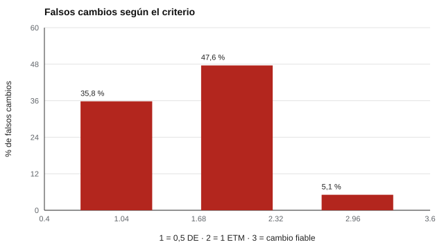

# 162 — Estrés percibido


<!-- NAV -->
[← 161 — Bienestar subjetivo y calidad de vida](../161-bienestar-subjetivo-y-calidad-de-vida/README.md) · [📚 Parte 16](../README.md) · [🗺️ Índice 001–200](../../../PROGRAMA.md) · [163 — Resiliencia y autoeficacia →](../163-resiliencia-y-autoeficacia/README.md)
<!-- /NAV -->

**Parte 16 — Evaluación socioemocional y bienestar** · Nivel avanzado · 4 h · Estado `escrita`
**Pensada para:** quien evalúa cambios en estrés (talleres, programas), y quien responde una escala de estrés.
**Prerrequisitos:** clases 025 y 030.

> Distribuciones simuladas y alfa supuesto. La escala describe percepciones; no diagnostica ni reemplaza una evaluación clínica.

## ¿Para qué te sirve esto?

Después de un taller de manejo del estrés, el puntaje de una persona baja 3 puntos. ¿Mejoró? Depende de **qué se considere un cambio importante**. Hay varios criterios (media desviación estándar, un error típico de medida, el cambio fiable) y dan respuestas muy distintas: con algunos, **cerca de la mitad de las personas que no cambiaron realmente parecen haber cambiado**. Esta clase te enseña a calcular esos umbrales y a no sobreinterpretar cambios pequeños.

## Al terminar esta clase podrás

- Distinguir estrés percibido de estresores y de trastornos.
- Comparar criterios de diferencia mínima importante.
- Calcular umbrales de cambio fiable.

## La idea en palabras simples

La *Perceived Stress Scale* (Cohen, Kamarck y Mermelstein, 1983) mide cuán impredecible, incontrolable y sobrecargada se percibe la vida. Para interpretar un cambio existen criterios:

- **0,5 DE** (Norman, Sloan y Wyrwich, 2003).
- **1 ETM** (error típico de medida).
- **Cambio fiable** (Jacobson y Truax, 1991): 1,96 · ETM · √2, que controla el error de medida.

Con **ETM = DE · √(1 − α)**. Ninguno dice si el cambio *importa* para la persona: eso requiere un criterio externo (un **ancla**).

## Cómo funciona, paso a paso

**1. Fijar** DE = 7 y alfa = 0,85 → ETM = 2,71.

**2. Calcular** cada umbral.

**3. Simular** 20 000 personas sin cambio real y contar cuántas superan cada umbral.

**Ejemplo resuelto.** ETM = 7 · √0,15 = 2,71; umbral fiable = 1,96 · 2,71 · 1,414 = 7,51.



*Figura 1.* Con 1 ETM, casi la mitad de quienes no cambiaron parecen haber cambiado.

## Si construyes el instrumento

- Declara el criterio de cambio y su tasa de falsos cambios.
- Usa un ancla externa para decidir si el cambio importa.
- Reporta el cambio individual con el cambio fiable.
- Usa umbrales de la población en que mides, no de otra.

## Si eres evaluado

- Un cambio de 3 puntos puede ser ruido de medición.
- Un puntaje de estrés no es un diagnóstico.
- Si tu estrés interfiere con tu vida, consulta a un profesional.

## Qué muestra el laboratorio

| Criterio | Umbral (puntos) | Falsos cambios |
|---|---:|---:|
| 0,5 DE | 3,50 | 35,8 % |
| 1 ETM | 2,71 | 47,6 % |
| Cambio fiable | 7,51 | 5,1 % |

**Análisis.** (1) «Cambio importante» depende del criterio. (2) Con 0,5 DE o 1 ETM, la mitad o más de las personas sin cambio real parecen haber cambiado. (3) El cambio fiable controla el error de medida (5 %), pero no dice si el cambio importa para la persona. (4) Una escala de estrés describe percepciones.

## Errores frecuentes

- Declarar «mejoró» con un cambio de 3 puntos.
- Confundir estrés percibido con depresión o ansiedad.
- Usar umbrales de otra población sin evidencia local.
- No distinguir cambio fiable de cambio importante.

## Lo mínimo que debes llevarte

1. Hay varios criterios de cambio y dan resultados distintos.
2. ETM = DE · √(1 − α).
3. El cambio fiable controla el error de medida.
4. Importancia para la persona requiere un ancla externa.

## Ejercicios

- **Inicial.** ¿Qué es un ancla? *Solución: un criterio externo (por ejemplo, «me siento mejor») que ayuda a decidir si un cambio importa.*
- **Intermedio.** DE = 6, alfa = 0,90. *Solución: ETM = 1,90; cambio fiable = 5,26.*
- **Avanzado.** Cambia alfa a 0,70 y observa los umbrales.
- **Aplicación.** Elige el criterio para evaluar un taller de manejo del estrés y justifica.

## Glosario

- **Estrés percibido:** valoración subjetiva de cuán sobrecargada se siente la vida.
- **ETM:** error típico de medida.
- **Cambio fiable:** cambio mayor al esperable por error de medida.
- **Ancla:** criterio externo para definir un cambio importante.

## Laboratorio

```bash
python classes/part-16-evaluacion-socioemocional-y-bienestar/162-estres-percibido/lab.py
python classes/part-16-evaluacion-socioemocional-y-bienestar/figuras.py
```

## Autoevaluación y criterios

1. ¿Qué criterio usarías para evaluar un taller de manejo del estrés? 2. ¿Qué más reportarías? 3. ¿Cuándo derivas?
Se logra la clase si calculas umbrales y evitas sobreinterpretar cambios pequeños.

## Bibliografía

- Cohen, S., Kamarck, T., & Mermelstein, R. (1983). A global measure of perceived stress. *Journal of Health and Social Behavior*, 24(4), 385-396. ✅ [DOI](https://doi.org/10.2307/2136404)
- Norman, G. R., Sloan, J. A., & Wyrwich, K. W. (2003). Interpretation of changes in health-related quality of life: The remarkable universality of half a standard deviation. *Medical Care*, 41(5), 582-592. ⚠️ hay una obra de título parecido en Crossref con otro año (2014): comprobar la edición a mano
- Jacobson, N. S., & Truax, P. (1991). Clinical significance: A statistical approach to defining meaningful change in psychotherapy research. *Journal of Consulting and Clinical Psychology*, 59(1), 12-19. ✅ [DOI](https://doi.org/10.1037/0022-006x.59.1.12)

Leyenda: ✅ existe en Crossref con título y año coincidentes (enlace al DOI); ⚠️ hay una obra de título parecido con otro año (no se enlaza: comprobar la edición); 🔎 no verificada automáticamente (libros sin DOI, normas y sitios web). Crossref confirma la existencia de la fuente, no que respalde cada afirmación de la clase. Ver [`docs/VERIFICACION_BIBLIOGRAFIA.md`](../../../docs/VERIFICACION_BIBLIOGRAFIA.md).

---

<!-- NAV -->
[← 161 — Bienestar subjetivo y calidad de vida](../161-bienestar-subjetivo-y-calidad-de-vida/README.md)  
[📚 Parte 16](../README.md) · [🗺️ Índice 001–200](../../../PROGRAMA.md)  
[163 — Resiliencia y autoeficacia →](../163-resiliencia-y-autoeficacia/README.md)
<!-- /NAV -->
