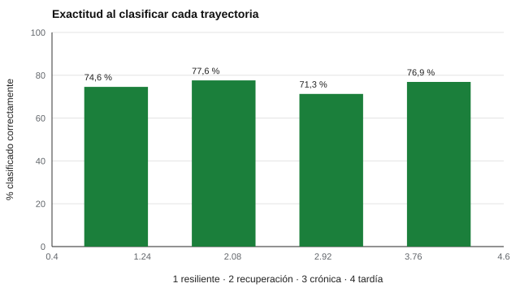

# 163 — Resiliencia y autoeficacia


<!-- NAV -->
[← 162 — Estrés percibido](../162-estres-percibido/README.md) · [📚 Parte 16](../README.md) · [🗺️ Índice 001–200](../../../PROGRAMA.md) · [164 — Regulación emocional →](../164-regulacion-emocional/README.md)
<!-- /NAV -->

**Parte 16 — Evaluación socioemocional y bienestar** · Nivel avanzado · 4 h · Estado `escrita`
**Pensada para:** quien evalúa resiliencia en programas o estudios, y quien recibe una etiqueta de «resiliente».
**Prerrequisitos:** clases 105 y 162.

> Proporciones y reglas supuestas. Quien muestra malestar persistente necesita apoyo profesional, no una etiqueta.

## ¿Para qué te sirve esto?

«Es una persona muy resiliente.» «Le falta resiliencia.» La palabra se usa como si fuera un rasgo que se tiene o no se tiene. Pero la investigación la entiende como un **resultado a lo largo del tiempo**: ¿qué trayectoria sigue alguien tras una adversidad? Lo más común es no desarrollar malestar persistente. Esta clase te enseña a **clasificar trayectorias**, a ver cuánto se equivoca esa clasificación cuando solo hay cuatro mediciones ruidosas y a distinguir **autoeficacia** (creencia) de **resiliencia** (resultado).

## Al terminar esta clase podrás

- Entender la resiliencia como resultado a lo largo del tiempo.
- Medir la exactitud al clasificar trayectorias con pocas mediciones.
- Distinguir autoeficacia (creencia) de resiliencia (resultado).

## La idea en palabras simples

Bonanno (2004) mostró que la trayectoria más común tras eventos adversos es la **estabilidad** (resiliencia como resultado), seguida de la **recuperación**; el malestar **crónico** o **tardío** es menos frecuente. Luthar, Cicchetti y Becker (2000) advierten que «resiliencia» exige dos condiciones: la **adversidad** y la **adaptación positiva**. La **autoeficacia** (Bandura, 1997) es la creencia de poder realizar una tarea concreta: es otra cosa.

## Cómo funciona, paso a paso

**1. Simular** cuatro trayectorias con proporciones supuestas (65/20/10/5 %) y 4 mediciones con ruido (DE 1,2).

**2. Clasificar** con una regla simple.

**3. Construir** la matriz de confusión entre la trayectoria real y la clasificada.

**Ejemplo resuelto.** Puntajes 2, 3, 2, 2: la máxima subida es 1 < 2,5 → resiliente. Puntajes 2, 7, 5, 3: sube más de 2,5 y el último está cerca del inicial → recuperación.



*Figura 1.* Con 4 mediciones ruidosas, una de cada cuatro trayectorias queda mal clasificada.

## Si construyes el instrumento

- Mide a lo largo del tiempo y con una adversidad definida.
- No infieras resiliencia de un cuestionario único.
- Mide autoeficacia para tareas concretas.
- Evita etiquetas como «poco resiliente».

## Si eres evaluado

- Lo habitual es no desarrollar malestar persistente; necesitar apoyo no es un defecto.
- La resiliencia depende de recursos y apoyo, no solo de la persona.
- Si el malestar persiste, busca apoyo profesional.

## Qué muestra el laboratorio

| Trayectoria real | Clasificada correctamente |
|---|---:|
| Resiliente | 74,6 % |
| Recuperación | 77,6 % |
| Crónica | 71,3 % |
| Tardía | 76,9 % |

Exactitud global 75,0 %.

**Análisis.** (1) Lo habitual es no desarrollar malestar persistente (65 % en este modelo). (2) Con 4 mediciones ruidosas, las trayectorias menos frecuentes (crónica, tardía) se confunden más. (3) La resiliencia se observa como resultado a lo largo del tiempo; no es una virtud individual. (4) Proporciones supuestas.

## Errores frecuentes

- Etiquetar como «poco resiliente» a quien necesita apoyo.
- Inferir resiliencia de un cuestionario sin adversidad ni seguimiento.
- Culpar a la persona por no «superar» sin considerar recursos y apoyo.
- Confundir autoeficacia con resiliencia.

## Lo mínimo que debes llevarte

1. Resiliencia es un resultado a lo largo del tiempo.
2. La estabilidad es la trayectoria más común.
3. La clasificación con pocas mediciones es imprecisa.
4. Autoeficacia es una creencia, no un resultado.

## Ejercicios

- **Inicial.** ¿Qué dos condiciones define el constructo de resiliencia? *Solución: la presencia de adversidad y una adaptación positiva.*
- **Intermedio.** ¿Qué errores son más frecuentes entre trayectorias? *Solución: crónica confundida con recuperación.*
- **Avanzado.** Reduce el ruido a 0,6 en `lab.py` y observa la exactitud.
- **Aplicación.** Redacta un ítem de autoeficacia para una tarea concreta.

## Glosario

- **Resiliencia:** adaptación positiva tras una adversidad.
- **Trayectoria:** patrón de cambio en el tiempo.
- **Autoeficacia:** creencia en la propia capacidad para una tarea.
- **Adversidad:** evento o condición desfavorable.

## Laboratorio

```bash
python classes/part-16-evaluacion-socioemocional-y-bienestar/163-resiliencia-y-autoeficacia/lab.py
python classes/part-16-evaluacion-socioemocional-y-bienestar/figuras.py
```

## Autoevaluación y criterios

1. ¿Qué apoyos influyen en la trayectoria? 2. ¿Cuándo derivarías? 3. ¿Cómo medirías autoeficacia para una tarea concreta?
Se logra la clase si distingues resultado de rasgo y evitas etiquetas.

## Bibliografía

- Bonanno, G. A. (2004). Loss, trauma, and human resilience: Have we underestimated the human capacity to thrive after extremely aversive events? *American Psychologist*, 59(1), 20-28. ✅ [DOI](https://doi.org/10.1037/0003-066x.59.1.20)
- Luthar, S. S., Cicchetti, D., & Becker, B. (2000). The construct of resilience: A critical evaluation and guidelines for future work. *Child Development*, 71(3), 543-562. ✅ [DOI](https://doi.org/10.1111/1467-8624.00164)
- Bandura, A. (1997). *Self-Efficacy: The Exercise of Control*. Freeman. ⚠️ hay una obra de título parecido en Crossref con otro año (1999): comprobar la edición a mano

Leyenda: ✅ existe en Crossref con título y año coincidentes (enlace al DOI); ⚠️ hay una obra de título parecido con otro año (no se enlaza: comprobar la edición); 🔎 no verificada automáticamente (libros sin DOI, normas y sitios web). Crossref confirma la existencia de la fuente, no que respalde cada afirmación de la clase. Ver [`docs/VERIFICACION_BIBLIOGRAFIA.md`](../../../docs/VERIFICACION_BIBLIOGRAFIA.md).

---

<!-- NAV -->
[← 162 — Estrés percibido](../162-estres-percibido/README.md)  
[📚 Parte 16](../README.md) · [🗺️ Índice 001–200](../../../PROGRAMA.md)  
[164 — Regulación emocional →](../164-regulacion-emocional/README.md)
<!-- /NAV -->
