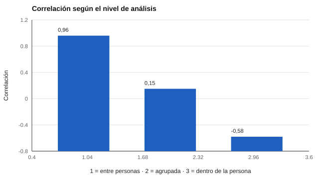

# 164 — Regulación emocional


<!-- NAV -->
[← 163 — Resiliencia y autoeficacia](../163-resiliencia-y-autoeficacia/README.md) · [📚 Parte 16](../README.md) · [🗺️ Índice 001–200](../../../PROGRAMA.md) · [165 — Habilidades sociales y empatía →](../165-habilidades-sociales-y-empatia/README.md)
<!-- /NAV -->

**Parte 16 — Evaluación socioemocional y bienestar** · Nivel avanzado · 4 h · Estado `escrita`
**Pensada para:** quien estudia regulación emocional con diarios o encuestas, y quien responde esas medidas.
**Prerrequisitos:** clases 109 y 027.

> Modelo simulado simple.

## ¿Para qué te sirve esto?

«Quienes usan más esta estrategia sienten más malestar.» Un estudio transversal lo muestra, y la conclusión parece obvia: la estrategia no funciona. Pero hay una trampa: lo que es cierto **entre personas** puede ser **lo contrario dentro de cada persona**. Puede ocurrir que las personas más angustiadas usen más la estrategia (correlación positiva entre personas) y que **en los días en que cada una la usa, se sienta mejor** (correlación negativa dentro). Esta clase te enseña a separar los dos niveles de análisis.

## Al terminar esta clase podrás

- Distinguir asociaciones entre personas y dentro de la persona.
- Reconocer la paradoja de Simpson en datos intensivos.
- Elegir diseños adecuados para procesos de regulación.

## La idea en palabras simples

El modelo de proceso de Gross (1998) describe estrategias de regulación emocional en distintos momentos. Los estudios transversales asocian algunas estrategias con más malestar (Aldao, Nolen-Hoeksema y Schweizer, 2010), pero la asociación **entre personas** puede diferir de la **dentro de la persona** (Curran y Bauer, 2011). Esto es un caso de la **paradoja de Simpson**: al mezclar niveles aparece una relación que invierte la de cada nivel.

## Cómo funciona, paso a paso

**1. Simular** 100 personas × 30 días.

**2. Calcular** la correlación entre los promedios de cada persona (entre).

**3. Calcular** la correlación agrupada ingenua y la correlación dentro (centrando por persona).

**Ejemplo resuelto.** Una persona que usa mucho la estrategia (promedio alto) también tiene afecto negativo promedio alto; pero en sus días de mayor uso su afecto es menor que en sus propios días de menor uso.



*Figura 1.* El signo cambia según el nivel de análisis.

## Si construyes el instrumento

- Usa datos intensivos (diarios, muestreo de experiencias) para procesos.
- Centra por persona para aislar el efecto dentro.
- Cuida la dirección temporal: el afecto puede causar el uso de la estrategia.
- Resguarda la privacidad de los diarios (parte 07).

## Si eres evaluado

- Lo que vale «en promedio para el grupo» puede no valer para ti.
- Una escala general describe tendencias, no tu proceso diario.
- Tienes derecho a saber cómo se usarán los datos de tu diario.

## Qué muestra el laboratorio

| Análisis | Correlación |
|---|---:|
| Entre personas (promedios) | 0,96 |
| Agrupada ingenua | 0,15 |
| Dentro de la persona | −0,58 |

**Análisis.** (1) Lo que es cierto entre personas puede ser lo contrario dentro de cada una. (2) Un estudio transversal no distingue ambos. (3) Para hablar de «regulación emocional» de una persona se necesitan datos intensivos de esa persona. (4) Una escala general describe tendencias, no el proceso diario.

## Errores frecuentes

- Generalizar una correlación de grupo a un individuo.
- Ignorar la dirección temporal.
- Interpretar una escala general como proceso diario.
- Usar la correlación agrupada ingenua.

## Lo mínimo que debes llevarte

1. Entre y dentro son niveles distintos.
2. La paradoja de Simpson invierte relaciones.
3. Centrar por persona aísla el efecto dentro.
4. Los procesos se estudian con datos intensivos.

## Ejercicios

- **Inicial.** ¿Qué es la paradoja de Simpson? *Solución: que una relación observada en el grupo se invierte al mirar dentro de los subgrupos.*
- **Intermedio.** ¿Por qué centrar por persona aísla el efecto dentro? *Solución: porque elimina las diferencias entre personas.*
- **Avanzado.** Aumenta el efecto entre personas a 2,0 en `lab.py` y observa la correlación agrupada.
- **Aplicación.** Diseña un diario de 14 días para estudiar una estrategia de regulación, con consentimiento y privacidad.

## Glosario

- **Regulación emocional:** procesos para influir en qué emociones se tienen y cómo se expresan.
- **Entre personas / dentro de la persona:** niveles de análisis.
- **Paradoja de Simpson:** inversión de una relación al agrupar o desagregar.
- **Centrar por persona:** restar a cada valor el promedio de la persona.

## Laboratorio

```bash
python classes/part-16-evaluacion-socioemocional-y-bienestar/164-regulacion-emocional/lab.py
python classes/part-16-evaluacion-socioemocional-y-bienestar/figuras.py
```

## Autoevaluación y criterios

1. ¿Qué diseño usarías para estudiar el proceso? 2. ¿Qué consentimiento y privacidad requiere un diario? 3. ¿Cómo informas hallazgos individuales?
Se logra la clase si separas los niveles de análisis.

## Bibliografía

- Gross, J. J. (1998). The emerging field of emotion regulation: An integrative review. *Review of General Psychology*, 2(3), 271-299. [DOI](https://doi.org/10.1037/1089-2680.2.3.271)
- Curran, P. J., & Bauer, D. J. (2011). The disaggregation of within-person and between-person effects in longitudinal models of change. *Annual Review of Psychology*, 62, 583-619. [DOI](https://doi.org/10.1146/annurev.psych.093008.100356)
- Aldao, A., Nolen-Hoeksema, S., & Schweizer, S. (2010). Emotion-regulation strategies across psychopathology: A meta-analytic review. *Clinical Psychology Review*, 30(2), 217-237. [DOI](https://doi.org/10.1016/j.cpr.2009.11.004)

---

<!-- NAV -->
[← 163 — Resiliencia y autoeficacia](../163-resiliencia-y-autoeficacia/README.md)  
[📚 Parte 16](../README.md) · [🗺️ Índice 001–200](../../../PROGRAMA.md)  
[165 — Habilidades sociales y empatía →](../165-habilidades-sociales-y-empatia/README.md)
<!-- /NAV -->
