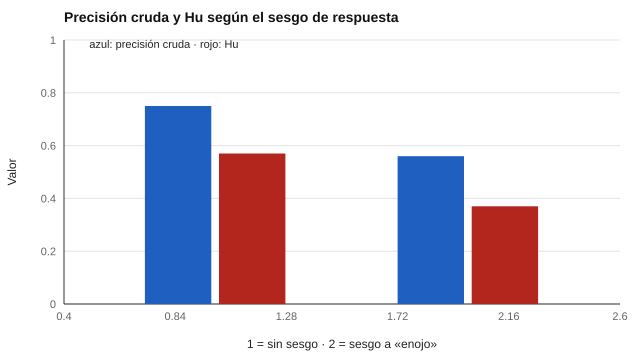

# 165 — Habilidades sociales y empatía


<!-- NAV -->
[← 164 — Regulación emocional](../164-regulacion-emocional/README.md) · [📚 Parte 16](../README.md) · [🗺️ Índice 001–200](../../../PROGRAMA.md) · [166 — Satisfacción académica y laboral →](../166-satisfaccion-academica-y-laboral/README.md)
<!-- /NAV -->

**Parte 16 — Evaluación socioemocional y bienestar** · Nivel avanzado · 4 h · Estado `escrita`
**Pensada para:** quien evalúa habilidades sociales o empatía, y quien responde estas pruebas.
**Prerrequisitos:** clases 045 y 083.

> Datos sintéticos. Ninguna prueba de esta clase diagnostica «falta de empatía».

## ¿Para qué te sirve esto?

La empatía se mide de dos formas muy distintas: **autoinformes** («me preocupo por los demás») y **pruebas de desempeño** (reconocer emociones en rostros o voces). No miden lo mismo: el autoinforme mide cómo uno se ve, la prueba mide cuánto percibe. Y la prueba de reconocimiento tiene su propio problema: quien tiende a responder «enojo» a todo acertará todos los enojos, y su puntaje parecerá bueno o malo según cómo se calcule. Esta clase te enseña a corregir ese **sesgo de respuesta** y a distinguir lo que mide cada tipo de instrumento.

## Al terminar esta clase podrás

- Distinguir empatía cognitiva y afectiva y su medición.
- Corregir el sesgo de respuesta en una prueba de reconocimiento de emociones.
- Diferenciar autoinformes de pruebas de desempeño.

## La idea en palabras simples

La empatía es **multidimensional** (Davis, 1983): toma de perspectiva, fantasía, preocupación empática y malestar personal. Los autoinformes miden el autoconcepto; las pruebas de reconocimiento miden desempeño perceptivo, pero mezclan percepción, vocabulario y sesgo de respuesta. La **tasa de acierto no sesgada (Hu)** de Wagner (1993) corrige el sesgo: para cada emoción, **Hu = (aciertos)² / (estímulos de esa emoción × veces que la persona respondió esa emoción)**.

## Cómo funciona, paso a paso

**1. Simular** 6 emociones × 12 estímulos con la misma nitidez perceptiva.

**2. Comparar** una persona sin sesgo con otra con sesgo a responder «enojo».

**3. Calcular** la precisión cruda y Hu.

**Ejemplo resuelto.** Para «enojo»: 11 aciertos de 12 estímulos, pero la persona responde «enojo» 30 veces: Hu_enojo = 11² / (12 · 30) = 0,34, muy inferior a la precisión cruda de esa categoría (0,92).



*Figura 1.* Con la misma percepción, el sesgo baja la precisión cruda y también Hu.

## Si construyes el instrumento

- Informa Hu además de la precisión cruda.
- Verifica la equivalencia cultural de los estímulos.
- No tomes el reconocimiento de emociones como habilidad social global.
- Complementa con observación en contexto.

## Si eres evaluado

- Una prueba de reconocimiento de emociones no mide cuánto te importan los demás.
- Un puntaje bajo no dice que te falte empatía.
- Los estímulos pueden ser culturalmente ajenos.

## Qué muestra el laboratorio

| Persona | Precisión cruda | Hu |
|---|---:|---:|
| Sin sesgo de respuesta | 0,75 | 0,57 |
| Sesgo a responder «enojo» | 0,56 | 0,37 |

**Análisis.** (1) Con la misma nitidez de percepción, el sesgo a una respuesta cambia la precisión cruda y también (menos) la tasa no sesgada. (2) Las pruebas de reconocimiento mezclan percepción, vocabulario y sesgo. (3) Las escalas autoinformadas miden autoconcepto. (4) Ni una ni otra diagnostican «falta de empatía».

## Errores frecuentes

- Diagnosticar «falta de empatía».
- Usar pruebas con rostros sin evidencia de equivalencia cultural.
- Tomar el reconocimiento de emociones como habilidad social global.
- Reportar solo la precisión cruda.

## Lo mínimo que debes llevarte

1. La empatía es multidimensional.
2. Autoinforme y desempeño miden cosas distintas.
3. Hu corrige el sesgo de respuesta.
4. Ninguna prueba diagnostica «falta de empatía».

## Ejercicios

- **Inicial.** ¿Qué mide un autoinforme de empatía? *Solución: cómo la persona se ve a sí misma (autoconcepto).*
- **Intermedio.** Hu con 9 aciertos, 12 estímulos y 15 respuestas. *Solución: 81 / (12 · 15) = 0,45.*
- **Avanzado.** Introduce un segundo sesgo (a «miedo») y compara.
- **Aplicación.** Diseña una observación en recreo para habilidades sociales, con definiciones operacionales.

## Glosario

- **Empatía cognitiva / afectiva:** comprender / compartir la emoción de otro.
- **Hu:** tasa de acierto no sesgada.
- **Sesgo de respuesta:** tendencia a una respuesta independiente del estímulo.
- **Habilidades sociales:** conductas para interactuar con otros de forma efectiva.

## Laboratorio

```bash
python classes/part-16-evaluacion-socioemocional-y-bienestar/165-habilidades-sociales-y-empatia/lab.py
python classes/part-16-evaluacion-socioemocional-y-bienestar/figuras.py
```

## Autoevaluación y criterios

1. ¿Cómo evalúas habilidades sociales en el aula? 2. ¿Qué observarías en contexto? 3. ¿Qué derivarías y cuándo?
Se logra la clase si corriges el sesgo y distingues qué mide cada tipo de instrumento.

## Bibliografía

- Davis, M. H. (1983). Measuring individual differences in empathy: Evidence for a multidimensional approach. *Journal of Personality and Social Psychology*, 44(1), 113-126. [DOI](https://doi.org/10.1037/0022-3514.44.1.113)
- Wagner, H. L. (1993). On measuring performance in category judgment studies of nonverbal behavior. *Journal of Nonverbal Behavior*, 17(1), 3-28. [DOI](https://doi.org/10.1007/bf00987006)

---

<!-- NAV -->
[← 164 — Regulación emocional](../164-regulacion-emocional/README.md)  
[📚 Parte 16](../README.md) · [🗺️ Índice 001–200](../../../PROGRAMA.md)  
[166 — Satisfacción académica y laboral →](../166-satisfaccion-academica-y-laboral/README.md)
<!-- /NAV -->
