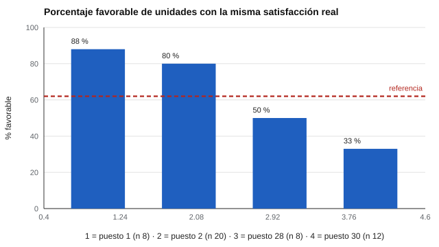

# 166 — Satisfacción académica y laboral


<!-- NAV -->
[← 165 — Habilidades sociales y empatía](../165-habilidades-sociales-y-empatia/README.md) · [📚 Parte 16](../README.md) · [🗺️ Índice 001–200](../../../PROGRAMA.md) · [167 — Escalas de síntomas: qué no se puede hacer si… →](../167-escalas-de-sintomas-que-no-se-puede/README.md)
<!-- /NAV -->

**Parte 16 — Evaluación socioemocional y bienestar** · Nivel avanzado · 4 h · Estado `escrita`
**Pensada para:** quien informa resultados de encuestas de satisfacción por unidad, y quien es comparado con ellos.
**Prerrequisitos:** clases 128 y 026.

> Datos simulados con satisfacción idéntica en todas las unidades.

## ¿Para qué te sirve esto?

«La Unidad 12 tiene 88 % de satisfacción; la Unidad 30, 33 %. Hay que revisar a su jefatura.» Con rankings así se premia o se sanciona. Esta clase muestra un experimento incómodo: **30 unidades con exactamente la misma satisfacción real (62 %)** producen, solo por azar, un ranking con unidades en la cima y en el fondo. Y las unidades pequeñas ocupan los extremos. Aprenderás a informar el porcentaje favorable con un **intervalo de Wilson** y a no comparar unidades como si las diferencias fueran reales.

## Al terminar esta clase podrás

- Informar porcentaje favorable con intervalo de Wilson.
- Reconocer los extremos espurios en rankings de unidades pequeñas.
- Evitar comparar unidades como si las diferencias fueran reales.

## La idea en palabras simples

Una forma frecuente de informar satisfacción es el **porcentaje «favorable»** (respuestas 4–5). Con pocos respondentes es muy variable. El **intervalo de Wilson** (Wilson, 1927; Brown, Cai y DasGupta, 2001) tiene mejor cobertura que el intervalo normal y muestra cuán incierto es el porcentaje. La relación entre satisfacción laboral y desempeño es modesta (Judge et al., 2001), así que tampoco debe tomarse como medida de desempeño.

## Cómo funciona, paso a paso

**1. Simular** 30 unidades con la misma satisfacción real (62 %) y tamaños de 8 a 100.

**2. Ordenar** por porcentaje favorable.

**3. Calcular** el intervalo de Wilson de cada unidad.

**Ejemplo resuelto.** k = 7 de n = 8: p = 0,875; Wilson ≈ [0,53; 0,98]: la «mejor» unidad es compatible con el promedio.



*Figura 1.* Los extremos del ranking los ocupan unidades pequeñas.

## Si construyes el instrumento

- Informa siempre el intervalo, no solo el porcentaje.
- Suprime unidades con muy pocas respuestas (clase 128).
- No compares unidades de tamaños muy distintos sin ajustar.
- Usa los resultados para conversar, no para sancionar.

## Si eres evaluado

- Un porcentaje bajo en una unidad pequeña puede ser azar.
- Pide el intervalo y el número de respondentes.
- La satisfacción no es desempeño.

## Qué muestra el laboratorio

Satisfacción real igual en las 30 unidades: 62 % favorable.

| Puesto | n | % favorable | IC 95 % de Wilson |
|---:|---:|---:|---|
| 1 | 8 | 88 % | [53 %; 98 %] |
| 2 | 20 | 80 % | [58 %; 92 %] |
| 3 | 25 | 76 % | [57 %; 89 %] |
| 4 | 12 | 75 % | [47 %; 91 %] |
| 28 | 8 | 50 % | [22 %; 78 %] |
| 29 | 15 | 47 % | [25 %; 70 %] |
| 30 | 12 | 33 % | [14 %; 61 %] |

De las 6 unidades de arriba, 4 tienen n ≤ 15; de las 6 de abajo, 3. Solo 1 de 30 intervalos excluye el 62 % real.

**Análisis.** (1) Los extremos del ranking los ocupan unidades pequeñas por pura variación. (2) Los intervalos de unidades pequeñas son tan anchos que no permiten rankear. (3) Se suprime lo que no cumple un mínimo de respuestas. (4) La satisfacción no es desempeño.

## Errores frecuentes

- Publicar rankings sin intervalos.
- Comparar unidades de tamaños muy distintos.
- Reportar unidades con muy pocos respondentes.
- Interpretar satisfacción como desempeño.

## Lo mínimo que debes llevarte

1. Un porcentaje favorable tiene incertidumbre.
2. Wilson cubre mejor que el intervalo normal.
3. Las unidades pequeñas ocupan los extremos por azar.
4. Se informa con intervalos y mínimos de respuesta.

## Ejercicios

- **Inicial.** ¿Qué es un porcentaje favorable? *Solución: la proporción de respuestas en los niveles positivos de la escala (por ejemplo, 4 y 5).*
- **Intermedio.** p = 0,5 y n = 10. *Solución: Wilson ≈ [0,26; 0,74].*
- **Avanzado.** Aumenta el n mínimo a 30 en `lab.py` y observa los extremos.
- **Aplicación.** Redacta cómo informarías los resultados a una unidad de 8 personas.

## Glosario

- **Porcentaje favorable:** proporción de respuestas positivas.
- **Intervalo de Wilson:** intervalo de confianza para una proporción.
- **Ranking espurio:** orden generado por variación aleatoria.
- **Satisfacción laboral:** valoración del propio trabajo.

## Laboratorio

```bash
python classes/part-16-evaluacion-socioemocional-y-bienestar/166-satisfaccion-academica-y-laboral/lab.py
python classes/part-16-evaluacion-socioemocional-y-bienestar/figuras.py
```

## Autoevaluación y criterios

1. ¿Cómo informarías unidades pequeñas? 2. ¿Qué acción derivas de una encuesta? 3. ¿Cómo evitas que se use para sancionar?
Se logra la clase si informas con intervalos y evitas rankings espurios.

## Bibliografía

- Wilson, E. B. (1927). Probable inference, the law of succession, and statistical inference. *Journal of the American Statistical Association*, 22(158), 209-212. ✅ [DOI](https://doi.org/10.1080/01621459.1927.10502953)
- Brown, L. D., Cai, T. T., & DasGupta, A. (2001). Interval estimation for a binomial proportion. *Statistical Science*, 16(2), 101-133. ✅ [DOI](https://doi.org/10.1214/ss/1009213286)
- Judge, T. A., Thoresen, C. J., Bono, J. E., & Patton, G. K. (2001). The job satisfaction–job performance relationship: A qualitative and quantitative review. *Psychological Bulletin*, 127(3), 376-407. ✅ [DOI](https://doi.org/10.1037/0033-2909.127.3.376)

Leyenda: ✅ existe en Crossref con título y año coincidentes (enlace al DOI); ⚠️ hay una obra de título parecido con otro año (no se enlaza: comprobar la edición); 🔎 no verificada automáticamente (libros sin DOI, normas y sitios web). Crossref confirma la existencia de la fuente, no que respalde cada afirmación de la clase. Ver [`docs/VERIFICACION_BIBLIOGRAFIA.md`](../../../docs/VERIFICACION_BIBLIOGRAFIA.md).

---

<!-- NAV -->
[← 165 — Habilidades sociales y empatía](../165-habilidades-sociales-y-empatia/README.md)  
[📚 Parte 16](../README.md) · [🗺️ Índice 001–200](../../../PROGRAMA.md)  
[167 — Escalas de síntomas: qué no se puede hacer si… →](../167-escalas-de-sintomas-que-no-se-puede/README.md)
<!-- /NAV -->
