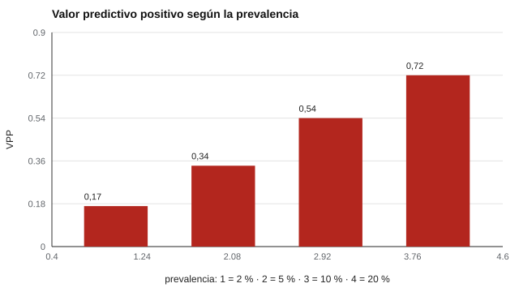

# 167 — Escalas de síntomas: qué no se puede hacer sin un profesional


<!-- NAV -->
[← 166 — Satisfacción académica y laboral](../166-satisfaccion-academica-y-laboral/README.md) · [📚 Parte 16](../README.md) · [🗺️ Índice 001–200](../../../PROGRAMA.md) · [168 — Protocolo de derivación y de riesgo →](../168-protocolo-de-derivacion-y-de-riesgo/README.md)
<!-- /NAV -->

**Parte 16 — Evaluación socioemocional y bienestar** · Nivel avanzado · 4 h · Estado `escrita`
**Pensada para:** quien necesita saber qué rol le corresponde ante una escala de síntomas, y quien la responde.
**Prerrequisitos:** clases 100 y 135.

> La escala y los datos son sintéticos: **no se usan para decidir sobre personas**. Aplicar o interpretar escalas de síntomas clínicos exige un profesional competente. Si tú o alguien cercano está en riesgo, busca ayuda profesional o los canales oficiales vigentes (consulta minsal.cl).

## ¿Para qué te sirve esto?

Hay escalas de síntomas (por ejemplo, el PHQ-9 para síntomas depresivos) que parecen sencillas: nueve preguntas, un puntaje y un corte. Es tentador usarlas en un colegio o en una empresa. Esta clase explica **por qué sin un profesional y sin un protocolo no se debe**: (1) con prevalencia baja, la mayoría de los «positivos» son falsos positivos; (2) los ítems de **seguridad** requieren una regla propia, independiente del puntaje total; (3) cada rol (docente, orientador, psicólogo, equipo de salud) tiene límites distintos.

## Al terminar esta clase podrás

- Calcular el valor predictivo de un cribado de síntomas según la prevalencia.
- Diseñar una regla de seguridad independiente del puntaje total y probarla.
- Delimitar qué puede hacer cada rol.

## La idea en palabras simples

Las escalas de síntomas (Kroenke, Spitzer y Williams, 2001) son instrumentos de **cribado y seguimiento**, **no de diagnóstico**. Con prevalencia baja, la mayoría de los positivos son falsos positivos (clase 100; Streiner y Norman, 2008). Los ítems de **seguridad** se tratan aparte: cualquier respuesta de riesgo activa un protocolo humano, **aunque el puntaje total sea bajo**. «Positivo» significa «conversar y evaluar», nunca «tiene el trastorno».

## Cómo funciona, paso a paso

**1. Calcular** el VPP de un cribado (corte ≥ 10) para distintas prevalencias.

**2. Definir** una regla de seguridad: ítem de riesgo > 0 ⇒ alerta de seguridad, independiente del total.

**3. Probarla** automáticamente con 100 000 protocolos.

**Ejemplo resuelto.** Total = 4 (por debajo del corte) pero ítem de riesgo = 1: no hay «positivo de cribado», pero sí alerta de seguridad: se activa el contacto humano.



*Figura 1.* Con prevalencia baja, la mayoría de los positivos son falsos positivos.

## Si construyes el instrumento

- Define el protocolo de respuesta **antes** de aplicar la escala.
- Mantén el ítem de riesgo separado del puntaje total.
- Prueba automáticamente la regla de seguridad.
- Restringe el acceso a los datos y no los reportes a terceros sin necesidad.

## Si eres evaluado

- Un puntaje sobre el corte no es un diagnóstico; es una invitación a conversar y evaluar.
- Tienes derecho a saber quién verá tus respuestas y qué pasará si indicas riesgo.
- Si estás pasando por un momento difícil, busca apoyo profesional o los canales oficiales de ayuda.

## Qué muestra el laboratorio

| Prevalencia | Positivos | VPP |
|---:|---:|---:|
| 2 % | 2 890 | 0,17 |
| 5 % | 3 495 | 0,34 |
| 10 % | 4 667 | 0,54 |
| 20 % | 6 780 | 0,72 |

Respuestas con ítem de riesgo > 0 sin alerta de seguridad, en 100 000 protocolos: **0** (propiedad probada).

**Análisis.** (1) Con prevalencias bajas, la mayoría de los positivos son falsos positivos. (2) La alerta de seguridad es independiente del puntaje total y lleva a contacto humano inmediato según un protocolo (clase 168). (3) Interpretar o aplicar escalas de síntomas clínicos exige un profesional competente. (4) Escala y datos sintéticos.

## Errores frecuentes

- Interpretar un puntaje como diagnóstico o reportarlo a terceros sin necesidad.
- Aplicar escalas de síntomas sin un protocolo de respuesta definido de antemano.
- Promediar el ítem de riesgo con los demás.
- Usar la escala sintética para decidir sobre personas.

## Lo mínimo que debes llevarte

1. Cribado no es diagnóstico.
2. Con baja prevalencia, el VPP es bajo.
3. La alerta de seguridad es independiente del total.
4. Aplicar e interpretar exige un profesional y un protocolo.

## Ejercicios

- **Inicial.** ¿Qué significa «positivo» en un cribado? *Solución: que corresponde conversar y evaluar más, no que tenga el trastorno.*
- **Intermedio.** VPP con S = 0,85, E = 0,90 y p = 0,05. *Solución: 0,31.*
- **Avanzado.** Añade una prueba automática que falle si el ítem de riesgo se omite sin alerta.
- **Aplicación.** Escribe, para tu contexto, qué puede y qué no puede hacer cada rol ante una escala de síntomas.

## Glosario

- **Cribado:** prueba breve para detectar riesgo en población general.
- **VPP:** proporción de positivos que realmente tienen la condición.
- **Ítem de seguridad:** ítem cuya respuesta activa un protocolo humano.
- **Protocolo de respuesta:** qué hacer, quién y en qué plazo ante una señal.

## Laboratorio

```bash
python classes/part-16-evaluacion-socioemocional-y-bienestar/167-escalas-de-sintomas-que-no-se-puede/lab.py
python classes/part-16-evaluacion-socioemocional-y-bienestar/figuras.py
```

## Autoevaluación y criterios

1. ¿Quién puede aplicar e interpretar estas escalas en tu contexto? 2. ¿Qué haces ante una respuesta de riesgo? 3. ¿Qué datos se guardan y quién accede?
Se logra la clase si calculas el VPP y diseñas una regla de seguridad verificada por pruebas.

## Bibliografía y fuentes

- Kroenke, K., Spitzer, R. L., & Williams, J. B. W. (2001). The PHQ-9: Validity of a brief depression severity measure. *Journal of General Internal Medicine*, 16(9), 606-613. ✅ [DOI](https://doi.org/10.1097/00006842-200203000-00008)
- Streiner, D. L., & Norman, G. R. (2008). *Health Measurement Scales* (4.ª ed.). Oxford University Press. ✅ [DOI](https://doi.org/10.1093/acprof:oso/9780199231881.001.0001)
- Ministerio de Salud de Chile: orientaciones de prevención del suicidio y canales de ayuda (versión vigente: verificar en minsal.cl). 🔎 sin verificar (libro, norma o sitio no hallado en Crossref: comprobar a mano)

Leyenda: ✅ existe en Crossref con título y año coincidentes (enlace al DOI); ⚠️ hay una obra de título parecido con otro año (no se enlaza: comprobar la edición); 🔎 no verificada automáticamente (libros sin DOI, normas y sitios web). Crossref confirma la existencia de la fuente, no que respalde cada afirmación de la clase. Ver [`docs/VERIFICACION_BIBLIOGRAFIA.md`](../../../docs/VERIFICACION_BIBLIOGRAFIA.md).

---

<!-- NAV -->
[← 166 — Satisfacción académica y laboral](../166-satisfaccion-academica-y-laboral/README.md)  
[📚 Parte 16](../README.md) · [🗺️ Índice 001–200](../../../PROGRAMA.md)  
[168 — Protocolo de derivación y de riesgo →](../168-protocolo-de-derivacion-y-de-riesgo/README.md)
<!-- /NAV -->
