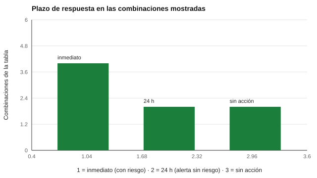

# 168 — Protocolo de derivación y de riesgo


<!-- NAV -->
[← 167 — Escalas de síntomas: qué no se puede hacer si…](../167-escalas-de-sintomas-que-no-se-puede/README.md) · [📚 Parte 16](../README.md) · [🗺️ Índice 001–200](../../../PROGRAMA.md) · [169 — Evaluación socioemocional escolar →](../169-evaluacion-socioemocional-escolar/README.md)
<!-- /NAV -->

**Parte 16 — Evaluación socioemocional y bienestar** · Nivel avanzado · 4 h · Estado `escrita`
**Pensada para:** quien diseña o revisa protocolos de respuesta ante riesgo, y quien podría ser objeto de uno.
**Prerrequisitos:** clases 135 y 167.

> Los plazos del laboratorio son ilustrativos. Los canales de ayuda y los plazos reales se verifican en la fuente oficial vigente. La tecnología no reemplaza al equipo humano.

## ¿Para qué te sirve esto?

Cuando una evaluación detecta una señal de riesgo, el peor momento para improvisar es ese. Un buen **protocolo** responde cuatro preguntas: ¿qué señal activa qué acción?, ¿quién actúa?, ¿en qué plazo?, ¿qué se registra? Esta clase te enseña a modelarlo como una **máquina de estados** pequeña y a **probar de forma exhaustiva** que cumple sus invariantes de seguridad, en vez de confiar en que alguien lo revise «a ojo» o lo recuerde en el momento.

## Al terminar esta clase podrás

- Modelar un protocolo de derivación como máquina de estados.
- Verificar sus invariantes de seguridad de forma exhaustiva.
- Definir roles, plazos y registro.

## La idea en palabras simples

Como el espacio de entradas es pequeño (alerta × riesgo × disponibilidad de profesional), se pueden probar **todas las combinaciones** (Reason, 1990: las defensas del sistema importan más que la memoria individual). El laboratorio fija cuatro **invariantes**:

- **I1.** Riesgo inmediato ⇒ contacto humano inmediato.
- **I2.** Alerta alta o riesgo ⇒ el caso no se cierra sin revisión humana.
- **I3.** Si hay alerta, nunca se responde «sin acción».
- **I4.** Si no hay profesional disponible, se escala.

## Cómo funciona, paso a paso

**1. Enumerar** las combinaciones de entradas (aquí, 12).

**2. Definir** la acción y el plazo para cada una.

**3. Verificar** que ninguna combinación viola un invariante.

**Ejemplo resuelto.** Alerta 0 con riesgo = sí: el nivel de alerta del cribado no importa; el indicador de riesgo manda (I1).



*Figura 1.* Toda combinación con riesgo se atiende de inmediato.

## Si construyes el instrumento

- Escribe el protocolo antes de aplicar cualquier instrumento.
- Verifica las invariantes con pruebas automáticas.
- Asigna roles y plazos, y define el registro.
- No automatices la decisión humana: el sistema alerta y registra, el equipo actúa.

## Si eres evaluado

- Pregunta qué ocurrirá si indicas una situación de riesgo.
- Tienes derecho a que se te acompañe y a que se informe a tu familia de forma respetuosa.
- Si estás en riesgo, busca ayuda inmediata con los canales oficiales vigentes.

## Qué muestra el laboratorio

Combinaciones verificadas: 12; violaciones de invariantes: 0.

| Alerta | Riesgo | Profesional | Acción | Plazo |
|---:|---|---|---|---|
| 2 | sí | sí | contacto humano inmediato y acompañamiento | inmediato |
| 2 | sí | no | escalar de inmediato a la jefatura de turno | inmediato |
| 2 | no | sí | derivar a profesional y contactar a la familia | 24 h |
| 2 | no | no | escalar y agendar derivación | 24 h |
| 0 | sí | sí | contacto humano inmediato y acompañamiento | inmediato |
| 0 | sí | no | escalar de inmediato a la jefatura de turno | inmediato |
| 0 | no | sí/no | sin acción específica; mantener monitoreo universal | — |

**Análisis.** (1) Las reglas de seguridad se prueban de forma exhaustiva, no se confía en revisarlas a ojo. (2) Un protocolo define quién actúa, en qué plazo y qué queda registrado. (3) La tecnología no reemplaza al equipo humano. (4) Los canales de ayuda reales se verifican en la fuente oficial.

## Errores frecuentes

- Depender de que alguien «recuerde» el protocolo.
- No registrar: sin registro no hay aprendizaje ni responsabilidad.
- Automatizar la decisión humana.
- Usar plazos ilustrativos como si fueran los oficiales.

## Lo mínimo que debes llevarte

1. Un protocolo responde qué, quién, cuándo y qué se registra.
2. Se prueba de forma exhaustiva con invariantes.
3. El riesgo manda sobre el nivel de alerta.
4. El sistema alerta; el equipo humano decide y actúa.

## Ejercicios

- **Inicial.** ¿Qué es un invariante? *Solución: una propiedad que debe cumplirse siempre, en todas las combinaciones.*
- **Intermedio.** Agrega una invariante nueva (por ejemplo, «todo caso inmediato queda registrado») y compruébala.
- **Avanzado.** Añade un nivel de alerta intermedio con reglas propias y verifica las invariantes.
- **Aplicación.** Dibuja el protocolo de tu institución con roles, plazos y registro.

## Glosario

- **Máquina de estados:** modelo de un proceso con estados y transiciones.
- **Invariante:** propiedad que siempre se cumple.
- **Escalar:** pasar el caso a un nivel de responsabilidad superior.
- **Registro:** constancia de lo ocurrido y de quién actuó.

## Laboratorio

```bash
python classes/part-16-evaluacion-socioemocional-y-bienestar/168-protocolo-de-derivacion-y-de-riesgo/lab.py
python classes/part-16-evaluacion-socioemocional-y-bienestar/figuras.py
```

## Autoevaluación y criterios

1. ¿Quién es responsable en cada paso? 2. ¿Cómo se informa a la familia? 3. ¿Cómo se cuida a quien aplica la evaluación?
Se logra la clase si modelas un protocolo y pruebas sus invariantes.

## Bibliografía y fuentes

- Reason, J. (1990). *Human Error*. Cambridge University Press. ✅ [DOI](https://doi.org/10.1017/cbo9781139062367)
- Ministerio de Salud de Chile: orientaciones y canales de ayuda vigentes (verificar en minsal.cl). 🔎 sin verificar (libro, norma o sitio no hallado en Crossref: comprobar a mano)

Leyenda: ✅ existe en Crossref con título y año coincidentes (enlace al DOI); ⚠️ hay una obra de título parecido con otro año (no se enlaza: comprobar la edición); 🔎 no verificada automáticamente (libros sin DOI, normas y sitios web). Crossref confirma la existencia de la fuente, no que respalde cada afirmación de la clase. Ver [`docs/VERIFICACION_BIBLIOGRAFIA.md`](../../../docs/VERIFICACION_BIBLIOGRAFIA.md).

---

<!-- NAV -->
[← 167 — Escalas de síntomas: qué no se puede hacer si…](../167-escalas-de-sintomas-que-no-se-puede/README.md)  
[📚 Parte 16](../README.md) · [🗺️ Índice 001–200](../../../PROGRAMA.md)  
[169 — Evaluación socioemocional escolar →](../169-evaluacion-socioemocional-escolar/README.md)
<!-- /NAV -->
