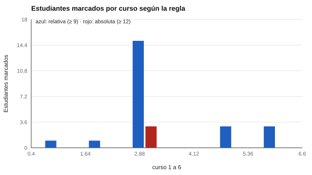

# 169 — Evaluación socioemocional escolar


<!-- NAV -->
[← 168 — Protocolo de derivación y de riesgo](../168-protocolo-de-derivacion-y-de-riesgo/README.md) · [📚 Parte 16](../README.md) · [🗺️ Índice 001–200](../../../PROGRAMA.md) · [170 — Intervenciones: recomendaciones, intervención… →](../170-intervenciones-recomendaciones-intervencion-profesional-y-tratamiento/README.md)
<!-- /NAV -->

**Parte 16 — Evaluación socioemocional y bienestar** · Nivel avanzado · 4 h · Estado `escrita`
**Pensada para:** equipos escolares que consideran un cribado universal, y estudiantes y familias que lo reciben.
**Prerrequisitos:** clases 128 y 168.

> Datos sintéticos. Los resultados individuales se manejan con confidencialidad, consentimiento y protocolo de derivación (clase 168).

## ¿Para qué te sirve esto?

Algunos colegios aplican un cuestionario breve a todo el estudiantado (por ejemplo, el SDQ de Goodman) para ver quién podría necesitar apoyo. La decisión clave es **cómo marcar a quién**: con una regla **relativa** («el 10 % con puntajes más altos») o con una **absoluta** («puntaje ≥ 12»). La relativa siempre marca a alrededor del 10 %, aunque toda la escuela esté muy bien; la absoluta ve diferencias reales pero necesita un corte bien fundamentado. Esta clase te muestra la diferencia con seis cursos y te enseña a leer los resultados también **a nivel de curso**.

## Al terminar esta clase podrás

- Comparar reglas relativas y absolutas para marcar estudiantes.
- Usar los resultados también a nivel de curso.
- Cuidar la confidencialidad en el cribado universal.

## La idea en palabras simples

El **cribado universal** en la escuela (Humphrey y Wigelsworth, 2016) busca identificar necesidades de apoyo en toda la población con un informe breve (por ejemplo, el SDQ, Goodman, 1997; se consultan sus condiciones de uso). Una regla **relativa** marca a un porcentaje fijo; una **absoluta** marca a quienes superan un corte. Además, un resultado **de curso** (por ejemplo, una media muy alta) puede apuntar a clima o convivencia de ese curso, es decir, a una intervención de aula, no a «estudiantes problema».

## Cómo funciona, paso a paso

**1. Simular** 6 cursos de 30 estudiantes (escala 0–20), con el curso 3 con dificultades mayores.

**2. Calcular** el corte relativo (percentil 90 de la escuela = 9) y el absoluto (12).

**3. Contar** marcados por curso con cada regla.

**Ejemplo resuelto.** El curso 3 tiene una media más del doble que los demás: es una señal de clima o convivencia de ese curso, que pide una intervención de aula, no 15 casos individuales.



*Figura 1.* La regla relativa marca en todos los cursos; la absoluta, solo donde hay diferencia real.

## Si construyes el instrumento

- Cribar solo con consentimiento, protocolo de derivación y apoyos disponibles.
- Funda el corte absoluto en la población propia, no copiado de otra.
- Informa los resultados individuales solo a quien deba actuar.
- Usa los resultados de curso para intervenciones de aula.

## Si eres evaluado (o eres familia)

- Pregunta quién verá los resultados y qué apoyos hay.
- Ser marcado no es un diagnóstico.
- Tienes derecho a que la información no se use para etiquetar.

## Qué muestra el laboratorio

Corte relativo (percentil 90 de la escuela) = 9; corte absoluto = 12.

| Curso | Media | Marcados (relativa, ≥ 9) | Marcados (absoluta, ≥ 12) |
|---:|---:|---:|---:|
| 1 | 3,6 | 1 | 0 |
| 2 | 4,6 | 1 | 0 |
| 3 | 8,2 | 15 | 3 |
| 4 | 3,5 | 0 | 0 |
| 5 | 4,3 | 3 | 0 |
| 6 | 4,5 | 3 | 0 |

Total: 23 con la regla relativa y 3 con la absoluta.

**Análisis.** (1) La regla relativa marca alrededor del 10 % aunque la escuela esté muy bien. (2) La absoluta depende de un corte bien fundamentado y ve la diferencia real. (3) El resultado de curso puede apuntar a una intervención de aula. (4) Los resultados individuales se manejan con confidencialidad, consentimiento y protocolo.

## Errores frecuentes

- Cribar sin consentimiento, sin protocolo o sin apoyos disponibles.
- Informar resultados individuales a docentes sin necesidad.
- Usar un corte absoluto copiado de otra población.
- Tratar un curso con media alta como «un grupo de casos».

## Lo mínimo que debes llevarte

1. Regla relativa: marca un porcentaje fijo.
2. Regla absoluta: marca por un corte.
3. El nivel de curso también es información.
4. La confidencialidad y el protocolo son condiciones previas.

## Ejercicios

- **Inicial.** ¿Qué diferencia hay entre regla relativa y absoluta? *Solución: la relativa marca un porcentaje fijo de la población; la absoluta, a quienes superan un corte.*
- **Intermedio.** Si el cribado marca al 10 % de 1 200 estudiantes. *Solución: 120.*
- **Avanzado.** Mide en `lab.py` qué ocurre si todos los cursos son iguales (medias 4).
- **Aplicación.** Escribe quién ve qué en un cribado socioemocional escolar.

## Glosario

- **Cribado universal:** aplicación a todo el estudiantado.
- **Regla relativa / absoluta:** marcar por porcentaje / por corte.
- **Confidencialidad:** resguardo de la información individual.
- **Clima de curso:** ambiente de convivencia del curso.

## Laboratorio

```bash
python classes/part-16-evaluacion-socioemocional-y-bienestar/169-evaluacion-socioemocional-escolar/lab.py
python classes/part-16-evaluacion-socioemocional-y-bienestar/figuras.py
```

## Autoevaluación y criterios

1. ¿Qué apoyos tiene la escuela para quienes sean marcados? 2. ¿Quién ve qué? 3. ¿Cómo evaluarás el programa?
Se logra la clase si comparas reglas y propones un uso de apoyo con confidencialidad.

## Bibliografía

- Goodman, R. (1997). The Strengths and Difficulties Questionnaire: A research note. *Journal of Child Psychology and Psychiatry*, 38(5), 581-586. ✅ [DOI](https://doi.org/10.1111/j.1469-7610.1997.tb01545.x)
- Humphrey, N., & Wigelsworth, M. (2016). Making the case for universal school-based mental health screening. *Emotional and Behavioural Difficulties*, 21(1), 22-42. ✅ [DOI](https://doi.org/10.1080/13632752.2015.1120051)

Leyenda: ✅ existe en Crossref con título y año coincidentes (enlace al DOI); ⚠️ hay una obra de título parecido con otro año (no se enlaza: comprobar la edición); 🔎 no verificada automáticamente (libros sin DOI, normas y sitios web). Crossref confirma la existencia de la fuente, no que respalde cada afirmación de la clase. Ver [`docs/VERIFICACION_BIBLIOGRAFIA.md`](../../../docs/VERIFICACION_BIBLIOGRAFIA.md).

---

<!-- NAV -->
[← 168 — Protocolo de derivación y de riesgo](../168-protocolo-de-derivacion-y-de-riesgo/README.md)  
[📚 Parte 16](../README.md) · [🗺️ Índice 001–200](../../../PROGRAMA.md)  
[170 — Intervenciones: recomendaciones, intervención… →](../170-intervenciones-recomendaciones-intervencion-profesional-y-tratamiento/README.md)
<!-- /NAV -->
