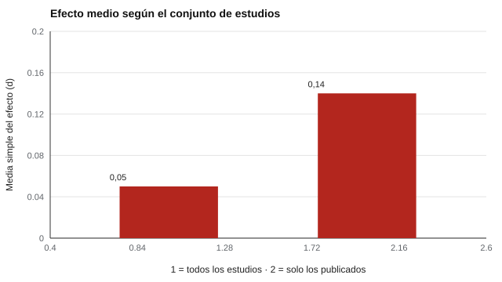

# 170 — Intervenciones: recomendaciones, intervención profesional y tratamiento


<!-- NAV -->
[← 169 — Evaluación socioemocional escolar](../169-evaluacion-socioemocional-escolar/README.md) · [📚 Parte 16](../README.md) · [🗺️ Índice 001–200](../../../PROGRAMA.md) · [171 — Diseño de un estudio de validación →](../../part-17-investigacion-psicometrica-y-analisis-de-datos/171-diseno-de-un-estudio-de-validacion/README.md)
<!-- /NAV -->

**Parte 16 — Evaluación socioemocional y bienestar** · Nivel avanzado · 5 h · Estado `escrita`
**Pensada para:** quien recomienda o evalúa programas de intervención, y familias o docentes que reciben esas recomendaciones.
**Prerrequisitos:** clases 039 y 160.

> Simulación con supuestos de publicación. Esta clase no recomienda ningún programa específico.

## ¿Para qué te sirve esto?

«Este programa mejora la atención y la inteligencia, hay estudios que lo demuestran.» Antes de creerlo conviene hacerse dos preguntas. Primera: **¿qué tipo de acción es?** No es lo mismo una *recomendación pedagógica*, una *intervención profesional* y un *tratamiento clínico*. Segunda: **¿qué estudios vemos?** Si solo se publican los resultados favorables, la evidencia visible exagera el efecto. Esta clase te permite verlo con una simulación: con un efecto verdadero casi nulo (d = 0,05), la literatura publicada muestra uno casi tres veces mayor.

## Al terminar esta clase podrás

- Distinguir recomendaciones pedagógicas, intervención profesional y tratamiento clínico.
- Reconocer el sesgo de publicación como razón para no prometer mejoras.
- Pedir evidencia sobre transferencia antes de recomendar un programa.

## La idea en palabras simples

- **Recomendación general** (pedagógica): sugerencias de buena práctica con evidencia acumulada, al alcance de docentes y familias.
- **Intervención profesional:** programas estructurados aplicados por profesionales formados, con objetivos y seguimiento.
- **Tratamiento clínico:** actos de salud, a cargo de profesionales habilitados, tras un diagnóstico.

La eficacia aparente puede inflarse si solo se publican los estudios significativos (Rosenthal, 1979: «problema del cajón»; Egger et al., 1997). El entrenamiento de memoria de trabajo ilustra la distancia entre **mejorar la tarea entrenada** y **transferir a la inteligencia** (Melby-Lervåg, Redick y Hulme, 2016).

## Cómo funciona, paso a paso

**1. Simular** 400 estudios con un efecto verdadero de d = 0,05.

**2. Publicar** los significativos y el 10 % de los demás (64 publicados).

**3. Comparar** la media de todos los estudios con la de los publicados.

**Ejemplo resuelto.** Si una revisión solo incluye 64 de 400 estudios (los significativos), el efecto promedio aparente (0,14) es 2,8 veces el verdadero (0,05).



*Figura 1.* Lo publicado casi triplica el efecto verdadero.

## Si construyes el instrumento

- Clasifica cada actividad: recomendación, intervención profesional o tratamiento.
- Pide registro previo del estudio, tamaños de muestra, medidas de transferencia y replicación independiente.
- No prometas mejoras cognitivas o conductuales sin evidencia de transferencia.
- Deriva a profesionales habilitados cuando corresponda.

## Si eres evaluado (o eres familia)

- Desconfía de promesas de mejora «general» a partir de un entrenamiento específico.
- Pregunta quién aplica el programa, con qué formación y qué evidencia independiente lo respalda.
- Un tratamiento clínico requiere un diagnóstico de un profesional habilitado.

## Qué muestra el laboratorio

400 estudios con efecto verdadero d = 0,05; se publican los significativos y 10 % de los demás (64 publicados).

| Conjunto | Media simple | Media ponderada |
|---|---:|---:|
| Todos los estudios | 0,05 | 0,06 |
| Solo los publicados | 0,14 | 0,13 |

**Análisis.** (1) Si solo se publica lo significativo, la media simple se infla varias veces. (2) La media ponderada se infla menos porque los estudios grandes pesan más. (3) El test de Egger es poco potente aquí. (4) Ante afirmaciones como «el entrenamiento cognitivo mejora la inteligencia», se pide revisar registros previos, tamaños de muestra y transferencia.

## Errores frecuentes

- Prometer mejoras cognitivas o conductuales sin evidencia de transferencia.
- Confundir la mejora en la tarea entrenada con mejora general.
- Recomendar un programa solo porque «hay estudios».
- Llamar «tratamiento» a una actividad no clínica.

## Lo mínimo que debes llevarte

1. Recomendación, intervención y tratamiento son distintos.
2. El sesgo de publicación infla los efectos visibles.
3. La transferencia hay que demostrarla.
4. Se piden registros previos y replicaciones.

## Ejercicios

- **Inicial.** ¿Qué es el sesgo de publicación? *Solución: que se publiquen más los resultados favorables o significativos, distorsionando la evidencia visible.*
- **Intermedio.** ¿Qué datos pedirías antes de adoptar un programa? *Solución: registro previo, tamaños de muestra, medidas de transferencia y replicación independiente.*
- **Avanzado.** Cambia la probabilidad de publicar no significativos a 50 % y observa la media simple.
- **Aplicación.** Clasifica tres actividades de tu contexto en recomendación, intervención o tratamiento.

## Glosario

- **Sesgo de publicación:** publicación selectiva de resultados favorables.
- **Transferencia:** mejora en habilidades distintas a la entrenada.
- **Registro previo:** declaración pública del plan antes del estudio.
- **Tratamiento clínico:** acto de salud de un profesional habilitado.

## Laboratorio

```bash
python classes/part-16-evaluacion-socioemocional-y-bienestar/170-intervenciones-recomendaciones-intervencion-profesional-y-tratamiento/lab.py
python classes/part-16-evaluacion-socioemocional-y-bienestar/figuras.py
```

## Autoevaluación y criterios

1. ¿Cómo clasificarías una actividad de «fortalecimiento de atención»? 2. ¿Qué dirías a una familia que pregunta por un programa popular? 3. ¿Cuándo derivarías?
Se logra la clase si clasificas correctamente y rechazas promesas sin respaldo.

## Bibliografía

- Rosenthal, R. (1979). The file drawer problem and tolerance for null results. *Psychological Bulletin*, 86(3), 638-641. ✅ [DOI](https://doi.org/10.1037/0033-2909.86.3.638)
- Egger, M., Davey Smith, G., Schneider, M., & Minder, C. (1997). Bias in meta-analysis detected by a simple, graphical test. *BMJ*, 315, 629-634. ✅ [DOI](https://doi.org/10.1136/bmj.315.7109.629)
- Melby-Lervåg, M., Redick, T. S., & Hulme, C. (2016). Working memory training does not improve performance on measures of intelligence or other measures of "far transfer". *Perspectives on Psychological Science*, 11(4), 512-534. ✅ [DOI](https://doi.org/10.1177/1745691616635612)

Leyenda: ✅ existe en Crossref con título y año coincidentes (enlace al DOI); ⚠️ hay una obra de título parecido con otro año (no se enlaza: comprobar la edición); 🔎 no verificada automáticamente (libros sin DOI, normas y sitios web). Crossref confirma la existencia de la fuente, no que respalde cada afirmación de la clase. Ver [`docs/VERIFICACION_BIBLIOGRAFIA.md`](../../../docs/VERIFICACION_BIBLIOGRAFIA.md).

---

<!-- NAV -->
[← 169 — Evaluación socioemocional escolar](../169-evaluacion-socioemocional-escolar/README.md)  
[📚 Parte 16](../README.md) · [🗺️ Índice 001–200](../../../PROGRAMA.md)  
[171 — Diseño de un estudio de validación →](../../part-17-investigacion-psicometrica-y-analisis-de-datos/171-diseno-de-un-estudio-de-validacion/README.md)
<!-- /NAV -->
