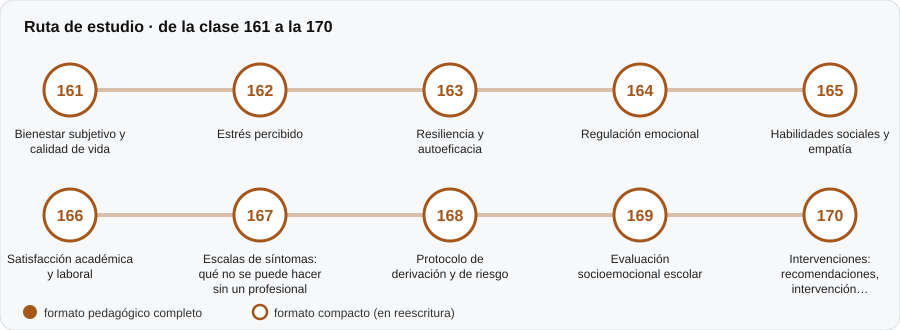

# ❤️ Parte 16 — Evaluación socioemocional y bienestar

**Nivel:** avanzado · **Duración estimada:** 4-5 semanas · **Clases:** 10

## De qué trata

Medición de bienestar y habilidades socioemocionales, con protocolos de protección y derivación.

## Por qué importa

Medir bienestar toca temas sensibles; hay límites claros sobre lo que un cuestionario puede y no puede decir.

## Según tu papel

- **Si construyes o aplicas instrumentos:** Cómo diseñar, aplicar y comunicar estas medidas, y cuándo derivar.
- **Si eres evaluado o recibes resultados:** Qué esperar de una evaluación así y qué hacer si algo te inquieta.

## Al terminar esta parte podrás

- Aplicar un protocolo de derivación.
- Explicar por qué una escala de síntomas no diagnostica.

## Cómo estudiarla

Lee primero las clases 167 y 168. Material educativo, no clínico; ante riesgo se acude a un profesional.

## Ruta de estudio

## Clases en orden de estudio

Las clases están numeradas de forma consecutiva (001 a 200) en el orden de estudio: sigue el número.

| Orden | ID | Clase | Qué aprenderás | Formato | Horas |
|---:|---|---|---|---|---:|
| 1 | 161 | [Bienestar subjetivo y calidad de vida](161-bienestar-subjetivo-y-calidad-de-vida/README.md) | Distinguir bienestar subjetivo, satisfacción con la vida y calidad de vida. | ✅ pedagógico | 4 |
| 2 | 162 | [Estrés percibido](162-estres-percibido/README.md) | Distinguir estrés percibido de estresores y de trastornos. | ✅ pedagógico | 4 |
| 3 | 163 | [Resiliencia y autoeficacia](163-resiliencia-y-autoeficacia/README.md) | Entender la resiliencia como resultado a lo largo del tiempo. | ✅ pedagógico | 4 |
| 4 | 164 | [Regulación emocional](164-regulacion-emocional/README.md) | Distinguir asociaciones entre personas y dentro de la persona. | ✅ pedagógico | 4 |
| 5 | 165 | [Habilidades sociales y empatía](165-habilidades-sociales-y-empatia/README.md) | Distinguir empatía cognitiva y afectiva y su medición. | ✅ pedagógico | 4 |
| 6 | 166 | [Satisfacción académica y laboral](166-satisfaccion-academica-y-laboral/README.md) | Informar porcentaje favorable con intervalo de Wilson. | ✅ pedagógico | 4 |
| 7 | 167 | [Escalas de síntomas: qué no se puede hacer sin un profesional](167-escalas-de-sintomas-que-no-se-puede/README.md) | Calcular el valor predictivo de un cribado de síntomas según la prevalencia. | ✅ pedagógico | 4 |
| 8 | 168 | [Protocolo de derivación y de riesgo](168-protocolo-de-derivacion-y-de-riesgo/README.md) | Modelar un protocolo de derivación como máquina de estados. | ✅ pedagógico | 4 |
| 9 | 169 | [Evaluación socioemocional escolar](169-evaluacion-socioemocional-escolar/README.md) | Comparar reglas relativas y absolutas para marcar estudiantes. | ✅ pedagógico | 4 |
| 10 | 170 | [Intervenciones: recomendaciones, intervención profesional y tratamiento](170-intervenciones-recomendaciones-intervencion-profesional-y-tratamiento/README.md) | Distinguir recomendaciones pedagógicas, intervención profesional y tratamiento clínico. | ✅ pedagógico | 4 |

[← Volver al índice del programa](../../README.md) · [Índice numérico de las 200 clases](../../PROGRAMA.md)
