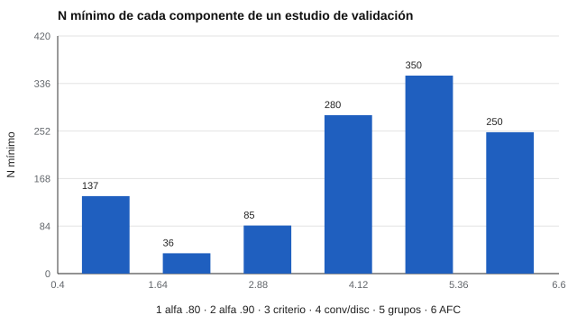

# 171 — Diseño de un estudio de validación


<!-- NAV -->
[← 170 — Intervenciones: recomendaciones, intervención…](../../part-16-evaluacion-socioemocional-y-bienestar/170-intervenciones-recomendaciones-intervencion-profesional-y-tratamiento/README.md) · [📚 Parte 17](../README.md) · [🗺️ Índice 001–200](../../../PROGRAMA.md) · [172 — Tamaño muestral y potencia →](../172-tamano-muestral-y-potencia/README.md)
<!-- /NAV -->

**Parte 17 — Investigación psicométrica y análisis de datos** · Nivel avanzado · 5 h · Estado `escrita`
**Pensada para:** quien planifica validar un instrumento, y quien debe evaluar si un estudio de validación es serio.
**Prerrequisitos:** clases 031 a 035 y 039.

> Aproximaciones estándar con supuestos en el código; el plan se afina por simulación (clase 173).

## ¿Para qué te sirve esto?

«Validamos el test con 150 personas.» ¿Es suficiente? Depende de **qué se quiera afirmar**. Cada afirmación de validez (la escala es fiable, correlaciona con un criterio, distingue grupos, tiene una estructura determinada) tiene su propio **costo muestral**. Con 150 personas se puede estimar bien un alfa, pero no distinguir una correlación convergente de una discriminante cercana. Esta clase te enseña a traducir cada afirmación en una hipótesis, un análisis y un N mínimo, y a declarar el plan **antes** de ver los datos.

## Al terminar esta clase podrás

- Traducir cada afirmación de validez en una hipótesis, un análisis y un tamaño de muestra.
- Calcular tamaños de muestra mínimos con supuestos explícitos.
- Preparar un plan previo que se pueda preinscribir.

## La idea en palabras simples

Un estudio de validación reúne evidencia de varias fuentes: **contenido, procesos de respuesta, estructura interna, relaciones con otras variables y consecuencias** (AERA/APA/NCME, 2014). Hay guías prácticas para las fases de desarrollo y validación (DeVellis, 2017; Boateng et al., 2018). Cada componente tiene su N mínimo, y **el componente más exigente fija el N del estudio**.

## Cómo funciona, paso a paso

**1. Listar** las afirmaciones de validez que se quieren sostener.

**2. Para cada una**, definir la hipótesis, el análisis, el efecto esperado y la fiabilidad supuesta.

**3. Calcular** el N mínimo de cada componente y tomar el mayor.

**Ejemplo resuelto.** Correlación r = 0,30 con 80 % de potencia: n = ((1,96 + 0,84) / atanh 0,30)² + 3 = (2,80 / 0,3095)² + 3 ≈ 85.



*Figura 1.* La diferencia entre grupos conocidos fija el N del estudio: 350 personas.

## Si construyes el instrumento

- Declara el efecto esperado y la fiabilidad supuesta de cada cálculo.
- Calcula el N de cada componente y toma el mayor.
- Registra el plan antes de recolectar datos.
- Discute la representatividad de la muestra de conveniencia.

## Si eres evaluado

- Pregunta cuántas personas participaron en la validación y cómo se las eligió.
- Un instrumento validado con una muestra muy distinta a ti puede no funcionar igual contigo.

## Qué muestra el laboratorio

| Componente | N mínimo |
|---|---:|
| Fiabilidad (alfa = 0,80; 12 ítems; ±0,05) | 137 |
| Fiabilidad (alfa = 0,90; 12 ítems; ±0,05) | 36 |
| Correlación con un criterio (r = 0,30) | 85 |
| Convergente 0,50 > discriminante 0,30 | 280 |
| Diferencia entre grupos conocidos (d = 0,30) | 350 |
| AFC (10 casos × 25 parámetros) | 250 |

El componente más exigente fija el N: 350 personas.

**Análisis.** (1) Cada afirmación de validez tiene su propio costo muestral. (2) Un estudio con 150 personas puede estimar un alfa con precisión razonable, pero no distingue una correlación convergente de una discriminante cercana. (3) El plan se declara antes de ver los datos (clase 178). (4) Los supuestos del cálculo se documentan.

## Errores frecuentes

- Calcular el N solo para el análisis más fácil.
- No declarar el efecto esperado ni la fiabilidad supuesta.
- Usar una muestra de conveniencia sin discutir su representatividad.
- Tomar las fórmulas aproximadas como definitivas.

## Lo mínimo que debes llevarte

1. Cada afirmación de validez tiene hipótesis, análisis y N.
2. El componente más exigente fija el N.
3. Los supuestos se declaran.
4. El plan se registra antes de recolectar.

## Ejercicios

- **Inicial.** Nombra las cinco fuentes de evidencia de los *Standards*. *Solución: contenido, procesos de respuesta, estructura interna, relaciones con otras variables y consecuencias.*
- **Intermedio.** Calcula n para r = 0,20 y 80 % de potencia. *Solución: ((2,80) / 0,2027)² + 3 ≈ 194.*
- **Avanzado.** Completa el plan con un componente de invarianza entre sexos.
- **Aplicación.** Escribe el plan de validación de un cuestionario de 15 ítems que tú propongas.

## Glosario

- **Evidencia de validez:** información que respalda las interpretaciones de los puntajes.
- **Potencia:** probabilidad de detectar un efecto que existe.
- **AFC:** análisis factorial confirmatorio.
- **Preinscripción:** registro público del plan antes del estudio.

## Laboratorio

```bash
python classes/part-17-investigacion-psicometrica-y-analisis-de-datos/171-diseno-de-un-estudio-de-validacion/lab.py
python classes/part-17-investigacion-psicometrica-y-analisis-de-datos/figuras.py
```

## Autoevaluación y criterios

1. ¿Qué evidencia es imprescindible para tu uso? 2. ¿Qué harías con N menor al requerido? 3. ¿Qué parte registrarías antes de recolectar?
Se logra la clase si produces un plan con hipótesis, análisis y N justificado.

## Bibliografía

- AERA, APA, & NCME (2014). *Standards for Educational and Psychological Testing*. AERA. 🔎 sin verificar (libro, norma o sitio no hallado en Crossref: comprobar a mano)
- DeVellis, R. F. (2017). *Scale Development: Theory and Applications* (4.ª ed.). Sage. ⚠️ hay una obra de título parecido en Crossref con otro año (1992): comprobar la edición a mano
- Boateng, G. O., Neilands, T. B., Frongillo, E. A., Melgar-Quiñonez, H. R., & Young, S. L. (2018). Best practices for developing and validating scales for health, social, and behavioral research: A primer. *Frontiers in Public Health*, 6, 149. ✅ [DOI](https://doi.org/10.3389/fpubh.2018.00149)

Leyenda: ✅ existe en Crossref con título y año coincidentes (enlace al DOI); ⚠️ hay una obra de título parecido con otro año (no se enlaza: comprobar la edición); 🔎 no verificada automáticamente (libros sin DOI, normas y sitios web). Crossref confirma la existencia de la fuente, no que respalde cada afirmación de la clase. Ver [`docs/VERIFICACION_BIBLIOGRAFIA.md`](../../../docs/VERIFICACION_BIBLIOGRAFIA.md).

---

<!-- NAV -->
[← 170 — Intervenciones: recomendaciones, intervención…](../../part-16-evaluacion-socioemocional-y-bienestar/170-intervenciones-recomendaciones-intervencion-profesional-y-tratamiento/README.md)  
[📚 Parte 17](../README.md) · [🗺️ Índice 001–200](../../../PROGRAMA.md)  
[172 — Tamaño muestral y potencia →](../172-tamano-muestral-y-potencia/README.md)
<!-- /NAV -->
