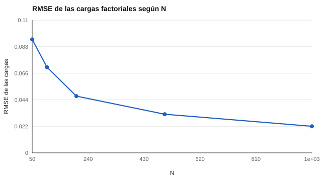

# 172 — Tamaño muestral y potencia


<!-- NAV -->
[← 171 — Diseño de un estudio de validación](../171-diseno-de-un-estudio-de-validacion/README.md) · [📚 Parte 17](../README.md) · [🗺️ Índice 001–200](../../../PROGRAMA.md) · [173 — Simulación de datos psicométricos →](../173-simulacion-de-datos-psicometricos/README.md)
<!-- /NAV -->

**Parte 17 — Investigación psicométrica y análisis de datos** · Nivel avanzado · 4 h · Estado `escrita`
**Pensada para:** quien necesita justificar el N de un análisis factorial o de fiabilidad.
**Prerrequisitos:** clases 042 y 171.

> Cargas y ruido del laboratorio supuestos; un solo factor.

## ¿Para qué te sirve esto?

«Para un análisis factorial se necesitan 10 casos por ítem.» «N ≥ 200.» Son reglas muy repetidas, pero **no son leyes**. Cuántos casos se necesitan depende de lo fuertes que sean las cargas, de cuántos ítems hay por factor y de la comunalidad. Con cargas altas y pocos factores bastan menos casos; con cargas bajas, muchos más. Esta clase te muestra cómo mejora la precisión con N en un caso concreto y por qué la forma fiable de justificar un N es **simular con tus supuestos**.

## Al terminar esta clase podrás

- Estimar cómo cambia la precisión de las cargas factoriales con N.
- Entender por qué las reglas fijas de N son heurísticas.
- Calcular el error de estimación de una matriz de correlaciones.

## La idea en palabras simples

El tamaño muestral necesario para el análisis factorial depende de la fuerza de las cargas, el número de ítems por factor y la comunalidad (MacCallum et al., 1999). Para el alfa existe una fórmula de precisión (van Zyl, Neudecker y Nel, 2000; Bonett, 2002). Lo más fiable es **simular**. El error de estimación decrece con **1/√N**: para reducirlo a la mitad hay que **cuadruplicar** la muestra.

## Cómo funciona, paso a paso

**1. Definir** un factor con 10 ítems con cargas entre 0,4 y 0,8.

**2. Generar** 40 réplicas para cada N (50 a 1 000).

**3. Medir** el RMSE de las cargas, la frecuencia de subestimación > 0,15 y el SRMR muestral.

**Ejemplo resuelto.** De N = 200 a N = 800 (× 4), el RMSE debería caer a la mitad: 0,047 → ≈ 0,024.



*Figura 1.* La precisión mejora con la raíz de N, no linealmente.

## Si construyes el instrumento

- Justifica el N con simulación y tus supuestos de cargas.
- No uses «10 casos por ítem» sin mirar las cargas.
- Distingue el ajuste de la matriz de correlaciones del ajuste del modelo.
- Reporta la precisión esperada de las cargas.

## Si eres evaluado

- Un instrumento validado con N pequeño tiene cargas estimadas con más incertidumbre.
- Pregunta cómo se justificó el tamaño de la muestra.

## Qué muestra el laboratorio

| N | RMSE de las cargas | Alguna carga subestimada > 0,15 | SRMR muestral |
|---:|---:|---:|---:|
| 50 | 0,094 | 40 % | 0,119 |
| 100 | 0,071 | 28 % | 0,087 |
| 200 | 0,047 | 2 % | 0,058 |
| 500 | 0,032 | 0 % | 0,039 |
| 1 000 | 0,022 | 0 % | 0,027 |

**Análisis.** (1) Con N = 50 las cargas se estiman con un error comparable a su diferencia entre ítems. (2) La precisión mejora con la raíz de N, no linealmente. (3) Las reglas como «N ≥ 200» son heurísticas. (4) El cálculo para tu estudio se hace por simulación con tus supuestos.

## Errores frecuentes

- Aplicar «10 casos por ítem» sin mirar las cargas.
- Confundir ajuste de la matriz con ajuste del modelo.
- Extrapolar a modelos con varios factores o datos ordinales.
- Tomar las cargas del laboratorio como universales.

## Lo mínimo que debes llevarte

1. El N necesario depende de cargas, ítems por factor y comunalidad.
2. El error decrece con 1/√N.
3. Las reglas fijas son heurísticas.
4. Se justifica por simulación.

## Ejercicios

- **Inicial.** ¿Qué es el RMSE? *Solución: la raíz del error cuadrático medio; el tamaño típico del error de estimación.*
- **Intermedio.** Si el RMSE con N = 100 es 0,07, ¿con N = 400? *Solución: ≈ 0,035.*
- **Avanzado.** Reduce las cargas a 0,3–0,5 en `lab.py` y observa el N necesario.
- **Aplicación.** Escribe cómo responderías si te piden «una regla» para el N de un factorial.

## Glosario

- **Carga factorial:** relación entre un ítem y el factor.
- **Comunalidad:** parte de la varianza del ítem explicada por los factores.
- **RMSE:** error cuadrático medio (raíz).
- **SRMR:** residuo estandarizado cuadrático medio.

## Laboratorio

```bash
python classes/part-17-investigacion-psicometrica-y-analisis-de-datos/172-tamano-muestral-y-potencia/lab.py
python classes/part-17-investigacion-psicometrica-y-analisis-de-datos/figuras.py
```

## Autoevaluación y criterios

1. ¿Cómo justificarías el N de tu estudio? 2. ¿Qué pasa con cargas bajas? 3. ¿Qué dirías si te piden «una regla»?
Se logra la clase si justificas el N por simulación y no por una regla fija.

## Bibliografía

- MacCallum, R. C., Widaman, K. F., Zhang, S., & Hong, S. (1999). Sample size in factor analysis. *Psychological Methods*, 4(1), 84-99. ✅ [DOI](https://doi.org/10.1037/1082-989x.4.1.84)
- Bonett, D. G. (2002). Sample size requirements for testing and estimating coefficient alpha. *Journal of Educational and Behavioral Statistics*, 27(4), 335-340. ✅ [DOI](https://doi.org/10.3102/10769986027004335)
- van Zyl, J. M., Neudecker, H., & Nel, D. G. (2000). On the distribution of the maximum likelihood estimator of Cronbach's alpha. *Psychometrika*, 65(3), 271-280. ✅ [DOI](https://doi.org/10.1007/bf02296146)

Leyenda: ✅ existe en Crossref con título y año coincidentes (enlace al DOI); ⚠️ hay una obra de título parecido con otro año (no se enlaza: comprobar la edición); 🔎 no verificada automáticamente (libros sin DOI, normas y sitios web). Crossref confirma la existencia de la fuente, no que respalde cada afirmación de la clase. Ver [`docs/VERIFICACION_BIBLIOGRAFIA.md`](../../../docs/VERIFICACION_BIBLIOGRAFIA.md).

---

<!-- NAV -->
[← 171 — Diseño de un estudio de validación](../171-diseno-de-un-estudio-de-validacion/README.md)  
[📚 Parte 17](../README.md) · [🗺️ Índice 001–200](../../../PROGRAMA.md)  
[173 — Simulación de datos psicométricos →](../173-simulacion-de-datos-psicometricos/README.md)
<!-- /NAV -->
