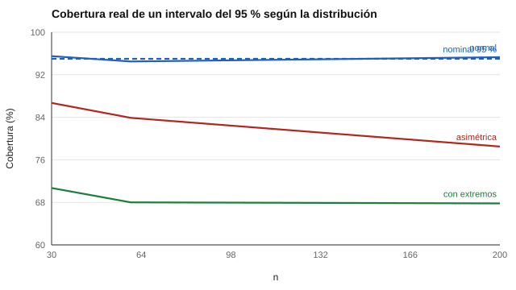

# 173 — Simulación de datos psicométricos


<!-- NAV -->
[← 172 — Tamaño muestral y potencia](../172-tamano-muestral-y-potencia/README.md) · [📚 Parte 17](../README.md) · [🗺️ Índice 001–200](../../../PROGRAMA.md) · [174 — Datos faltantes en instrumentos →](../174-datos-faltantes-en-instrumentos/README.md)
<!-- /NAV -->

**Parte 17 — Investigación psicométrica y análisis de datos** · Nivel avanzado · 4 h · Estado `escrita`
**Pensada para:** quien quiere comprobar si un método estadístico merece confianza, y quien lee estudios de simulación.
**Prerrequisitos:** clases 172 y 027.

> Una simulación solo prueba lo que se le pregunta: los escenarios se justifican.

## ¿Para qué te sirve esto?

Los intervalos de confianza vienen con una promesa: «contiene el valor verdadero el 95 % de las veces». ¿Se cumple siempre? Solo si los datos cumplen los supuestos del método. Una **simulación de Monte Carlo** genera datos de un modelo conocido, aplica el método y compara el resultado con la verdad. Esta clase te muestra un caso concreto: el intervalo de confianza para una correlación cubre el 95 % con datos normales, pero **baja a 68–78 % con datos asimétricos o con valores extremos**, aun con n = 200.

## Al terminar esta clase podrás

- Diseñar un estudio de Monte Carlo con escenarios justificados.
- Medir la cobertura real de un intervalo de confianza.
- Detectar condiciones donde un método no cumple lo que promete.

## La idea en palabras simples

Un estudio de simulación genera datos de un modelo conocido, aplica un método y compara sus resultados con la verdad (Morris, White y Crowther, 2019). Se informan **sesgo, error y cobertura**. La **cobertura** es la proporción de intervalos que contienen el valor verdadero. El intervalo de Fisher para r (Fisher, 1915) supone aproximadamente normalidad bivariada. Si los datos no la cumplen, la cobertura real se desvía del 95 % nominal.

## Cómo funciona, paso a paso

**1. Fijar** escenarios: distribución normal, asimétrica y con extremos (10 %), con r ≈ 0,40.

**2. Generar** 2 000 réplicas por celda (n = 30, 60, 200).

**3. Contar** en cuántas el intervalo contiene la r poblacional.

**Ejemplo resuelto.** Con 2 000 réplicas, el error de Monte Carlo de una cobertura de 95 % es √(0,95 · 0,05 / 2 000) = 0,5 %: diferencias de 1 punto ya son detectables.



*Figura 1.* Con datos no normales, la cobertura queda lejos del 95 % y no mejora con n.

## Si construyes el instrumento

- Prueba tus métodos en escenarios plausibles de tus datos, no solo en el favorable.
- Usa suficientes réplicas y fija la semilla (clase 178).
- Reporta sesgo, error y cobertura.
- Con datos asimétricos, considera alternativas (bootstrap, Spearman).

## Si eres evaluado

- Un intervalo de confianza «del 95 %» no siempre cubre el 95 %.
- Pregunta si el método fue probado en condiciones parecidas a las de los datos.

## Qué muestra el laboratorio

| Distribución | r poblacional | Cobertura n = 30 | n = 60 | n = 200 |
|---|---:|---:|---:|---:|
| Normal | 0,399 | 95,5 % | 94,5 % | 95,3 % |
| Asimétrica (lognormal) | 0,288 | 86,7 % | 83,9 % | 78,5 % |
| Con extremos (10 %) | 0,403 | 70,7 % | 68,0 % | 67,8 % |

**Análisis.** (1) Con datos normales la cobertura es ~95 %. (2) Con asimetría fuerte o valores extremos cae, incluso con n = 200. (3) Simular los métodos bajo condiciones plausibles es una forma barata de saber si merecen confianza. (4) La correlación poblacional se recalcula en cada distribución.

## Errores frecuentes

- Probar un método solo en el escenario favorable.
- Reportar muy pocas réplicas.
- No fijar la semilla.
- Concluir más allá de los escenarios probados.

## Lo mínimo que debes llevarte

1. Monte Carlo compara un método con la verdad conocida.
2. Cobertura = proporción de intervalos que contienen el valor verdadero.
3. Un método puede fallar bajo condiciones no previstas.
4. Los escenarios se justifican.

## Ejercicios

- **Inicial.** ¿Qué es la cobertura? *Solución: la proporción de intervalos de confianza que contienen el valor verdadero.*
- **Intermedio.** Error de Monte Carlo para cobertura 90 % con 500 réplicas. *Solución: √(0,09 / 500) = 1,3 %.*
- **Avanzado.** Agrega un escenario con datos ordinales de 5 categorías.
- **Aplicación.** Diseña una simulación para comprobar si el alfa de Cronbach es robusto con 5 categorías de respuesta.

## Glosario

- **Monte Carlo:** estudio basado en datos simulados.
- **Réplica:** una repetición de la simulación.
- **Cobertura:** frecuencia real con que un intervalo contiene el valor verdadero.
- **Cobertura nominal:** la prometida (por ejemplo, 95 %).

## Laboratorio

```bash
python classes/part-17-investigacion-psicometrica-y-analisis-de-datos/173-simulacion-de-datos-psicometricos/lab.py
python classes/part-17-investigacion-psicometrica-y-analisis-de-datos/figuras.py
```

## Autoevaluación y criterios

1. ¿Qué escenarios incluirías? 2. ¿Cómo reportarías los resultados? 3. ¿Qué método alternativo usarías con datos asimétricos? (bootstrap, Spearman)
Se logra la clase si mides cobertura bajo varias condiciones y concluyes con cautela.

## Bibliografía

- Morris, T. P., White, I. R., & Crowther, M. J. (2019). Using simulation studies to evaluate statistical methods. *Statistics in Medicine*, 38(11), 2074-2102. ✅ [DOI](https://doi.org/10.1002/sim.8086)
- Fisher, R. A. (1915). Frequency distribution of the values of the correlation coefficient in samples from an indefinitely large population. *Biometrika*, 10(4), 507-521. ✅ [DOI](https://doi.org/10.2307/2331838)

Leyenda: ✅ existe en Crossref con título y año coincidentes (enlace al DOI); ⚠️ hay una obra de título parecido con otro año (no se enlaza: comprobar la edición); 🔎 no verificada automáticamente (libros sin DOI, normas y sitios web). Crossref confirma la existencia de la fuente, no que respalde cada afirmación de la clase. Ver [`docs/VERIFICACION_BIBLIOGRAFIA.md`](../../../docs/VERIFICACION_BIBLIOGRAFIA.md).

---

<!-- NAV -->
[← 172 — Tamaño muestral y potencia](../172-tamano-muestral-y-potencia/README.md)  
[📚 Parte 17](../README.md) · [🗺️ Índice 001–200](../../../PROGRAMA.md)  
[174 — Datos faltantes en instrumentos →](../174-datos-faltantes-en-instrumentos/README.md)
<!-- /NAV -->
