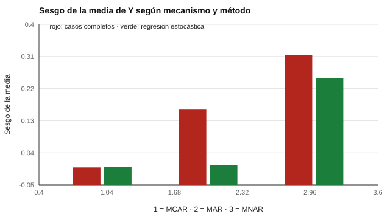

# 174 — Datos faltantes en instrumentos


<!-- NAV -->
[← 173 — Simulación de datos psicométricos](../173-simulacion-de-datos-psicometricos/README.md) · [📚 Parte 17](../README.md) · [🗺️ Índice 001–200](../../../PROGRAMA.md) · [175 — Análisis longitudinal y cambio confiable →](../175-analisis-longitudinal-y-cambio-confiable/README.md)
<!-- /NAV -->

**Parte 17 — Investigación psicométrica y análisis de datos** · Nivel avanzado · 4 h · Estado `escrita`
**Pensada para:** quien analiza datos con respuestas omitidas, y quien deja preguntas en blanco.
**Prerrequisitos:** clases 027 y 172.

> Simulación con mecanismos simples; en la práctica se usa imputación múltiple.

## ¿Para qué te sirve esto?

Casi todo conjunto de datos de cuestionarios tiene respuestas faltantes. La forma de tratarlas, **sin pensarlo**, puede sesgar los resultados. Imputar con el promedio parece inocente, pero **siempre subestima la correlación**. Descartar a quienes tienen datos faltantes parece neutral, pero si quienes omiten son distintos, el promedio se sesga. Lo importante es **por qué** faltan los datos. Esta clase te enseña los tres mecanismos (MCAR, MAR, MNAR), compara tres métodos y muestra qué no se puede corregir.

## Al terminar esta clase podrás

- Distinguir MCAR, MAR y MNAR.
- Comparar casos completos, imputación por la media y regresión estocástica.
- Planificar la prevención de datos faltantes.

## La idea en palabras simples

Rubin (1976) clasificó los mecanismos:

- **MCAR** (*missing completely at random*): la omisión es al azar.
- **MAR** (*missing at random*): depende de variables observadas.
- **MNAR** (*missing not at random*): depende del propio valor faltante.

Los casos completos son insesgados bajo MCAR; bajo MAR se requiere un método que use las variables observadas (imputación múltiple, máxima verosimilitud; Schafer y Graham, 2002). **Bajo MNAR ningún método simple corrige.**

## Cómo funciona, paso a paso

**1. Simular** una variable X completa y una Y con 30 % faltante (r verdadera 0,50; media verdadera 0).

**2. Generar** la omisión según cada mecanismo.

**3. Medir** el sesgo de la media y de la correlación con cada método (300 réplicas).

**Ejemplo resuelto.** Bajo MAR (los de bajo X responden menos), la media de Y de los completos sobreestima; imputar con Y ~ X recupera la media (sesgo +0,005) porque X explica la ausencia.



*Figura 1.* El sesgo de la media aparece bajo MAR y MNAR con casos completos; solo la regresión corrige bajo MAR.

## Si construyes el instrumento

- Previene las omisiones: instrucciones claras, pocas preguntas sensibles, seguimiento.
- Registra por qué faltan los datos, si es posible.
- Haz análisis de sensibilidad ante MNAR.
- No imputes por la media para analizar como si fuera completo.

## Si eres evaluado

- Dejar preguntas en blanco puede afectar cómo se interpretan los resultados del grupo.
- Pregunta qué se hace con las respuestas omitidas.

## Qué muestra el laboratorio

Verdad: media de Y = 0,00; correlación X–Y = 0,50.

| Mecanismo | Método | Sesgo de la media | Sesgo de r |
|---|---|---:|---:|
| MCAR | completos | −0,001 | −0,001 |
| MCAR | media | −0,001 | −0,082 |
| MCAR | regresión estocástica | −0,000 | −0,001 |
| MAR | completos | +0,161 | −0,041 |
| MAR | media | +0,161 | −0,161 |
| MAR | regresión estocástica | +0,005 | −0,003 |
| MNAR | completos | +0,314 | −0,038 |
| MNAR | media | +0,314 | −0,130 |
| MNAR | regresión estocástica | +0,249 | −0,030 |

**Análisis.** (1) Bajo MCAR los casos completos son insesgados (con menos datos). (2) Bajo MAR, la media de casos completos se sesga, pero se corrige si el modelo de imputación incluye la variable causante. (3) Imputar por la media subestima la correlación siempre. (4) Bajo MNAR ningún método simple corrige.

## Errores frecuentes

- Imputar por la media y analizar como si fuera completo.
- Suponer MAR sin argumento: no es verificable con los datos.
- Descartar variables que explican la ausencia.
- Ignorar el mecanismo de omisión.

## Lo mínimo que debes llevarte

1. Importa por qué faltan los datos.
2. Casos completos funcionan solo bajo MCAR.
3. La imputación por la media subestima correlaciones.
4. Bajo MNAR hace falta análisis de sensibilidad y prevención.

## Ejercicios

- **Inicial.** ¿Qué diferencia hay entre MAR y MNAR? *Solución: en MAR la omisión depende de lo observado; en MNAR, del propio valor omitido.*
- **Intermedio.** ¿Cómo previene un diseño las omisiones? *Solución: instrucciones claras, pocas preguntas sensibles y seguimiento.*
- **Avanzado.** Reduce el porcentaje faltante a 10 % y observa los sesgos.
- **Aplicación.** Escribe el plan de manejo de datos faltantes de un estudio que propongas.

## Glosario

- **MCAR / MAR / MNAR:** mecanismos de omisión.
- **Imputación:** reemplazar valores faltantes por estimaciones.
- **Regresión estocástica:** imputación con una predicción más ruido.
- **Análisis de sensibilidad:** probar cuánto cambian las conclusiones bajo supuestos distintos.

## Laboratorio

```bash
python classes/part-17-investigacion-psicometrica-y-analisis-de-datos/174-datos-faltantes-en-instrumentos/lab.py
python classes/part-17-investigacion-psicometrica-y-analisis-de-datos/figuras.py
```

## Autoevaluación y criterios

1. ¿Qué mecanismo es plausible en tu estudio? 2. ¿Qué análisis de sensibilidad harías? 3. ¿Qué informarías?
Se logra la clase si eliges un tratamiento según el mecanismo y declaras tus supuestos.

## Bibliografía

- Rubin, D. B. (1976). Inference and missing data. *Biometrika*, 63(3), 581-592. [DOI](https://doi.org/10.1093/biomet/63.3.581)
- Schafer, J. L., & Graham, J. W. (2002). Missing data: Our view of the state of the art. *Psychological Methods*, 7(2), 147-177. [DOI](https://doi.org/10.1037/1082-989x.7.2.147)

---

<!-- NAV -->
[← 173 — Simulación de datos psicométricos](../173-simulacion-de-datos-psicometricos/README.md)  
[📚 Parte 17](../README.md) · [🗺️ Índice 001–200](../../../PROGRAMA.md)  
[175 — Análisis longitudinal y cambio confiable →](../175-analisis-longitudinal-y-cambio-confiable/README.md)
<!-- /NAV -->
