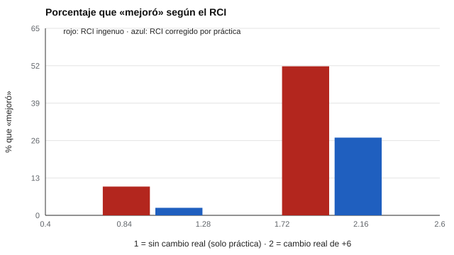

# 175 — Análisis longitudinal y cambio confiable


<!-- NAV -->
[← 174 — Datos faltantes en instrumentos](../174-datos-faltantes-en-instrumentos/README.md) · [📚 Parte 17](../README.md) · [🗺️ Índice 001–200](../../../PROGRAMA.md) · [176 — Estimación de incertidumbre y bootstrap →](../176-estimacion-de-incertidumbre-y-bootstrap/README.md)
<!-- /NAV -->

**Parte 17 — Investigación psicométrica y análisis de datos** · Nivel avanzado · 4 h · Estado `escrita`
**Pensada para:** quien evalúa cambio individual con pruebas repetidas, y quien se vuelve a evaluar.
**Prerrequisitos:** clases 025 y 162.

> Datos simulados con parámetros supuestos.

## ¿Para qué te sirve esto?

Alguien rinde una prueba, recibe un programa y la rinde otra vez: sube 10 puntos. ¿Mejoró? Dos cosas pueden engañar: (1) el **error de medida**, que hace que la diferencia entre dos mediciones sea más ruidosa que cada una; (2) el **efecto de práctica**, que hace que mejores solo por haber hecho la prueba antes. Esta clase te enseña el **índice de cambio fiable (RCI)** y cómo corregirlo por práctica; sin corregir, **un 10 % de personas sin cambio real parece haber mejorado** (se esperaba 2,5 %).

## Al terminar esta clase podrás

- Calcular el índice de cambio fiable (RCI).
- Corregir por efecto de práctica.
- Distinguir cambio fiable de cambio importante.

## La idea en palabras simples

El RCI (Jacobson y Truax, 1991) compara el cambio observado con el error de la diferencia:

**RCI = (X₂ − X₁) / EE_dif,   EE_dif = √2 · ETM,   ETM = DE · √(1 − fiabilidad)**

Un |RCI| > 1,96 indica cambio fiable. Cuando hay **efecto de práctica**, se descuenta la mejora esperada (Chelune et al., 1993; Hageman y Arrindell, 1999). Un cambio fiable no es necesariamente un cambio **importante** (clase 162).

## Cómo funciona, paso a paso

**1. Calcular** ETM y EE_dif (DE = 10; fiabilidad 0,90 → ETM = 3,16; EE_dif = 4,47; umbral 8,77).

**2. Simular** 2 condiciones: sin cambio real (solo práctica de +3 puntos) y cambio real de +6.

**3. Contar** cuántas personas se declaran «mejoró» con el RCI ingenuo y con el RCI corregido por práctica.

**Ejemplo resuelto.** Cambio observado 10 puntos y práctica 3: RCI ingenuo = 10 / 4,47 = 2,24 (mejoró); RCI corregido = 7 / 4,47 = 1,57 (sin cambio fiable).



*Figura 1.* Sin corregir la práctica, un 10 % sin cambio real parece haber mejorado.

## Si construyes el instrumento

- Estima la práctica con un grupo de comparación o con datos de repetición.
- Usa formas alternas de la prueba.
- Usa fiabilidades de la población en que aplicas.
- Distingue cambio fiable de cambio importante.

## Si eres evaluado

- Mejorar en una prueba repetida puede deberse a la práctica.
- Un cambio pequeño puede ser ruido de medición.
- Pregunta cómo se calculó el «cambio fiable» y si se descontó la práctica.

## Qué muestra el laboratorio

ETM = 3,16; EE_dif = 4,47; umbral de cambio fiable = 8,77 puntos.

| Condición | RCI ingenuo: «mejoró» | RCI con práctica: «mejoró» |
|---|---:|---:|
| Sin cambio real (solo práctica) | 10,0 % | 2,6 % |
| Cambio real de +6 puntos | 51,8 % | 27,0 % |

**Análisis.** (1) Sin corregir la práctica, un 10 % de personas sin cambio real aparece como «mejoró» (el esperado por azar es 2,5 %). (2) El efecto de práctica se estima con un grupo de comparación o datos de repetición y se descuenta. (3) «Cambio fiable» no es «cambio importante». (4) Un umbral de 8,77 puntos exige cambios grandes: la sensibilidad es baja (27 % de detección de +6).

## Errores frecuentes

- Ignorar la práctica en pruebas repetidas.
- Confundir cambio fiable con cambio clínicamente importante.
- Aplicar el RCI con fiabilidades de otra población.
- Esperar que el RCI detecte cambios pequeños.

## Lo mínimo que debes llevarte

1. RCI = cambio / EE_dif, con EE_dif = √2 · ETM.
2. La práctica produce falsos «mejoró».
3. Se corrige descontando la mejora esperada.
4. Fiable no es lo mismo que importante.

## Ejercicios

- **Inicial.** ¿Qué es el efecto de práctica? *Solución: la mejora por haber hecho la prueba antes, sin cambio en la habilidad.*
- **Intermedio.** EE_dif con DE = 15 y fiabilidad 0,95. *Solución: 15 · √0,05 · 1,414 = 4,74.*
- **Avanzado.** Cambia la práctica a 5 puntos y observa el RCI ingenuo.
- **Aplicación.** Diseña cómo estimarías el efecto de práctica de una prueba de memoria.

## Glosario

- **RCI:** índice de cambio fiable.
- **ETM:** error típico de medida.
- **Efecto de práctica:** mejora por repetición.
- **Cambio importante:** cambio relevante para la persona.

## Laboratorio

```bash
python classes/part-17-investigacion-psicometrica-y-analisis-de-datos/175-analisis-longitudinal-y-cambio-confiable/lab.py
python classes/part-17-investigacion-psicometrica-y-analisis-de-datos/figuras.py
```

## Autoevaluación y criterios

1. ¿Cómo estimarías la práctica? 2. ¿Qué formas alternas usarías? 3. ¿Cómo informarías el cambio a la persona?
Se logra la clase si corriges por práctica y no sobreinterpretas.

## Bibliografía

- Jacobson, N. S., & Truax, P. (1991). Clinical significance: A statistical approach to defining meaningful change in psychotherapy research. *Journal of Consulting and Clinical Psychology*, 59(1), 12-19. [DOI](https://doi.org/10.1037/0022-006x.59.1.12)
- Chelune, G. J., Naugle, R. I., Lüders, H., Sedlak, J., & Awad, I. A. (1993). Individual change after epilepsy surgery: Practice effects and base-rate information. *Neuropsychology*, 7(1), 41-52.
- Hageman, W. J. J. M., & Arrindell, W. A. (1999). Establishing clinically significant change: Increment of precision and the distinction between individual and group level analysis. *Behaviour Research and Therapy*, 37(12), 1169-1193.

---

<!-- NAV -->
[← 174 — Datos faltantes en instrumentos](../174-datos-faltantes-en-instrumentos/README.md)  
[📚 Parte 17](../README.md) · [🗺️ Índice 001–200](../../../PROGRAMA.md)  
[176 — Estimación de incertidumbre y bootstrap →](../176-estimacion-de-incertidumbre-y-bootstrap/README.md)
<!-- /NAV -->
