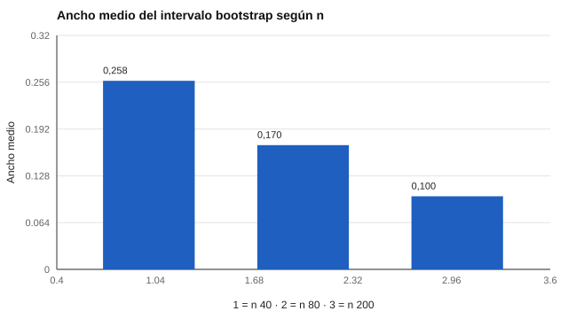

# 176 — Estimación de incertidumbre y bootstrap


<!-- NAV -->
[← 175 — Análisis longitudinal y cambio confiable](../175-analisis-longitudinal-y-cambio-confiable/README.md) · [📚 Parte 17](../README.md) · [🗺️ Índice 001–200](../../../PROGRAMA.md) · [177 — Funcionamiento diferencial del ítem en la prá… →](../177-funcionamiento-diferencial-del-item-en-la-practica/README.md)
<!-- /NAV -->

**Parte 17 — Investigación psicométrica y análisis de datos** · Nivel avanzado · 4 h · Estado `escrita`
**Pensada para:** quien informa coeficientes psicométricos (alfa, correlaciones) con su incertidumbre.
**Prerrequisitos:** clases 022 y 173.

> Con solo 40 réplicas las coberturas del laboratorio son ruidosas por diseño (ejecución rápida): para afirmar que un método cubre el 95 % se simulan miles.

## ¿Para qué te sirve esto?

«El alfa de la escala es 0,77.» Con 40 personas ese 0,77 puede ser en realidad 0,65 o 0,90. Un número sin su incertidumbre da una **falsa sensación de precisión**. El **bootstrap** es una forma general de construir un intervalo: se remuestrea con reemplazo los casos observados, se recalcula el coeficiente miles de veces y se usan los percentiles 2,5 y 97,5. No necesita fórmula, así que sirve para coeficientes complicados. Esta clase te enseña a construirlo y a informarlo.

## Al terminar esta clase podrás

- Construir un intervalo bootstrap percentil para un coeficiente.
- Compararlo con un intervalo analítico.
- Informar la incertidumbre junto con la estimación puntual.

## La idea en palabras simples

El **bootstrap** (Efron y Tibshirani, 1993) remuestrea con reemplazo los casos observados, recalcula el estadístico y usa los percentiles 2,5 y 97,5 como intervalo. El alfa también tiene intervalos analíticos (Feldt, 1965; van Zyl et al., 2000), que dependen de supuestos. Un intervalo informa tanto como la estimación: **el ancho dice cuánto confiar**.

## Cómo funciona, paso a paso

**1. Simular** una escala de 6 ítems con cargas 0,6 (alfa poblacional 0,771).

**2. Calcular** el intervalo bootstrap y el analítico para n = 40, 80 y 200.

**3. Medir** la cobertura y el ancho medio.

**Ejemplo resuelto.** De 100 remuestreos ordenados, el intervalo de 95 % usa los valores en las posiciones 3 y 98.



*Figura 1.* El ancho cae al aumentar n: con n = 40, el alfa de 0,77 admite valores de ~0,65 a ~0,90.

## Si construyes el instrumento

- Usa al menos 1 000 remuestreos en análisis reales.
- Informa el intervalo, no solo el punto, y declara el método.
- Con datos agrupados (por curso), usa remuestreo por grupos.
- Evita el bootstrap con muestras muy pequeñas.

## Si eres evaluado

- Un coeficiente sin intervalo puede dar una impresión falsa de precisión.
- Pregunta con cuántas personas se estimó.

## Qué muestra el laboratorio

Alfa poblacional = 0,771.

| n | Cobertura bootstrap | Cobertura analítica | Ancho medio del intervalo |
|---:|---:|---:|---:|
| 40 | 90 % | 98 % | 0,258 |
| 80 | 95 % | 98 % | 0,170 |
| 200 | 90 % | 90 % | 0,100 |

**Análisis.** (1) El bootstrap no necesita fórmula; aquí su cobertura (90 a 95 %) es compatible con el 95 % nominal, pero con 40 réplicas es ruidosa (±7 %). (2) El ancho del intervalo es la información más útil. (3) Se reporta el intervalo, no solo el punto. (4) Se declara el método.

## Errores frecuentes

- Usar pocos remuestreos (< 1 000 en análisis reales).
- Aplicar bootstrap con muestras muy pequeñas o muy dependientes.
- Reportar solo el estimador puntual.
- Afirmar cobertura con pocas réplicas de simulación.

## Lo mínimo que debes llevarte

1. El bootstrap remuestrea los casos y recalcula.
2. El intervalo usa los percentiles 2,5 y 97,5.
3. El ancho informa sobre la precisión.
4. Se reporta siempre el intervalo.

## Ejercicios

- **Inicial.** ¿Qué es un remuestreo con reemplazo? *Solución: sacar casos al azar de la muestra dejando que un mismo caso salga varias veces.*
- **Intermedio.** ¿Cuánto se reduce el ancho al cuadruplicar n? *Solución: a la mitad.*
- **Avanzado.** Aumenta REPS y BOOT en `lab.py` y estabiliza la cobertura.
- **Aplicación.** Calcula el alfa de una escala propia con su intervalo bootstrap y redacta cómo lo informarías.

## Glosario

- **Bootstrap:** método de remuestreo para estimar incertidumbre.
- **Intervalo percentil:** usa los percentiles de la distribución bootstrap.
- **Cobertura:** proporción de intervalos que contienen el valor verdadero.
- **Estimación puntual:** un solo valor (sin su incertidumbre).

## Laboratorio

```bash
python classes/part-17-investigacion-psicometrica-y-analisis-de-datos/176-estimacion-de-incertidumbre-y-bootstrap/lab.py
python classes/part-17-investigacion-psicometrica-y-analisis-de-datos/figuras.py
```

## Autoevaluación y criterios

1. ¿Cuándo falla el bootstrap? 2. ¿Cómo informarías un alfa con su intervalo? 3. ¿Cómo manejas datos agrupados (por curso)?
Se logra la clase si construyes e interpretas un intervalo y declaras su método.

## Bibliografía

- Efron, B., & Tibshirani, R. J. (1993). *An Introduction to the Bootstrap*. Chapman & Hall. ✅ [DOI](https://doi.org/10.1007/978-1-4899-4541-9)
- Feldt, L. S. (1965). The approximate sampling distribution of Kuder-Richardson reliability coefficient twenty. *Psychometrika*, 30(3), 357-370. ✅ [DOI](https://doi.org/10.1007/bf02289499)
- van Zyl, J. M., Neudecker, H., & Nel, D. G. (2000). On the distribution of the maximum likelihood estimator of Cronbach's alpha. *Psychometrika*, 65(3), 271-280. ✅ [DOI](https://doi.org/10.1007/bf02296146)

Leyenda: ✅ existe en Crossref con título y año coincidentes (enlace al DOI); ⚠️ hay una obra de título parecido con otro año (no se enlaza: comprobar la edición); 🔎 no verificada automáticamente (libros sin DOI, normas y sitios web). Crossref confirma la existencia de la fuente, no que respalde cada afirmación de la clase. Ver [`docs/VERIFICACION_BIBLIOGRAFIA.md`](../../../docs/VERIFICACION_BIBLIOGRAFIA.md).

---

<!-- NAV -->
[← 175 — Análisis longitudinal y cambio confiable](../175-analisis-longitudinal-y-cambio-confiable/README.md)  
[📚 Parte 17](../README.md) · [🗺️ Índice 001–200](../../../PROGRAMA.md)  
[177 — Funcionamiento diferencial del ítem en la prá… →](../177-funcionamiento-diferencial-del-item-en-la-practica/README.md)
<!-- /NAV -->
