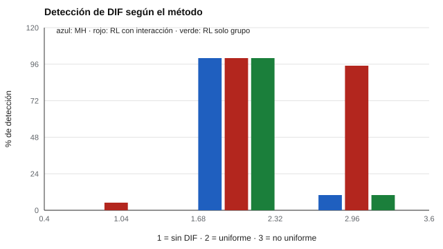

# 177 — Funcionamiento diferencial del ítem en la práctica


<!-- NAV -->
[← 176 — Estimación de incertidumbre y bootstrap](../176-estimacion-de-incertidumbre-y-bootstrap/README.md) · [📚 Parte 17](../README.md) · [🗺️ Índice 001–200](../../../PROGRAMA.md) · [178 — Reproducibilidad: preregistro, datos y código →](../178-reproducibilidad-preregistro-datos-y-codigo/README.md)
<!-- /NAV -->

**Parte 17 — Investigación psicométrica y análisis de datos** · Nivel avanzado · 5 h · Estado `escrita`
**Pensada para:** quien revisa la equidad de ítems entre grupos, y quien rinde pruebas donde se revisa.
**Prerrequisitos:** clases 063 y 053.

> Con solo 40 réplicas las tasas del laboratorio son aproximadas.

## ¿Para qué te sirve esto?

Un ítem tiene **funcionamiento diferencial (DIF)** si personas con la misma habilidad pero de grupos distintos tienen distinta probabilidad de acertarlo. Detectarlo es parte de la equidad de una prueba. Pero hay una trampa: el método más conocido, **Mantel–Haenszel**, detecta bien un DIF que desplaza la curva del ítem de un grupo, pero **casi no ve** el DIF cuyas curvas **se cruzan**. Con él, «no hay DIF» puede significar «no lo vi». Esta clase te enseña a elegir el método según el tipo de DIF que se sospecha.

## Al terminar esta clase podrás

- Distinguir DIF uniforme y no uniforme.
- Comparar Mantel–Haenszel con la regresión logística.
- Elegir el método según el tipo de DIF sospechado.

## La idea en palabras simples

- **DIF uniforme:** la curva del ítem de un grupo está desplazada; la diferencia no depende de la habilidad.
- **DIF no uniforme:** cambia la pendiente; las curvas se cruzan.

**Mantel–Haenszel** (Holland y Thayer, 1988) está diseñado para el uniforme. La **regresión logística** (Swaminathan y Rogers, 1990) con un término de interacción habilidad × grupo (2 gl) detecta ambos (Zumbo, 1999). Siempre hay que revisar la **magnitud** y el **contenido** del ítem, no solo la significación.

## Cómo funciona, paso a paso

**1. Simular** 20 ítems con 2 grupos de 600 y un ítem con DIF (o sin él).

**2. Aplicar** MH, regresión logística con interacción y regresión solo con grupo.

**3. Contar** en 40 réplicas cuántas veces cada método detecta el ítem.

**Ejemplo resuelto.** Con DIF no uniforme, el grupo focal rinde mejor en habilidad baja y peor en alta (o al revés); el efecto promedio del grupo es cercano a 0 y MH no lo ve.



*Figura 1.* Solo la regresión con interacción detecta el DIF no uniforme.

## Si construyes el instrumento

- Elige el método según el tipo de DIF que temes.
- No elimines ítems solo por significación; revisa magnitud y contenido.
- Cuida la potencia: con muestras pequeñas el DIF pasa desapercibido.
- Informa la magnitud del DIF.

## Si eres evaluado

- Un ítem con DIF puede perjudicar a un grupo sin que importe su habilidad.
- Pregunta si la prueba pasó revisiones de DIF y con qué método.

## Qué muestra el laboratorio

| Escenario | MH (1 gl) | RL con interacción (2 gl) | RL solo grupo |
|---|---:|---:|---:|
| Sin DIF | 0 % | 5 % | 0 % |
| Uniforme | 100 % | 100 % | 100 % |
| No uniforme | 10 % | 95 % | 10 % |

**Análisis.** (1) MH y la prueba de grupo detectan el DIF uniforme y casi no ven el no uniforme. (2) La regresión con interacción lo detecta. (3) Se elige el método según el tipo de DIF que se teme. (4) En «sin DIF» la detección debe rondar el 5 % (falsos positivos).

## Errores frecuentes

- Usar MH y concluir «no hay DIF» sin considerar el no uniforme.
- Eliminar ítems por significación estadística sin revisar magnitud ni contenido.
- Trabajar con muestras pequeñas: poca potencia.
- Aceptar tasas con pocas réplicas como exactas.

## Lo mínimo que debes llevarte

1. DIF uniforme desplaza; no uniforme cruza.
2. MH ve el uniforme; no el no uniforme.
3. La regresión con interacción ve ambos.
4. Se revisa magnitud y contenido, no solo significación.

## Ejercicios

- **Inicial.** ¿Qué es el DIF no uniforme? *Solución: que la diferencia entre grupos cambia con el nivel de habilidad (las curvas se cruzan).*
- **Intermedio.** ¿Qué gl tiene la prueba conjunta de grupo e interacción? *Solución: 2.*
- **Avanzado.** Aumenta el DIF uniforme (shift 0,3) y estima la potencia.
- **Aplicación.** Redacta qué harías con un ítem detectado con DIF: revisión del contenido, decisión y registro.

## Glosario

- **DIF:** funcionamiento diferencial del ítem.
- **Grupo focal / de referencia:** grupo cuyo funcionamiento se examina / con el que se compara.
- **Mantel–Haenszel:** método basado en tablas estratificadas por puntaje.
- **Regresión logística:** modelo de la probabilidad de acierto según puntaje, grupo e interacción.

## Laboratorio

```bash
python classes/part-17-investigacion-psicometrica-y-analisis-de-datos/177-funcionamiento-diferencial-del-item-en-la-practica/lab.py
python classes/part-17-investigacion-psicometrica-y-analisis-de-datos/figuras.py
```

## Autoevaluación y criterios

1. ¿Qué haces con un ítem con DIF? 2. ¿Cómo eliges el grupo focal? 3. ¿Cómo informas la magnitud?
Se logra la clase si seleccionas el método según el DIF y distingues significación de magnitud.

## Bibliografía

- Holland, P. W., & Thayer, D. T. (1988). Differential item performance and the Mantel-Haenszel procedure. En H. Wainer & H. I. Braun (Eds.), *Test Validity*. Lawrence Erlbaum. ⚠️ hay una obra de título parecido en Crossref con otro año (2013): comprobar la edición a mano
- Swaminathan, H., & Rogers, H. J. (1990). Detecting differential item functioning using logistic regression procedures. *Journal of Educational Measurement*, 27(4), 361-370. ✅ [DOI](https://doi.org/10.1111/j.1745-3984.1990.tb00754.x)
- Zumbo, B. D. (1999). *A Handbook on the Theory and Methods of Differential Item Functioning (DIF)*. National Defense Headquarters, Ottawa. 🔎 sin verificar (libro, norma o sitio no hallado en Crossref: comprobar a mano)

Leyenda: ✅ existe en Crossref con título y año coincidentes (enlace al DOI); ⚠️ hay una obra de título parecido con otro año (no se enlaza: comprobar la edición); 🔎 no verificada automáticamente (libros sin DOI, normas y sitios web). Crossref confirma la existencia de la fuente, no que respalde cada afirmación de la clase. Ver [`docs/VERIFICACION_BIBLIOGRAFIA.md`](../../../docs/VERIFICACION_BIBLIOGRAFIA.md).

---

<!-- NAV -->
[← 176 — Estimación de incertidumbre y bootstrap](../176-estimacion-de-incertidumbre-y-bootstrap/README.md)  
[📚 Parte 17](../README.md) · [🗺️ Índice 001–200](../../../PROGRAMA.md)  
[178 — Reproducibilidad: preregistro, datos y código →](../178-reproducibilidad-preregistro-datos-y-codigo/README.md)
<!-- /NAV -->
