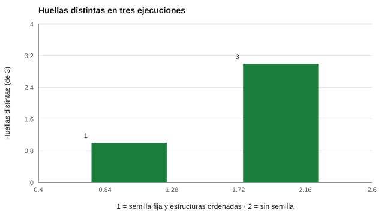

# 178 — Reproducibilidad: preregistro, datos y código


<!-- NAV -->
[← 177 — Funcionamiento diferencial del ítem en la prá…](../177-funcionamiento-diferencial-del-item-en-la-practica/README.md) · [📚 Parte 17](../README.md) · [🗺️ Índice 001–200](../../../PROGRAMA.md) · [179 — Metaanálisis psicométrico →](../179-metaanalisis-psicometrico/README.md)
<!-- /NAV -->

**Parte 17 — Investigación psicométrica y análisis de datos** · Nivel avanzado · 4 h · Estado `escrita`
**Pensada para:** quien analiza y publica resultados, y quien quiere confiar en lo que lee.
**Prerrequisitos:** clases 171 y 173.

> La reproducibilidad no garantiza que el análisis sea correcto: garantiza que se puede revisar.

## ¿Para qué te sirve esto?

«Ejecuté el análisis y me dio 0,489. Hoy me da 0,501.» Si no se puede repetir un resultado, no se puede revisar. La **reproducibilidad** exige un plan previo (preinscripción), los datos (o su generador) y el código, una **semilla** para el azar y el registro del entorno. Pero la semilla no basta: hay fuentes sutiles de variación, como el orden de iteración de un conjunto. Esta clase te enseña a verificar la reproducibilidad con **huellas criptográficas** y a reconocer qué la rompe.

## Al terminar esta clase podrás

- Verificar la reproducibilidad con huellas criptográficas.
- Reconocer las fuentes de no reproducibilidad (semilla, orden, entorno).
- Preparar un registro de investigación reutilizable.

## La idea en palabras simples

La investigación reproducible incluye un plan previo (**preinscripción**; Nosek et al., 2018), datos (o su generador) y código compartidos con principios **FAIR** (Wilkinson et al., 2016), semilla y registro del entorno (Peng, 2011). Una verificación simple: **ejecutar dos veces y comparar la huella** (SHA-256 del resultado). Si las huellas coinciden, el resultado es el mismo.

## Cómo funciona, paso a paso

**1. Ejecutar** el análisis tres veces con semilla fija y estructuras ordenadas.

**2. Ejecutarlo sin semilla** y con iteración sobre un `set`.

**3. Comparar** las huellas y registrar el entorno (versión de Python, plataforma).

**Ejemplo resuelto.** `json.dumps(resultado, sort_keys=True)` fija el orden de las claves antes de calcular la huella: sin eso, dos diccionarios iguales podrían serializarse distinto.



*Figura 1.* Con semilla fija las tres ejecuciones dan la misma huella; sin semilla, tres distintas.

## Si construyes el instrumento

- Preinscribe hipótesis y análisis antes de ver los datos.
- Fija semillas, ordena las estructuras y registra las versiones de las librerías.
- Comparte datos anonimizados o sintéticos (clase 078).
- Declara los análisis exploratorios como tales.

## Si eres evaluado

- Una investigación reproducible permite que otros revisen si tus datos se usaron bien.
- Pregunta si los datos y el código están disponibles y cómo se resguarda tu identidad.

## Qué muestra el laboratorio

| Situación | Resultado |
|---|---|
| Semilla fija, estructuras ordenadas | 3 huellas idénticas (852ffb6b…) |
| Sin semilla | 3 huellas distintas |
| Semilla fija con iteración sobre un `set` | el orden puede variar entre procesos |

Entorno registrado: versión de Python y plataforma.

**Análisis.** (1) La semilla es necesaria pero no suficiente: también importan el orden de iteración, las versiones de las librerías y los datos. (2) Comprobar que dos ejecuciones dan la misma huella es una prueba barata, y es lo que hace el CI del repositorio con sus generadores de bancos. (3) El preregistro protege contra análisis flexibles. (4) Reproducible no es lo mismo que correcto.

## Errores frecuentes

- Confiar solo en la semilla.
- No registrar las versiones de las librerías.
- Compartir datos con identificadores.
- Creer que reproducible equivale a correcto.

## Lo mínimo que debes llevarte

1. Reproducir exige plan, datos, código, semilla y entorno.
2. La huella permite verificar rápidamente.
3. El orden de iteración puede romper la reproducibilidad.
4. Se comparten datos anonimizados o sintéticos.

## Ejercicios

- **Inicial.** ¿Qué es la preinscripción? *Solución: registrar hipótesis y plan de análisis antes de ver los datos.*
- **Intermedio.** ¿Por qué ordenar las claves antes del hash? *Solución: para obtener una serialización determinista.*
- **Avanzado.** Añade al laboratorio un archivo `requirements` fijado con hashes y verifícalo.
- **Aplicación.** Escribe el índice de un paquete de reproducibilidad para un estudio psicométrico.

## Glosario

- **Preinscripción:** registro público del plan antes del estudio.
- **FAIR:** datos encontrables, accesibles, interoperables y reutilizables.
- **Semilla:** valor inicial del generador aleatorio.
- **Huella (hash):** resumen criptográfico de un contenido.

## Laboratorio

```bash
python classes/part-17-investigacion-psicometrica-y-analisis-de-datos/178-reproducibilidad-preregistro-datos-y-codigo/lab.py
python classes/part-17-investigacion-psicometrica-y-analisis-de-datos/figuras.py
```

## Autoevaluación y criterios

1. ¿Qué incluirías en un paquete de reproducibilidad? 2. ¿Qué datos no puedes compartir? 3. ¿Cómo declararías análisis exploratorios?
Se logra la clase si verificas reproducibilidad y documentas el entorno.

## Bibliografía

- Nosek, B. A., Ebersole, C. R., DeHaven, A. C., & Mellor, D. T. (2018). The preregistration revolution. *Proceedings of the National Academy of Sciences*, 115(11), 2600-2606. ✅ [DOI](https://doi.org/10.1073/pnas.1708274114)
- Wilkinson, M. D., et al. (2016). The FAIR Guiding Principles for scientific data management and stewardship. *Scientific Data*, 3, 160018. ⚠️ hay una obra de título parecido en Crossref con otro año (2018): comprobar la edición a mano
- Peng, R. D. (2011). Reproducible research in computational science. *Science*, 334, 1226-1227. ✅ [DOI](https://doi.org/10.1126/science.1213847)

Leyenda: ✅ existe en Crossref con título y año coincidentes (enlace al DOI); ⚠️ hay una obra de título parecido con otro año (no se enlaza: comprobar la edición); 🔎 no verificada automáticamente (libros sin DOI, normas y sitios web). Crossref confirma la existencia de la fuente, no que respalde cada afirmación de la clase. Ver [`docs/VERIFICACION_BIBLIOGRAFIA.md`](../../../docs/VERIFICACION_BIBLIOGRAFIA.md).

---

<!-- NAV -->
[← 177 — Funcionamiento diferencial del ítem en la prá…](../177-funcionamiento-diferencial-del-item-en-la-practica/README.md)  
[📚 Parte 17](../README.md) · [🗺️ Índice 001–200](../../../PROGRAMA.md)  
[179 — Metaanálisis psicométrico →](../179-metaanalisis-psicometrico/README.md)
<!-- /NAV -->
