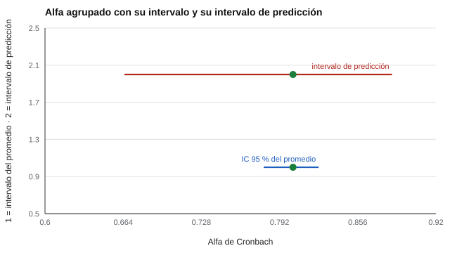

# 179 — Metaanálisis psicométrico


<!-- NAV -->
[← 178 — Reproducibilidad: preregistro, datos y código](../178-reproducibilidad-preregistro-datos-y-codigo/README.md) · [📚 Parte 17](../README.md) · [🗺️ Índice 001–200](../../../PROGRAMA.md) · [180 — Redacción y revisión de un informe de validac… →](../180-redaccion-y-revision-de-un-informe-de/README.md)
<!-- /NAV -->

**Parte 17 — Investigación psicométrica y análisis de datos** · Nivel avanzado · 4 h · Estado `escrita`
**Pensada para:** quien resume la fiabilidad de un instrumento en varios estudios, y quien lee «el alfa es 0,80».
**Prerrequisitos:** clases 039 y 176.

> Datos sintéticos.

## ¿Para qué te sirve esto?

«La escala tiene un alfa de 0,80.» ¿En qué muestra? El alfa **no es una propiedad fija de la escala**: cambia con la muestra, el contexto y la heterogeneidad. La **generalización de la fiabilidad** reúne los alfas de muchos estudios, los agrupa con un modelo de efectos aleatorios y mide cuánto varían. Esta clase te muestra que, aunque el alfa agrupado se estime con precisión (0,80 ± 0,02), **un estudio nuevo puede dar entre 0,67 y 0,88**. Por eso se informa un intervalo de **predicción**, además del intervalo del promedio.

## Al terminar esta clase podrás

- Agrupar coeficientes alfa con efectos aleatorios.
- Interpretar heterogeneidad (τ², I²).
- Informar un intervalo de predicción.

## La idea en palabras simples

La **generalización de la fiabilidad** (Vacha-Haase, 1998) estudia cómo varía la fiabilidad entre muestras. Se transforma el alfa con **ln(1 − α)** (Bonett, 2010), se agrupa con el modelo de efectos aleatorios de DerSimonian y Laird (1986) y se informa:

- **τ²:** varianza entre estudios.
- **I²:** porcentaje de variación debido a heterogeneidad real y no al azar.
- **Intervalo de predicción:** el rango donde caería el alfa de un estudio nuevo (IntHout et al., 2016).

## Cómo funciona, paso a paso

**1. Simular** 25 estudios de 10 ítems con alfa verdadero ~ N(0,80; 0,05).

**2. Agrupar** con efectos aleatorios y calcular τ² e I².

**3. Calcular** el intervalo de confianza del promedio y el de predicción.

**Ejemplo resuelto.** Un estudio nuevo puede dar un alfa tan bajo como 0,67 o tan alto como 0,88 aunque el alfa agrupado sea 0,80: el IC del promedio (0,78–0,82) no describe al estudio siguiente.



*Figura 1.* El intervalo de predicción es mucho más ancho que el del promedio.

## Si construyes el instrumento

- Estima la fiabilidad en cada contexto de uso o declara la evidencia de generalización.
- Informa heterogeneidad y el intervalo de predicción.
- Busca moderadores que expliquen la variación (muestra, formato, idioma).
- Registra el protocolo de búsqueda y el sesgo de publicación.

## Si eres evaluado

- El alfa de un instrumento en tu contexto puede ser distinto al publicado.
- Pregunta en qué población se estimó la fiabilidad.

## Qué muestra el laboratorio

| Medida | Valor |
|---|---:|
| Alfa observado: media simple (rango) | 0,796 (0,67–0,90) |
| Alfa agrupado (efectos aleatorios), IC 95 % | 0,803 [0,779; 0,824] |
| τ² / I² | 0,0700 / 86 % |
| Intervalo de predicción | [0,665; 0,884] |

**Análisis.** (1) El alfa agrupado se estima con precisión. (2) Un estudio nuevo puede dar valores bastante distintos (intervalo de predicción más ancho). (3) Afirmar «la escala tiene alfa 0,80» sin la muestra es incompleto. (4) Datos sintéticos.

## Errores frecuentes

- Informar «el alfa de la escala es 0,80» sin muestra.
- Ignorar el sesgo de publicación.
- Agrupar estudios con escalas o formatos distintos.
- Interpretar el IC del promedio como rango para un estudio nuevo.

## Lo mínimo que debes llevarte

1. La fiabilidad varía entre estudios.
2. I² mide la heterogeneidad.
3. El intervalo de predicción es más ancho que el IC del promedio.
4. Se informa con la muestra.

## Ejercicios

- **Inicial.** ¿Qué mide I²? *Solución: el porcentaje de la variación entre estudios debido a heterogeneidad real.*
- **Intermedio.** ¿Por qué el intervalo de predicción es más ancho? *Solución: porque incluye la heterogeneidad (τ²).*
- **Avanzado.** Reduce la DE entre estudios a 0,02 y observa I².
- **Aplicación.** Redacta el protocolo de búsqueda para un metaanálisis de la fiabilidad de una escala.

## Glosario

- **Generalización de la fiabilidad:** estudio de la variación de la fiabilidad entre muestras.
- **Efectos aleatorios:** modelo que permite verdadera variación entre estudios.
- **τ² / I²:** varianza entre estudios / proporción de heterogeneidad.
- **Intervalo de predicción:** rango esperable para un estudio nuevo.

## Laboratorio

```bash
python classes/part-17-investigacion-psicometrica-y-analisis-de-datos/179-metaanalisis-psicometrico/lab.py
python classes/part-17-investigacion-psicometrica-y-analisis-de-datos/figuras.py
```

## Autoevaluación y criterios

1. ¿Qué moderadores explicarían la variación? 2. ¿Cómo buscarías estudios? 3. ¿Cómo registrarías el protocolo?
Se logra la clase si agrupas fiabilidades e informas heterogeneidad y predicción.

## Bibliografía

- DerSimonian, R., & Laird, N. (1986). Meta-analysis in clinical trials. *Controlled Clinical Trials*, 7(3), 177-188. [DOI](https://doi.org/10.1016/0197-2456(86)90046-2)
- Bonett, D. G. (2010). Varying coefficient meta-analytic methods for alpha reliability. *Psychological Methods*, 15(4), 368-385. [DOI](https://doi.org/10.1037/a0020142)
- Vacha-Haase, T. (1998). Reliability generalization: Exploring variance in measurement error affecting score reliability across studies. *Educational and Psychological Measurement*, 58(1), 6-20.
- IntHout, J., Ioannidis, J. P. A., Rovers, M. M., & Goeman, J. J. (2016). Plea for routinely presenting prediction intervals in meta-analysis. *BMJ Open*, 6, e010247. [DOI](https://doi.org/10.1136/bmjopen-2015-010247)

---

<!-- NAV -->
[← 178 — Reproducibilidad: preregistro, datos y código](../178-reproducibilidad-preregistro-datos-y-codigo/README.md)  
[📚 Parte 17](../README.md) · [🗺️ Índice 001–200](../../../PROGRAMA.md)  
[180 — Redacción y revisión de un informe de validac… →](../180-redaccion-y-revision-de-un-informe-de/README.md)
<!-- /NAV -->
