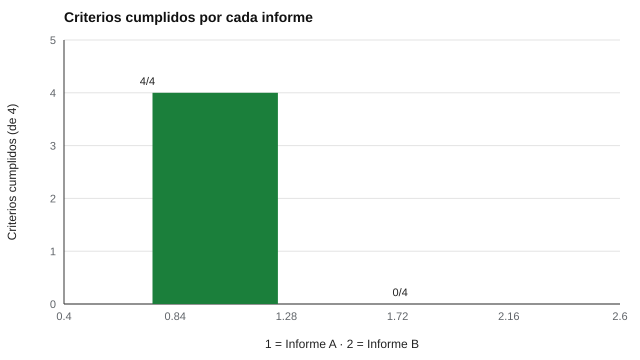

# 180 — Redacción y revisión de un informe de validación


<!-- NAV -->
[← 179 — Metaanálisis psicométrico](../179-metaanalisis-psicometrico/README.md) · [📚 Parte 17](../README.md) · [🗺️ Índice 001–200](../../../PROGRAMA.md) · [181 — Arquitectura de un motor de evaluación declar… →](../../part-18-ingenieria-de-sistemas-de-evaluacion-digital/181-arquitectura-de-un-motor-de-evaluacion-declarativo/README.md)
<!-- /NAV -->

**Parte 17 — Investigación psicométrica y análisis de datos** · Nivel avanzado · 5 h · Estado `escrita`
**Pensada para:** quien redacta o revisa informes de validación, y quien debe decidir si confiar en uno.
**Prerrequisitos:** clases 031, 171 y 178.

> Los informes de ejemplo son breves y ficticios. La lista automática detecta la forma, no el fondo.

## ¿Para qué te sirve esto?

«El test fue validado y garantiza su uso en selección.» Esa frase parece una conclusión, pero no dice **para quién**, **para qué**, **con cuántas personas** ni **con qué evidencia**. La validez no es una propiedad del test sino de **una interpretación y un uso** (Kane, 2013). Un buen informe cualifica cada afirmación y declara las limitaciones. Esta clase te enseña la estructura mínima y te da una **lista de control automática** para revisar la forma, sabiendo que la revisión del fondo la hace una persona.

## Al terminar esta clase podrás

- Estructurar un informe de validación completo.
- Cualificar cada afirmación de validez (para quién, para qué).
- Usar una lista de control automática como apoyo, no como sustituto de la revisión.

## La idea en palabras simples

Un informe de validación declara **población, procedimiento, fiabilidad, evidencia de validez, limitaciones y uso previsto** (AERA/APA/NCME, 2014), y sigue estándares de reporte (Appelbaum et al., 2018). Como la validez es de una interpretación y un uso (Kane, 2013), cada afirmación se **cualifica**. La lista del laboratorio revisa cuatro reglas: secciones mínimas, «válido» cualificado, coeficientes con n o intervalo, y ausencia de lenguaje absoluto.

## Cómo funciona, paso a paso

**1. Redactar** con las secciones mínimas y cada afirmación cualificada.

**2. Pasar** la lista automática de cuatro reglas.

**3. Someter** el informe a revisión por pares, que evalúa el fondo.

**Ejemplo resuelto.** Mal: «El test fue validado y garantiza su uso en selección». Mejor: «La correlación con el rendimiento fue r = 0,41, IC 95 % [0,31; 0,50] (n = 312 estudiantes de 8.º básico); la evidencia no respalda decisiones de admisión».



*Figura 1.* El Informe B no cumple ninguna de las reglas de forma.

## Si construyes el instrumento

- Incluye siempre población, procedimiento, coeficientes con n e intervalos, limitaciones y uso previsto.
- Evita palabras absolutas («garantiza», «demuestra»).
- Declara conflictos de interés.
- Pide revisión por pares antes de publicar.

## Si eres evaluado

- Un buen informe te dice para quién y para qué sirve el instrumento.
- Desconfía de «el test está validado» sin más.
- Tienes derecho a conocer la evidencia que respalda un uso que te afecta.

## Qué muestra el laboratorio

| Criterio | Informe A | Informe B |
|---|---|---|
| Secciones mínimas | ok | falla |
| «Válido» cualificado (población y uso) | ok | falla |
| Coeficientes con n o intervalo | ok | falla |
| Sin lenguaje absoluto | ok | falla |
| Total | 4/4 | 0/4 |

**Análisis.** (1) El Informe B afirma validez sin población ni propósito, da coeficientes sin n ni intervalo y usa lenguaje absoluto. (2) Un informe de validación cualifica cada afirmación (para quién, para qué) y declara limitaciones. (3) La revisión automática detecta la forma; la revisión por pares evalúa el fondo. (4) Los informes son ficticios.

## Errores frecuentes

- Informar solo los coeficientes favorables.
- Omitir las limitaciones.
- Usar la lista automática como prueba de calidad.
- Usar lenguaje absoluto.

## Lo mínimo que debes llevarte

1. La validez es de una interpretación y un uso.
2. Cada afirmación se cualifica.
3. Los coeficientes llevan n o intervalo.
4. La lista automática no reemplaza la revisión.

## Ejercicios

- **Inicial.** ¿Qué secciones mínimas incluye un informe? *Solución: población, procedimiento, fiabilidad, evidencia de validez, limitaciones y uso previsto.*
- **Intermedio.** Reescribe «el test es confiable» con la información que falta.
- **Avanzado.** Añade una regla que detecte la falta de intervalos para correlaciones.
- **Aplicación.** Revisa un informe real con la lista de cuatro reglas y redacta tus observaciones de fondo.

## Glosario

- **Informe de validación:** documento que presenta la evidencia de validez de una interpretación.
- **Cualificar:** especificar para quién y para qué vale una afirmación.
- **Lenguaje absoluto:** palabras como «garantiza», «demuestra», «siempre».
- **Revisión por pares:** evaluación del fondo por especialistas independientes.

## Laboratorio

```bash
python classes/part-17-investigacion-psicometrica-y-analisis-de-datos/180-redaccion-y-revision-de-un-informe-de/lab.py
python classes/part-17-investigacion-psicometrica-y-analisis-de-datos/figuras.py
```

## Autoevaluación y criterios

1. ¿Quién debe revisar tu informe? 2. ¿Qué datos publicarías? 3. ¿Cómo declararías conflictos de interés?
Se logra la clase si redactas un informe cualificado y lo sometes a revisión.

## Bibliografía

- AERA, APA, & NCME (2014). *Standards for Educational and Psychological Testing*. AERA. 🔎 sin verificar (libro, norma o sitio no hallado en Crossref: comprobar a mano)
- Kane, M. T. (2013). Validating the interpretations and uses of test scores. *Journal of Educational Measurement*, 50(1), 1-73. ✅ [DOI](https://doi.org/10.1111/jedm.12000)
- Appelbaum, M., et al. (2018). Journal article reporting standards for quantitative research in psychology. *American Psychologist*, 73(1), 3-25. ✅ [DOI](https://doi.org/10.1037/amp0000191)

Leyenda: ✅ existe en Crossref con título y año coincidentes (enlace al DOI); ⚠️ hay una obra de título parecido con otro año (no se enlaza: comprobar la edición); 🔎 no verificada automáticamente (libros sin DOI, normas y sitios web). Crossref confirma la existencia de la fuente, no que respalde cada afirmación de la clase. Ver [`docs/VERIFICACION_BIBLIOGRAFIA.md`](../../../docs/VERIFICACION_BIBLIOGRAFIA.md).

---

<!-- NAV -->
[← 179 — Metaanálisis psicométrico](../179-metaanalisis-psicometrico/README.md)  
[📚 Parte 17](../README.md) · [🗺️ Índice 001–200](../../../PROGRAMA.md)  
[181 — Arquitectura de un motor de evaluación declar… →](../../part-18-ingenieria-de-sistemas-de-evaluacion-digital/181-arquitectura-de-un-motor-de-evaluacion-declarativo/README.md)
<!-- /NAV -->
