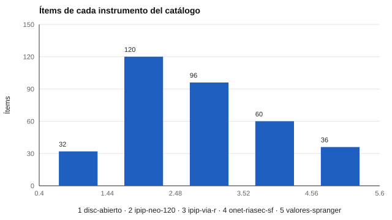

# 181 — Arquitectura de un motor de evaluación declarativo


<!-- NAV -->
[← 180 — Redacción y revisión de un informe de validac…](../../part-17-investigacion-psicometrica-y-analisis-de-datos/180-redaccion-y-revision-de-un-informe-de/README.md) · [📚 Parte 18](../README.md) · [🗺️ Índice 001–200](../../../PROGRAMA.md) · [182 — Modelos de ítems y esquemas versionados →](../182-modelos-de-items-y-esquemas-versionados/README.md)
<!-- /NAV -->

**Parte 18 — Ingeniería de sistemas de evaluación digital** · Nivel avanzado · 5 h · Estado `escrita`
**Pensada para:** quien construye o evalúa plataformas de evaluación, y quien quiere entender cómo se calcula un puntaje.
**Prerrequisitos:** clase 180.

> El instrumento de demostración no mide nada real.

## ¿Para qué te sirve esto?

Muchos sistemas de evaluación tienen la puntuación de cada test escrita dentro del programa: un `if` aquí, una fórmula allá. Agregar un test nuevo exige programar, y cada test es una fuente de errores. Un **motor declarativo** invierte el planteamiento: el instrumento es un **archivo de datos** (ítems, escalas, opciones, claves, licencia) y el cálculo es **código genérico**, probado una sola vez. Esta clase te muestra cómo funciona el motor de este repositorio: ya tiene 5 instrumentos, y sumar un sexto es escribir un archivo, no programar.

## Al terminar esta clase podrás

- Separar catálogo, administración, puntuación y datos normativos.
- Declarar un instrumento nuevo solo como datos.
- Explicar por qué el esquema validado reduce errores.

## La idea en palabras simples

Un motor declarativo trata el instrumento como **dato** y el cálculo como **código genérico**. Eso permite que un especialista aporte contenido sin programar y que el código se pruebe una sola vez (Fowler, 2010, sobre lenguajes específicos de dominio). La puntuación de la teoría clásica (clase 004) es la misma para cualquier instrumento: promedio o suma por escala, con ítems invertidos cuando corresponde. Lo que cambia es el archivo de datos. Cada capa tiene su responsabilidad: **catálogo** (qué instrumentos hay), **administración** (cómo se presenta), **puntuación** (cómo se calcula) y **datos normativos** (con qué se compara).

## Cómo funciona, paso a paso

**1. Escribir** el archivo YAML del instrumento: escalas, opciones, claves y licencia.

**2. Cargar** con el cargador, que rechaza lo mal declarado.

**3. Puntuar** con el mismo código que para cualquier otro instrumento.

**Ejemplo resuelto.** Para un instrumento nuevo de 10 ítems se escribe el YAML (escalas, opciones, claves), se ejecuta `cargar` y el motor lo rechaza si una clave es inválida. Nunca se escribe una función de puntuación a medida. En el laboratorio, un instrumento de demostración de 3 ítems definido como texto se puntúa sin tocar Python.



*Figura 1.* Cinco instrumentos con tamaños muy distintos se puntúan con el mismo código.

## Si construyes el instrumento

- Mueve las reglas de puntuación a datos; nunca a funciones a medida.
- Valida el archivo antes de aceptarlo.
- Registra la licencia y la procedencia de cada instrumento.
- Recuerda: «declarativo» garantiza consistencia técnica, no validez.

## Si eres evaluado

- Un sistema declarativo permite revisar con exactitud cómo se calculó tu puntaje.
- Pregunta qué versión del instrumento se usó (clase 182).

## Qué muestra el laboratorio

El catálogo real del motor:

| Instrumento | Tipo | Escalas | Ítems | Invertidos | Licencia |
|---|---|---:|---:|---:|---|
| disc-abierto | likert | 4 | 32 | 50 % | autoría propia |
| ipip-neo-120 | likert | 35 | 120 | 46 % | dominio público |
| ipip-via-r | likert | 30 | 96 | 50 % | dominio público |
| onet-riasec-sf | likert | 6 | 60 | 0 % | O\*NET Tools Developer |
| valores-spranger | likert | 6 | 36 | 33 % | autoría propia |

Instrumento nuevo declarado como texto (`demo-mini`, 3 ítems): respuestas (3, 1, 3) con el ítem 2 invertido → media de la escala A = 3,0.

**Análisis.** (1) Agregar un test es escribir un archivo de datos validado, no programar. (2) Esa decisión reduce errores (el cargador rechaza lo mal declarado) y permite que un especialista contribuya sin tocar Python. (3) Cada capa tiene su responsabilidad y sus pruebas. (4) El instrumento de demostración no mide nada real.

## Errores frecuentes

- Meter reglas de puntuación en el código de cada instrumento.
- Creer que «declarativo» garantiza validez.
- Mezclar contenido del instrumento con datos de personas.
- Aceptar archivos sin validarlos.

## Lo mínimo que debes llevarte

1. El instrumento es un dato; el cálculo es código genérico.
2. El cargador rechaza lo mal declarado.
3. Cada capa tiene una responsabilidad.
4. Declarativo no equivale a válido.

## Ejercicios

- **Inicial.** ¿Qué capas separa el motor? *Solución: catálogo, administración, puntuación y datos normativos.*
- **Intermedio.** Añade al YAML de ejemplo una segunda escala con dos ítems.
- **Avanzado.** Propón cómo declararías una puntuación con ponderaciones sin tocar el motor.
- **Aplicación.** Declara como YAML un cuestionario de 5 ítems propio y puntúalo con el motor.

## Glosario

- **Motor declarativo:** programa que ejecuta lo que describe un archivo de datos.
- **Esquema:** reglas que debe cumplir un archivo.
- **Escala:** conjunto de ítems que se puntúa junto.
- **Ítem invertido:** ítem cuya puntuación se invierte antes de sumar.

## Laboratorio

```bash
python classes/part-18-ingenieria-de-sistemas-de-evaluacion-digital/181-arquitectura-de-un-motor-de-evaluacion-declarativo/lab.py
python classes/part-18-ingenieria-de-sistemas-de-evaluacion-digital/figuras.py
```

## Autoevaluación y criterios

1. ¿Qué parte del diseño podría fallar sin que nadie lo note? 2. ¿Qué evidencia guardarías? 3. ¿Qué dato no deberías conservar?
Se logra la clase si implementas la idea, la pruebas con datos sintéticos y declaras sus límites.

## Bibliografía

- Fowler, M. (2010). *Domain-Specific Languages*. Addison-Wesley.
- AERA, APA, & NCME (2014). *Standards for Educational and Psychological Testing*. AERA.

---

<!-- NAV -->
[← 180 — Redacción y revisión de un informe de validac…](../../part-17-investigacion-psicometrica-y-analisis-de-datos/180-redaccion-y-revision-de-un-informe-de/README.md)  
[📚 Parte 18](../README.md) · [🗺️ Índice 001–200](../../../PROGRAMA.md)  
[182 — Modelos de ítems y esquemas versionados →](../182-modelos-de-items-y-esquemas-versionados/README.md)
<!-- /NAV -->
