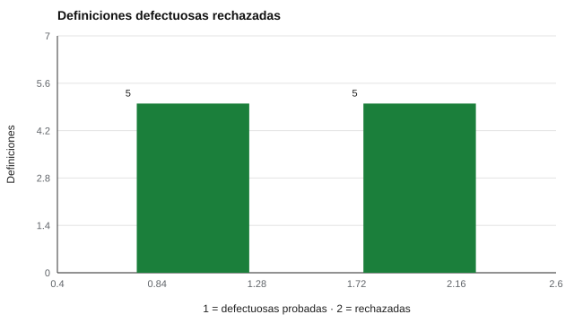

# 182 — Modelos de ítems y esquemas versionados


<!-- NAV -->
[← 181 — Arquitectura de un motor de evaluación declar…](../181-arquitectura-de-un-motor-de-evaluacion-declarativo/README.md) · [📚 Parte 18](../README.md) · [🗺️ Índice 001–200](../../../PROGRAMA.md) · [183 — Baterías de evaluación y sesiones reanudables →](../183-baterias-de-evaluacion-y-sesiones-reanudables/README.md)
<!-- /NAV -->

**Parte 18 — Ingeniería de sistemas de evaluación digital** · Nivel avanzado · 5 h · Estado `escrita`
**Pensada para:** quien mantiene instrumentos en el tiempo, y quien compara puntajes de distintos momentos.
**Prerrequisitos:** clase 181.

> El esquema valida forma, no calidad psicométrica.

## ¿Para qué te sirve esto?

Alguien corrige una errata en un ítem, otro cambia el sentido de una frase, otro agrega una escala. Seis meses después, ¿se pueden comparar los puntajes? La respuesta depende de **qué cambió**. Esta clase te enseña dos herramientas que se complementan: un **esquema estricto** que rechaza definiciones defectuosas (licencias desconocidas, ítems duplicados, escalas vacías…) y un **versionado semántico** que comunica si los puntajes siguen siendo comparables. Y una regla que sorprende: **cambiar el texto de un ítem es cambiar el instrumento**.

## Al terminar esta clase podrás

- Validar estrictamente la definición de un instrumento.
- Aplicar versionado semántico a instrumentos.
- Justificar por qué un cambio de redacción cambia el instrumento.

## La idea en palabras simples

Un esquema estricto detecta temprano licencias desconocidas, ítems duplicados, escalas vacías y propietarios con ítems. El **versionado semántico** (mayor.menor.parche; Preston-Werner, semver.org) comunica la comparabilidad:

- **Parche** (1.2.0 → 1.2.3): corrección menor; comparable.
- **Menor** (1.2.0 → 1.3.0): cambio de contenido o puntuación; documentar y recalcular.
- **Mayor** (1.2.0 → 2.0.0): ruptura; puntajes no comparables.

Cambiar el texto de un ítem altera el estímulo y, por tanto, el instrumento (AERA et al., 2014).

## Cómo funciona, paso a paso

**1. Definir** el esquema: qué campos, qué licencias, qué restricciones.

**2. Probar** con definiciones defectuosas que deben ser rechazadas con mensaje claro.

**3. Asignar** la versión según el tipo de cambio y registrarla en cada resultado.

**Ejemplo resuelto.** Si corriges una errata de ortografía: parche. Si cambias el sentido de un ítem o la clave: menor o mayor y se documenta; los puntajes viejos no se mezclan sin análisis.



*Figura 1.* Las cinco definiciones defectuosas fueron rechazadas.

## Si construyes el instrumento

- Rechaza lo «casi bien» en vez de corregirlo en silencio.
- Registra la versión del instrumento en cada resultado.
- Documenta cada cambio con su motivo.
- No compares versiones distintas sin evidencia de equivalencia.

## Si eres evaluado

- Un puntaje sin versión no puede reproducirse.
- Pregunta si tu resultado es comparable con uno anterior.

## Qué muestra el laboratorio

Defectuosos rechazados: 5 de 5.

| Defecto | Resultado |
|---|---|
| Licencia desconocida | rechazado |
| Ítem con id repetido | rechazado |
| Ítem en escala inexistente | rechazado |
| Escala sin ítems | rechazado |
| Propietaria con ítems | rechazado |

Política de versiones: 1.2.0 → 1.2.3 comparable; → 1.3.0 recalcular y documentar; → 2.0.0 ruptura.

**Análisis.** (1) Un esquema estricto convierte errores de datos en errores inmediatos. (2) La versión de un instrumento forma parte del resultado: un puntaje sin su versión no puede reproducirse. (3) Cambiar el texto de un ítem es cambiar el instrumento. (4) El esquema valida forma, no calidad.

## Errores frecuentes

- Aceptar datos «casi bien» y corregirlos en silencio.
- Comparar puntajes de versiones distintas sin evidencia de equivalencia.
- Creer que un esquema válido asegura un buen instrumento.
- No registrar la versión en los resultados.

## Lo mínimo que debes llevarte

1. Un esquema estricto detecta errores temprano.
2. La versión viaja con el resultado.
3. Parche, menor y mayor tienen significados distintos.
4. Cambiar un ítem es cambiar el instrumento.

## Ejercicios

- **Inicial.** ¿Qué indica el número mayor de una versión? *Solución: una ruptura: los puntajes no son comparables con versiones anteriores.*
- **Intermedio.** Escribe una sexta definición defectuosa y comprueba su rechazo.
- **Avanzado.** Diseña un registro de cambios para un instrumento con dos versiones.
- **Aplicación.** Clasifica tres cambios (errata, cambio de sentido, nueva escala) como parche, menor o mayor.

## Glosario

- **Versionado semántico:** esquema mayor.menor.parche.
- **Esquema estricto:** definición que rechaza lo que no cumple las reglas.
- **Comparabilidad:** posibilidad de comparar puntajes entre versiones.
- **Registro de cambios:** documento que lista y justifica los cambios.

## Laboratorio

```bash
python classes/part-18-ingenieria-de-sistemas-de-evaluacion-digital/182-modelos-de-items-y-esquemas-versionados/lab.py
python classes/part-18-ingenieria-de-sistemas-de-evaluacion-digital/figuras.py
```

## Autoevaluación y criterios

1. ¿Qué parte del diseño podría fallar sin que nadie lo note? 2. ¿Qué evidencia guardarías? 3. ¿Qué dato no deberías conservar?
Se logra la clase si implementas la idea, la pruebas con datos sintéticos y declaras sus límites.

## Bibliografía

- Preston-Werner, T. *Semantic Versioning 2.0.0*. semver.org.
- AERA, APA, & NCME (2014). *Standards for Educational and Psychological Testing*. AERA.

---

<!-- NAV -->
[← 181 — Arquitectura de un motor de evaluación declar…](../181-arquitectura-de-un-motor-de-evaluacion-declarativo/README.md)  
[📚 Parte 18](../README.md) · [🗺️ Índice 001–200](../../../PROGRAMA.md)  
[183 — Baterías de evaluación y sesiones reanudables →](../183-baterias-de-evaluacion-y-sesiones-reanudables/README.md)
<!-- /NAV -->
