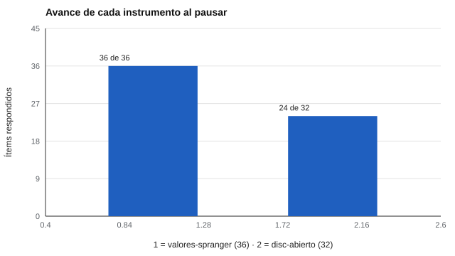

# 183 — Baterías de evaluación y sesiones reanudables


<!-- NAV -->
[← 182 — Modelos de ítems y esquemas versionados](../182-modelos-de-items-y-esquemas-versionados/README.md) · [📚 Parte 18](../README.md) · [🗺️ Índice 001–200](../../../PROGRAMA.md) · [184 — Telemetría de interacción y tiempos de respue… →](../184-telemetria-de-interaccion-y-tiempos-de-respuesta/README.md)
<!-- /NAV -->

**Parte 18 — Ingeniería de sistemas de evaluación digital** · Nivel avanzado · 5 h · Estado `escrita`
**Pensada para:** quien diseña aplicaciones en varias sesiones, y quien responde una evaluación larga.
**Prerrequisitos:** clase 182.

> Datos sintéticos. La normativa de datos personales (Ley 19.628 y Ley 21.719) se consulta en la fuente oficial vigente; esta clase no es asesoría jurídica.

## ¿Para qué te sirve esto?

Una evaluación larga (varios instrumentos, 60 minutos) rara vez se contesta de una sola vez: se corta la conexión, la persona se cansa, el colegio cambia de clase. Si el sistema pierde lo respondido, la persona debe empezar de nuevo, y eso sesga los resultados (abandona o responde apurada). Esta clase te enseña a diseñar una **batería** (varios instrumentos para la misma persona) con **sesiones reanudables**: se guarda solo lo respondido, se recalcula al pedir resultados y se detecta si el archivo fue alterado.

## Al terminar esta clase podrás

- Agrupar instrumentos en una batería.
- Pausar y reanudar una sesión sin perder datos.
- Detectar alteraciones del estado guardado.

## La idea en palabras simples

Una **batería** es una lista de instrumentos aplicados a la misma persona. Principios de diseño:

- **Guardar solo las respuestas** y recalcular los puntajes al consultar: así no se arrastran puntajes obsoletos si el motor se corrige.
- Una **huella SHA-256** del estado detecta cambios accidentales o manipulación, pero **no controla el acceso**: no protege la confidencialidad.
- Una **bitácora** registra eventos sin datos personales ni reloj.

## Cómo funciona, paso a paso

**1. Aplicar** dos instrumentos (36 + 32 = 68 respuestas).

**2. Pausar** a las 60 respuestas: la sesión se guarda como JSON (≈ 6,8 kB) con su huella.

**3. Reanudar:** el motor sabe cuál es el siguiente ítem y, al completar, entrega el mismo resultado que una sesión continua.

**Ejemplo resuelto.** Una persona deja el DISC a medias: la sesión guarda 24 de 32 respuestas, devuelve `('disc-abierto','c01')` como siguiente ítem y, al completar, entrega el mismo resultado que si no hubiera pausado.



*Figura 1.* La sesión pausada recuerda el avance de cada instrumento.

## Si construyes el instrumento

- Guarda respuestas, no puntajes derivados.
- Calcula una huella del estado y verifícala al reanudar.
- Cifra el almacenamiento y controla el acceso (clase 188).
- Registra eventos mínimos, sin datos personales.

## Si eres evaluado

- Tienes derecho a pausar y reanudar sin perder lo respondido.
- Pregunta dónde se guarda tu sesión pausada y por cuánto tiempo.

## Qué muestra el laboratorio

| Medida | Valor |
|---|---|
| Avance al pausar | valores-spranger 36/36; disc-abierto 24/32 |
| Tamaño del JSON | 6 824 bytes |
| Siguiente ítem tras reanudar | `('disc-abierto', 'c01')` |
| Resultado de la sesión pausada == sesión continua | Sí |
| Alteración detectada | Sí (la huella no coincide) |
| Eventos en la bitácora | 68 (sin datos personales ni reloj) |

**Análisis.** (1) Guardar solo respuestas y recalcular evita datos viejos si el motor se corrige. (2) La huella detecta cambios accidentales o manipulación, pero no impide el acceso. (3) El almacenamiento necesita cifrado y control de acceso. (4) Los datos del laboratorio son sintéticos.

## Errores frecuentes

- Guardar puntajes derivados en vez de respuestas.
- Creer que la huella protege la confidencialidad.
- Registrar datos personales en la bitácora.
- No verificar la huella al reanudar.

## Lo mínimo que debes llevarte

1. Una batería agrupa instrumentos para la misma persona.
2. Se guardan respuestas; los puntajes se recalculan.
3. La huella detecta alteraciones, no controla el acceso.
4. La reanudación da el mismo resultado que la sesión continua.

## Ejercicios

- **Inicial.** ¿Por qué se guardan respuestas y no puntajes? *Solución: para recalcular con el motor vigente y no arrastrar puntajes obsoletos.*
- **Intermedio.** Añade una tercera pausa y verifica la igualdad.
- **Avanzado.** Propón cómo cifrarías el JSON de sesión y dónde guardarías la clave.
- **Aplicación.** Diseña el flujo de una evaluación de 90 minutos con dos pausas y una política de caducidad.

## Glosario

- **Batería:** conjunto de instrumentos para la misma persona.
- **Sesión reanudable:** estado guardado que permite continuar después.
- **Huella SHA-256:** resumen criptográfico del estado.
- **Bitácora:** registro de eventos del sistema.

## Laboratorio

```bash
python classes/part-18-ingenieria-de-sistemas-de-evaluacion-digital/183-baterias-de-evaluacion-y-sesiones-reanudables/lab.py
python classes/part-18-ingenieria-de-sistemas-de-evaluacion-digital/figuras.py
```

## Autoevaluación y criterios

1. ¿Qué parte del diseño podría fallar sin que nadie lo note? 2. ¿Qué evidencia guardarías? 3. ¿Qué dato no deberías conservar?
Se logra la clase si implementas la idea, la pruebas con datos sintéticos y declaras sus límites.

## Bibliografía

- AERA, APA, & NCME (2014). *Standards for Educational and Psychological Testing*. AERA.
- Ley 19.628 y Ley 21.719 (Chile), sobre protección de datos: verificar el texto vigente en la fuente oficial.

---

<!-- NAV -->
[← 182 — Modelos de ítems y esquemas versionados](../182-modelos-de-items-y-esquemas-versionados/README.md)  
[📚 Parte 18](../README.md) · [🗺️ Índice 001–200](../../../PROGRAMA.md)  
[184 — Telemetría de interacción y tiempos de respue… →](../184-telemetria-de-interaccion-y-tiempos-de-respuesta/README.md)
<!-- /NAV -->
