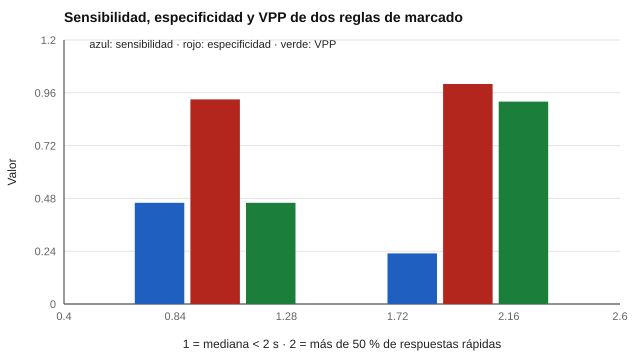

# 184 — Telemetría de interacción y tiempos de respuesta


<!-- NAV -->
[← 183 — Baterías de evaluación y sesiones reanudables](../183-baterias-de-evaluacion-y-sesiones-reanudables/README.md) · [📚 Parte 18](../README.md) · [🗺️ Índice 001–200](../../../PROGRAMA.md) · [185 — Evaluación adaptativa: implementación →](../185-evaluacion-adaptativa-implementacion/README.md)
<!-- /NAV -->

**Parte 18 — Ingeniería de sistemas de evaluación digital** · Nivel avanzado · 5 h · Estado `escrita`
**Pensada para:** quien usa tiempos de respuesta para detectar descuido, y quien es medido por ellos.
**Prerrequisitos:** clase 183.

> Datos sintéticos: no hay umbrales universales. La telemetría se informa en el consentimiento y no se usa para decidir sin revisión humana.

## ¿Para qué te sirve esto?

Una plataforma digital puede registrar cuánto tarda cada persona en cada ítem. Responder en menos de 2 segundos casi siempre significa que no se leyó. Eso es útil para detectar **respuestas descuidadas**… pero hay lectores rápidos legítimos que también responden rápido. Esta clase te enseña a evaluar una regla de marcado como cualquier prueba de cribado (sensibilidad, especificidad y VPP) y a aplicar **minimización de datos**: conservar indicadores agregados, no los tiempos de cada ítem.

## Al terminar esta clase podrás

- Calcular indicadores simples de respuesta descuidada.
- Evaluar sensibilidad, especificidad y valor predictivo.
- Aplicar minimización de datos a la telemetría.

## La idea en palabras simples

Los tiempos de respuesta pueden señalar respuestas sin lectura (Wise y Kong, 2005, «esfuerzo de respuesta»). Una regla de marcado (por ejemplo, «mediana de tiempos < 2 s») se evalúa con **sensibilidad** (de los descuidados, cuántos marca), **especificidad** (de los cuidadosos, cuántos deja pasar) y **VPP** (de los marcados, cuántos son realmente descuidados). El VPP depende de la prevalencia. El indicador **alerta**, no condena.

## Cómo funciona, paso a paso

**1. Simular** 2 000 personas (10 % descuidadas) con lectores rápidos legítimos.

**2. Aplicar** tres reglas de marcado.

**3. Calcular** sensibilidad, especificidad, VPP y el AUC de la mediana de tiempos.

**Ejemplo resuelto.** La regla estricta («más de 50 % de respuestas rápidas») casi no marca a personas honestas, pero deja pasar a tres de cada cuatro descuidadas: el umbral cambia errores de un tipo por otros.



*Figura 1.* La regla estricta gana especificidad y VPP, pero pierde sensibilidad.

## Si construyes el instrumento

- Marca para revisar, no para descartar.
- Conserva solo indicadores agregados y descarta los tiempos por ítem (clase 076).
- Informa el uso de tiempos en el consentimiento.
- Calibra los umbrales con datos propios.

## Si eres evaluado

- Responder rápido no significa que respondas mal, pero puede activar una alerta.
- Tienes derecho a saber si se registran tus tiempos y para qué.
- Ninguna decisión sobre ti debería basarse solo en esa alerta.

## Qué muestra el laboratorio

| Regla de marcado | Sensibilidad | Especificidad | VPP |
|---|---:|---:|---:|
| Mediana < 2 s | 0,46 | 0,93 | 0,46 |
| Más de 50 % de respuestas rápidas | 0,23 | 1,00 | 0,92 |
| Mediana < 2 s y CV < 0,5 | 0,46 | 0,93 | 0,46 |

AUC de la mediana de tiempos = 0,90.

**Análisis.** (1) Los tiempos separan bien a quienes responden sin leer. (2) Un lector rápido o con experiencia puede ser marcado: el indicador alerta, no condena. (3) Se conservan solo los indicadores agregados (minimización). (4) El uso se informa en el consentimiento y no decide sin revisión humana.

## Errores frecuentes

- Marcar y descartar sin revisión humana.
- Guardar tiempos por ítem sin necesidad.
- Usar umbrales de otro contexto.
- No informar el uso de telemetría.

## Lo mínimo que debes llevarte

1. Los tiempos señalan respuestas sin lectura.
2. Una regla de marcado se evalúa como un cribado.
3. El VPP depende de la prevalencia.
4. Se minimizan los datos y se informa el uso.

## Ejercicios

- **Inicial.** ¿Por qué el VPP cambia con la prevalencia? *Solución: porque con menos casos reales, una proporción mayor de los marcados serán falsos positivos.*
- **Intermedio.** Cambia la prevalencia al 2 % y recalcula el VPP.
- **Avanzado.** Redacta el texto de consentimiento que informa el uso de tiempos.
- **Aplicación.** Define qué indicadores agregados conservarías y cuáles descartarías.

## Glosario

- **Telemetría:** registro automático de datos de interacción.
- **Esfuerzo de respuesta:** indicador de que la persona leyó antes de responder.
- **Minimización de datos:** conservar solo lo necesario.
- **CV:** coeficiente de variación (DE / media).

## Laboratorio

```bash
python classes/part-18-ingenieria-de-sistemas-de-evaluacion-digital/184-telemetria-de-interaccion-y-tiempos-de-respuesta/lab.py
python classes/part-18-ingenieria-de-sistemas-de-evaluacion-digital/figuras.py
```

## Autoevaluación y criterios

1. ¿Qué parte del diseño podría fallar sin que nadie lo note? 2. ¿Qué evidencia guardarías? 3. ¿Qué dato no deberías conservar?
Se logra la clase si implementas la idea, la pruebas con datos sintéticos y declaras sus límites.

## Bibliografía

- Wise, S. L., & Kong, X. (2005). Response time effort: A new measure of examinee motivation in computer-based tests. *Applied Measurement in Education*, 18(2), 163-183.
- AERA, APA, & NCME (2014). *Standards for Educational and Psychological Testing*. AERA.

---

<!-- NAV -->
[← 183 — Baterías de evaluación y sesiones reanudables](../183-baterias-de-evaluacion-y-sesiones-reanudables/README.md)  
[📚 Parte 18](../README.md) · [🗺️ Índice 001–200](../../../PROGRAMA.md)  
[185 — Evaluación adaptativa: implementación →](../185-evaluacion-adaptativa-implementacion/README.md)
<!-- /NAV -->
